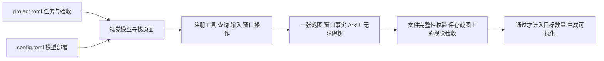
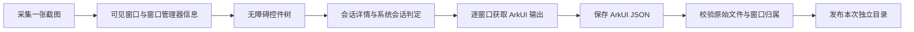

# Har-GUI

通过官方 HDC、UiTest 和 WindowManagerService，采集鸿蒙设备当前显示器的截图、无障碍控件树、
ArkUI 组件树和窗口信息。两类树分别保存，保留来源与作用范围。
每次运行生成独立目录；窗口通过 `hostWindowId` 与窗口管理器的 `WinId` 关联。

## 由 agent 自主采集

`project.toml` 描述要找什么页面、怎样变化和收多少样本；`config.toml` 选择视觉模型。
核心不预置应用或场景名单。当前最小闭环使用 Midscene HarmonyAgent 寻找页面，
通过已注册工具操作设备，再复用 Python 采集器保存正式样本。



需要 Node.js 24、Python 3.11 或更新版本，以及已授权调试连接的鸿蒙设备。
从[华为开发者下载页](https://developer.huawei.com/consumer/cn/download/)安装 DevEco Studio 或 Command Line Tools，
使用其中 `sdk/default/openharmony/toolchains` 目录下的 HDC；获取方式与连接步骤见
[官方 HDC 文档](https://github.com/openharmony/docs/blob/master/zh-cn/application-dev/dfx/hdc.md)。
仓库不包含 SDK 和 HDC 二进制文件。下面使用示例路径，请替换为自己的安装位置和设备序列号。

在仓库根目录安装与配置：

```powershell
npm ci
python -m pip install -r requirements.txt
Copy-Item config.example.toml config.toml
npm run agent -- tools
npm run agent -- validate --project project.toml --config config.toml
```

`validate` 不连接设备、不读取凭据、不调用模型。当前示例使用 `deepseek-flash`，
密钥通过 `api_key_env` 指定的环境变量读取，也可以用 `--env-file` 加载已有环境变量文件：

```powershell
npm run agent -- run --project project.toml --config config.toml `
  --hdc C:\Huawei\toolchains\hdc.exe --env-file C:\config\deepseek.env --device YOUR_DEVICE_SERIAL
```

可选 `--hdc` 和 `--python` 明确指定可执行文件。运行时必须指定设备序列号。
示例任务要求自主找到系统设置的显示页面、切换窗口最大化或还原、采集一个样本。
更换应用、页面、数量和视觉验收条件只需修改项目任务；省略 `bundle_names` 即可让 agent 发现应用。
远程模型会接收导航截图和工具反馈；原始组件树只留在本地。

输出位于 `project.toml` 的 `run.output`（相对项目文件目录）：

```text
output/<运行时间>-<随机标识>/
  configuration.json    已冻结的任务、模型名称、凭据变量名和配置摘要，不包含密钥
  events.jsonl          规划提示、观察摘要、工具参数与结果、窗口变化及验收记录
  model-usage.jsonl     每次模型调用的实际模型、时间、状态和服务商原始用量计数
  run.json              complete / failed 状态、已验收样本和失败原因
  captures/<capture_id>/
    screenshot.png      唯一正式截图
    metadata.json       窗口边界、包名、层叠顺序、采集时间和文件摘要
    accessibility.json  原始无障碍控件树
    arkui/              ArkUI JSON 及原始文本
    sample.json         任务、页面、变化证据和视觉模型验收结果
    model-usage-summary.json  本样本导航、执行和验收的模型用量及可计算的费用估算
    viewer.html         可离线打开的窗口与双树检查页面
```

导航截图和 SDK 临时日志在运行结束时清理。样本验收使用已经保存的 `screenshot.png`，
不会为验收再次抓屏。失败保留证据，退出码为 `1`，不会把失败候选计入配额。
截图、窗口与双树仍是顺序采集，元数据明确标记非原子快照。

### 模型用量与费用

每个样本从开始找页面到完成验收的模型调用都纳入统计，包含规划、控件定位和保存截图上的视觉验收。
`model-usage.jsonl` 保存服务商返回的输入、输出、总量及缓存命中、未命中 token 计数。
请求前先写入 `running`，结束时以相同 `call_id` 追加最终状态；读取时按调用标识取最后一条。
不保存请求正文、响应正文或密钥。样本摘要用 `call_ids` 关联这些原始计数；运行汇总位于 `run.json.model_usage`。
已生成候选目录时，失败样本也保留用量摘要；尚未生成目录的失败在 `events.jsonl` 的 `sample_usage` 中记录。

`config.toml` 可选 `[llm.<name>.pricing]`，显式提供 `currency="USD"` 及每百万 token 的
`input_cache_hit_per_million`、`input_cache_miss_per_million`、`output_per_million`。
价格作为本次运行的配置快照保存，不自动查询最新价或切换峰谷时段；`config.example.toml` 提供带日期的示例快照。
未配置价格时 `configured_cost=null`；配置后也只按实际返回的计数估价，不能代替服务商账单。
缺失用量保留 `null`，不当作零费用；任一调用无法计价时总费用同样为 `null`。
早先未记录服务商 usage 的运行无法还原实际 token 或费用，不能按工具次数推算。

### 当前工具与扩展

| 工具 | 当前行为 |
| --- | --- |
| `ListApplications`、`LaunchApplication` | 查询安装包、分页筛选；从包元数据解析真实启动入口 |
| `ReadWindows` | 读取显示器零的 WMS 前台会话、真实包名、窗口边界、进程与层叠顺序 |
| `Tap`、`DoubleClick`、`Input`、`Scroll`、`DragAndDrop`、`KeyboardPress` | 复用 Midscene 官方 Harmony 输入；项目选择启用 |
| `ToggleWindowSize` | 按窗口无障碍树中唯一可操作的 `EnhanceMaximizeBtn` 切换最大化或还原，并核验实际 WMS 边界 |
| `MoveWindow` | 按当前系统标题栏的无障碍身份定位拖动点，用官方 `uinput` 鼠标拖动到指定屏幕像素坐标 |
| `ResizeWindow` | 拖动浮动窗口右下边框到指定宽高，保持左上角不变，并核验实际尺寸 |
| `OccludeWindow` | 移动一个真实应用窗口，使其位于目标窗口前方并形成部分矩形交集 |
| `Capture` | 调用已有采集器；完整性校验和视觉验收通过后计数 |

Midscene 内置 `Sleep` 是运行器等待动作，也计入动作预算。任意 shell 与结束应用工具未公开。
查询结果通过 SDK 的规划反馈进入下一轮。动作绑定实际规划截图，窗口身份或边界变化时中止；
工具失败不会自动换工具、换模型或重复操作。

工具由 `agent/tools.ts` 注册，窗口几何操作位于 `agent/geometry.ts`；
每个注册项包含标准动作定义、结果 Schema 和是否修改设备的声明。
新增工具时实现一个模块并调用 `ToolRegistry.register()`，然后在项目中启用名称；无需修改 agent 循环。
注册器统一执行预算、互斥、结果校验、模型反馈和审计。保留官方 SDK 的输入动作名称，
例如文本输入为 `Input`，不再创建同义工具名。

当前只实现显示器零。移动、指定尺寸和主动遮挡要求被操作窗口处于浮动模式（WMS `window_mode=102`），
目标矩形完整位于屏幕内，拖动起点不被另一普通应用窗口覆盖。
移动按 `hostWindowId`、`containerModalButtonRowId` 及唯一 `ContainerModal` 的标题栏祖先关系定位，
不要求窗口具有最大化按钮；还原或最大化仍必须找到 `EnhanceMaximizeBtn`。
几何操作要求 WMS 连续两次返回请求的精确矩形；系统因应用最小尺寸等限制未达到目标时明确失败，
不会改用近似尺寸或其他操作。`OccludeWindow` 另外核验前景窗口的 `z_order` 与部分矩形交集，
返回的 `bounding_box_overlap_fraction` 是几何比例，不是透明度、圆角或真实遮挡像素的测量结果。
内容缩放仍未实现专用工具。应用范围、任务数量和验收条件均属于项目，
Issue #8 的应用清单及五文件导出不属于当前最小闭环的固定规则。

`bundle_names` 限制显式应用启动、窗口操作和原生输入的目标应用。坐标范围检查依据普通应用的
WMS 矩形与层叠顺序，不将透明系统窗口的矩形当作像素遮挡证明。限定范围时 `Input`、`Scroll`
必须提供定位目标；按键始终校验实际聚焦应用。运行失败会保存原因，不会绕开范围检查继续执行。

### 已验证的实机闭环

2026-10-22 使用连接的 Harmony PC 和 `deepseek-flash` 完成三个项目任务，均通过文件完整性和
保存截图上的视觉验收。实际导航和动作由模型决定，任务文件中没有导航坐标。

| 任务 | 实际执行 | 保存结果 |
| --- | --- | --- |
| 显示设置 | 查询安装包、启动设置、读窗口、最大化切换为还原、采集，共五次工具调用 | 设置从 3120×1955 变为 1596×1468；设置、小红书和 Dock 均有双树 |
| 声音设置 | 从显示页面寻找声音入口、关闭出现的对话框、读取窗口、还原切换为最大化、采集，共八次工具调用 | 设置恢复 3120×1955；设置与 Dock 均有双树 |
| 主动遮挡 | 启动设置、读窗口、指定尺寸、移动、启动计算器、读窗口、主动遮挡、采集，共八次工具调用 | 设置为 1950×1480、位置 `(400, 180)`；计算器前置，矩形重叠 74.29%；四个可见窗口均有双树 |

每个运行均只保留一张正式 PNG，模型凭据未写入运行配置、事件或结果文件。
初次视觉窗口按钮定位曾误点最小化，运行正确中止且没有生成样本；窗口切换已改为确定性的
系统按钮查询，上表是修复后的成功运行。原始失败记录保留在输出目录中用于排查。

声音页面任务放在 `examples/settings-sound.project.toml`，可直接改用该项目重复运行。

窗口几何的独立实机验证已通过：官方 `uinput -M -g` 将设置窗口从 1596×1468 精确调整为
2000×1500，再将左上角精确移动到 `(500, 200)`，前后均有 WMS 记录。
这证明当前设备上的鼠标拖动路径有效，不代表所有应用都支持任意尺寸。
`examples/window-occlusion.project.toml` 已提供设置与计算器的移动、指定尺寸、部分遮挡和采集任务；
该完整流程已通过实机验证，成功运行位于
`output/2026-10-22T11-10-57-580Z-c150a543-232a-4fba-bcfc-2b36a4401ea6`。
成功样本包含设置、计算器、小红书与 Dock，共一张截图和四组 ArkUI、无障碍树。
本次起始显示页面已经打开，仍由 agent 观察页面、选择窗口尺寸与位置并构造遮挡。

这条样本的导航、操作和验收共十次模型请求，输入 101676、输出 2070 token，
其中输入缓存命中 82176、未命中 19500 token。按 2026-10-22 官方低峰价格估算为 $0.004413528，
按配置中峰值单价估算为 $0.008827056；不代表固定单条成本或服务商实际扣款。
样本流程耗时 132.444 秒，正式采集 22.310 秒；不含查看页约 116.1 MiB，含查看页约 148.9 MiB。
开发验证中的失败与中断单列保存，不计作成功样本；费用与完整性见 `artifacts/window-geometry-cost-report.json`。
上述 `output/` 和 `artifacts/` 路径指本地验证记录，采集数据和报告不随 Git 仓库分发。

```powershell
npm run agent -- run --project examples/window-occlusion.project.toml --config config.toml `
  --hdc C:\Huawei\toolchains\hdc.exe --env-file C:\config\deepseek.env --device YOUR_DEVICE_SERIAL
```

执行类型检查和测试：

```powershell
npm run typecheck
npm run test:agent
python -m unittest discover -s tests -q
```

## 运行

需要 Python 3.11 或更新版本、官方 HDC，以及已经授权调试连接的鸿蒙设备。
通过 `--hdc` 指定已经安装的 HDC。默认查找 `.tools/openharmony/toolchains/hdc.exe`，
但该本地工具目录不会随仓库分发。

```powershell
python -m pip install -r requirements.txt
python capture.py --hdc C:\Huawei\toolchains\hdc.exe
```

再次执行相同命令即可再采集一次。标准输出返回本次结果目录，运行日志写入标准错误。
连接多台设备时指定设备标识；外部 HDC 路径、显示器和输出目录也可以显式指定：

```powershell
python capture.py --device YOUR_DEVICE_SERIAL --display 0 --output captures
python capture.py --hdc C:\Huawei\toolchains\hdc.exe
```

使用 `hdc list targets -v` 查看设备标识。只有 `Connected` 状态的设备可被选择。
每条命令超时为 60 秒；采集失败返回退出码 `1`，用户中断返回 `130`。

## 查看可视化页面

为最新一次采集生成页面：

```powershell
python visualize.py
```

也可以指定已有采集目录：

```powershell
python visualize.py captures\YOUR_CAPTURE_DIRECTORY
```

命令输出本次生成的 `viewer.html` 路径，用浏览器打开即可。
页面将截图、元数据和控件树保存在一个 HTML 文件中，支持离线查看；可视化文件与原始证据放在同一目录。
生成前校验截图和控件树的文件摘要、图片尺寸及采集状态，原始采集文件保持不变。
ArkUI 组件树直接读取本次保存的 JSON，并核对对应原文；节点位置显示 JSON Pointer，
悬停可查看原文文件与行号。

- 截图按采集坐标标注每个窗口的 `bounding_box`、`bundle_name` 和 `z_order`。
- 点击截图中的窗口，查看对应控件树；重叠区域按实际 `z_order` 选择最前方窗口。
- 窗口列表可以选择被覆盖的窗口；展开控件树、搜索控件、点击节点可查看原始属性。
- 在“无障碍控件树”和“ArkUI 组件树”之间切换，查看各自的节点数、来源和节点原文。
- 无障碍节点可按屏幕坐标高亮；ArkUI 的局部 `FrameRect` 保留原值，不直接当作屏幕坐标。
- Dock 等系统窗口从完整 ArkUI 输出中按会话节点精确提取，并保留完整原文和字节切片位置。
- 页面展示采集时间、顺序采集说明和窗口覆盖信息，窗口关联使用原始树的 JSON Pointer。

当前生成器要求包含 ArkUI JSON 的完整双树采集格式；旧采集目录需要重新采集。
已经生成的旧 HTML 可以继续独立打开。

通过 `project.toml` 描述任务、`config.toml` 配置模型，并使用可扩展工具自主寻找页面和采集的方案见
[HarmonyOS 通用场景自动化采集设计](docs/design/harmony-gui-agent-collection.md)。
Issue #8 作为首个项目示例，不限定系统的应用或场景范围。已实现范围和运行方式见上面的 agent 采集说明；
设计中其他工具与导出要求仍是后续工作，不会作为已支持的配置被静默接受。

交互组织参考 [Appium Inspector 的截图检查方式](https://appium.github.io/appium-inspector/2026.7/session-inspector/screenshot/)，
使用浏览器原生 DOM 展示当前采集格式。

## 每次采集的文件

```text
captures/<UTC时间>-<随机标识>/
  screenshot.png        本次唯一截图，用于页面显示和边界标注
  layout.json           UITest 按可见边界过滤的原始树，用于确定本次窗口
  accessibility.json    UITest -i 的原始无障碍窗口数组
  arkui/
    window-<ID>.json          从原文解析的完整窗口 ArkUI 组件树
    window-<ID>.txt           原始窗口树文本；系统窗口保存精确的原文字节片段
    window-<ID>-response.txt  窗口管理器响应；系统窗口保留完整 ArkUI 导出
  windows.txt           WindowManagerService 的完整文本输出
  session-details.txt   窗口会话详情，提供 isSystem 和 uiNodeId 证据
  metadata.json         应用、窗口、时间和文件摘要
  commands.json         每条 HDC 命令的时间、退出码和输出
```



每次采集只保存一张 `screenshot.png`，在树导出前采集，作为可视化页面标注窗口的底图。
这张截图、窗口信息、`accessibility.json` 和各窗口的 ArkUI JSON 统一按 `capture_id` 配对，
保存在同一个采集目录中；`metadata.json` 记录窗口与对应树文件的关联。

截图与各棵树以相同的 `capture_id` 配对。`layout.json`、`accessibility.json` 和 ArkUI 原文
保留设备返回的字节内容；`arkui/window-<ID>.json` 是从对应原文解析得到的结构化文件。
组件顺序保持原样，复杂属性仍可通过节点中的原始文本核对。
每个文件的大小和 SHA-256 记录在 `metadata.json.files` 中。

## 应用与窗口字段

一个应用可能有多个窗口。`applications` 通过 `bundle_name` 列出该应用的 `window_ids`；
每个窗口的边界、层叠顺序和控件树引用分别放在 `windows` 中，避免把多个窗口合并成一个错误的应用矩形。

| `windows` 字段 | 含义和来源 |
| --- | --- |
| `window_id` | 窗口管理器的 `WinId`，对应控件树的 `hostWindowId` |
| `bundle_name` | 原始控件树窗口根节点的 `bundleName` |
| `bounding_box` | 窗口管理器的窗口矩形，格式为 `{x, y, width, height}` |
| `layout_bounding_box` | 原始控件树窗口根节点的 `bounds`，转换为同样的矩形格式 |
| `z_order` | 窗口管理器的 `ZOrd`；同一显示器上数值越大越靠前 |
| `layout` | 原始文件名及 JSON Pointer，例如 `{"file":"layout.json","json_pointer":"/children/0"}` |
| `node_count` | 该窗口子树的节点数量，包含窗口根 |
| `trees.accessibility` | 无障碍原始文件、窗口数组 JSON Pointer、节点数和来源 |
| `trees.arkui` | ArkUI JSON 文件、摘要、节点数、输出位置、范围和会话证据 |
| `trees.arkui.raw` | 对应 ArkUI 原文文件、大小和 SHA-256 |
| `display_id` | 窗口所属显示器 |
| `window_name`、`process_id` | 窗口名称与进程 ID |
| `window_type`、`window_mode` | 窗口管理器返回的类型与模式数值 |
| `transform` | 窗口管理器返回的偏移、缩放和缩放中心 |

`windows` 按 `z_order` 从前到后排列；`layout.json` 保留原始顺序，`json_pointer` 始终指向原始节点。
控件节点的 `zIndex` 表示组件内部的层级，不能作为跨应用的窗口层叠顺序。

`bounding_box` 来自 `GetSessionRect`，使用显示器坐标；控件树的边界可能受屏幕裁剪影响。
窗口处于缩放或移动动画时，两者也可能不同，因此同时保存原始矩形、控件树矩形和 `transform`，
不把窗口管理器矩形误当成已经应用全部变换后的可见像素区域。

## 无障碍与 ArkUI 的区别

| 数据 | 官方命令与含义 | 关联方式 |
| --- | --- | --- |
| 可见窗口树 | `uitest dumpLayout -d 0 -m false -p <path>`，保留可见边界过滤 | `hostWindowId` |
| 无障碍控件树 | `uitest dumpLayout -d 0 -i -p <path>`，关闭可见边界过滤，输出窗口数组 | 原始数组中的 `hostWindowId` 和 `bundleName` |
| 普通窗口 ArkUI 组件树 | `hidumper -s WindowManagerService -a '-w <ID> -element'` | 响应的 `WinId`、`Pid`，加会话详情核定范围 |
| 系统窗口 ArkUI 组件树 | `hidumper -s WindowManagerService -a '-w <ID> -default -all'` | `WindowScene` 的 `AccessibilityId` 对应会话 `uiNodeId`，且 `compid=session<窗口ID>` |
| 会话详情 | `hidumper -s WindowManagerService -a '-c'` | `PersistentId`、`callingPid`、`isSystem`、`uiNodeId`、`displayId` |

无障碍导出用于查看系统对外暴露的可访问属性；`-i` 并不保证所有内部节点或全部原生无障碍字段都被序列化。
当前设备不支持新版 `-e accessibility`，工具不使用该参数。`-inspector` 也走无障碍导出逻辑，
不能替代 `-element` 的 ArkUI 内部组件树。

普通窗口 `-element` 的官方输出有两种位置：小树写入命令输出，大树写入应用的 `files/arkui.dump`。
工具在每条 `-element` 命令前后记录目标进程命名空间下文件的修改时间和大小；
只有唯一文件新建或发生变化才接收，并立即保存，避免不同窗口覆盖同一文件或复用旧结果。
文件不变、多个文件变化、窗口或进程不匹配都会使本次采集失败。

系统会话的官方路由按显示器选择 SceneBoard 根 UIContent；仅读取最后一个 `arkui.dump` 不足以获取完整结果。
官方 `OutPutBySize` 会重开同名文件，多根或嵌套导出可能覆盖先前输出。
系统会话使用 `-default -all` 一次输出当前注册表的全部根，避免这个文件分流过程。

工具在完整原文中寻找唯一的 `WindowScene`：其 `AccessibilityId` 必须等于会话详情的 `uiNodeId`，
且 `compid` 必须是 `session<窗口ID>`。`uiNodeId` 对应无障碍标识，不能简单用 ArkUI 的内部 `ID` 替代。
原样保存该节点及后代的连续字节片段；`origin.selection` 保存完整输出中的字节偏移、长度、行号和节点标识。
完整导出也单独保存。页面生成时会从完整原文重新提取并核对，防止子树与窗口误关联。
找不到或出现多个匹配节点会报错，不按屏幕矩形猜测归属。普通窗口与成功提取的系统窗口均记录 `scope="window"`。

## ArkUI JSON 节点

每个 `arkui/window-<ID>.json` 保存一个窗口根节点，通过 `children` 递归保存全部后代。
它可独立用于数据处理；可视化页面也直接使用这个文件。

| 节点字段 | 含义 |
| --- | --- |
| `attributes` | 供查看和搜索的属性；`type` 为原始节点标签，其余字段保留原名称和字符串值 |
| `source_attributes` | 从原文解析的属性，包括原文中可能存在的 `type` 字段 |
| `children` | 按原文顺序排列的子节点数组 |
| `raw` | 此节点未经改写的原始属性文本，保留换行和复杂多行内容 |
| `source_line` | 节点标题在对应 `.txt` 文件中的行号，从第一行开始计数 |
| `declared_child_count` | 原始节点标题中的 `childSize` 值 |

同名属性重复出现时保存为数组，不覆盖之前的值。节点标签如 `WindowScene,175,175` 原样保留；
字段 `ID`、`AccessibilityId`、`FrameRect` 也保留其原始名称，不把内部节点标识或局部坐标替换成窗口标识或屏幕坐标。
属性解析无法表达的多行结构仍完整保存在 `raw` 和原始 `.txt` 中。

`trees.arkui.file` 指向 JSON，`trees.arkui.raw.file` 指向原文。
例如 `arkui/window-9.json#/children/0` 定位 JSON 中的子节点，
该节点的 `source_line` 则定位 `arkui/window-9.txt` 的原文行。
系统窗口的原文是完整导出的精确切片；需要追溯完整导出时，使用 `origin.selection` 中记录的字节和行号范围。

## 时间与配对

`started_at` 和 `finished_at` 记录整次采集区间；`capture_times` 分别记录截图、控件树、
窗口信息、会话详情、无障碍树和各窗口 ArkUI 导出的命令起止时间及耗时。
时间使用 Windows 主机的 UTC 时钟，
属于命令执行区间，不是设备端精确渲染时间。

这些系统接口顺序执行，`consistency.atomic` 始终为 `false`。
相同的 `capture_id` 表示数据属于同一次采集；截图、窗口信息和两类树具有各自的采集时间，
不表示它们来自同一个原子画面。屏幕在树导出期间发生变化时，截图与树可能反映不同时间的状态。

## 覆盖范围与失败处理

成功结果要求每一棵已返回的窗口控件树都具有有效的包名、窗口边界和层叠顺序，
且所有子节点的窗口、显示器归属一致。缺失必需字段或窗口在关联时已离开前景会报错，
不会补造包名、矩形或层叠顺序。

UiTest 返回系统对外暴露的控件树。完全遮挡的应用、后台应用，以及没有暴露可访问节点的内容，
可能不在结果中。因此成功表示本次已返回的数据完整有效，并不保证获得所有运行中应用的完整内部界面。
`foreground_window_ids_without_tree` 明确列出窗口管理器前景列表中未返回控件树的窗口 ID；
它可能包含系统窗口或完全被遮挡的应用，并不等于屏幕上确实存在遗漏的可见像素。
可在 `windows.txt` 中继续核对这些窗口；其中 `ZOrd=-1` 是非前景标记，不是实际层叠位置。

采集期间使用 `.partial` 目录，全部验证通过后才发布完整目录和 `status: complete`。
失败目录以 `.failed` 结尾，保留已有文件、`commands.json` 和 `error.json`；强制结束进程可能留下 `.partial`。
两类未完成目录都不应被当成有效采集。

成功采集后清理本次创建的设备临时文件，并在 `device_cleanup` 中记录结果；
应用自身的 `arkui.dump` 保留，下一次采集必须重新验证其新鲜度。
清理失败会明确记录错误及残留路径，已经验证的本地证据仍然保留。

## 验证

```powershell
python -m unittest discover -s tests -v
```

已在连接的 HAD-W32 鸿蒙电脑实测，系统报告 `OpenHarmony-7.0.0.33`、API 26、
UiTest `7.0.0.1`，主机 HDC `3.2.0b`。设置窗口与 Dock 同屏显示时，
采集 `20261022T085505.466032Z-bfeae316` 得到以下结果：

| 窗口 | 无障碍节点 | ArkUI 节点 | ArkUI 范围 | z_order |
| --- | --- | --- | --- | --- |
| 设置 | 612 | 1664 | 窗口 | 112 |
| Dock | 211 | 740 | Dock 的 WindowScene 独立子树 | 902 |

本次目录只有一张 `screenshot.png`，命令记录只有一次 `screenCap`。
83 项自动化测试通过，覆盖单截图配对、JSON 与原文一致性、系统窗口提取、错误归属及页面生成。
浏览器实测双树切换、中文搜索、节点属性与原文、无障碍节点高亮和截图重叠区域选择；
Dock 的内部 `SCBSmartDock` 组件可搜索查看。采集是顺序执行的非原子过程。
这些是当前设备的实测值，不是固定配置。其他系统版本需要提供相同的命令及窗口表字段。

## 官方接口依据

- [UiTest 命令行截图与控件树采集](https://github.com/openharmony/docs/blob/master/zh-cn/application-dev/application-test/uitest-guidelines.md#基于命令行进行ui测试)
- [窗口矩形、前景状态和 ZOrd 输出](https://github.com/openharmony/window_window_manager/blob/8b0d8fe1b973d865904c942c286b3d2a3b9b08e7/window_scene/session_manager/src/scene_session_manager.cpp#L9018-L9070)
- [窗口按层叠顺序排序](https://github.com/openharmony/window_window_manager/blob/8b0d8fe1b973d865904c942c286b3d2a3b9b08e7/window_scene/session_manager/src/scene_session_manager.cpp#L18735-L18815)
- [组件 zIndex 的作用范围](https://github.com/openharmony/docs/blob/master/zh-cn/application-dev/reference/apis-arkui/arkui-ts/ts-universal-attributes-z-order.md)
- [ArkUI 组件树与大文件导出](https://github.com/openharmony/docs/blob/master/zh-cn/application-dev/performance/performance-optimization-using-hidumper.md)
- [ArkUI 输出大小与文件位置](https://github.com/openharmony/arkui_ace_engine/blob/master/frameworks/base/log/dump_log.cpp)
- [窗口会话详情中的 isSystem 来源](https://github.com/openharmony/window_window_manager/blob/master/window_scene/session_manager/src/hidump_controller.cpp)
- [系统会话的屏幕根 UIContent 路由](https://github.com/openharmony/window_window_manager/blob/master/window_scene/interfaces/kits/napi/scene_session_manager/js_scene_session_manager.cpp)
- [完整根导出与 OutPutDefault](https://github.com/openharmony/arkui_ace_engine/blob/master/frameworks/core/pipeline_ng/pipeline_context.cpp)
- [系统会话 uiNodeId 对应 AccessibilityId](https://github.com/openharmony/arkui_ace_engine/blob/master/frameworks/core/components_ng/pattern/window_scene/scene/system_window_scene.cpp)
