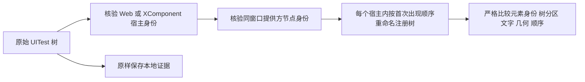

# 无障碍树稳定性比较

采集前后画面和窗口事实完全相同，但原生无障碍提供方重新注册时，节点的运行期 `treeId` 可能变化。
比较规则 `uitest-semantic-state-v2` 将这种注册变化与真实页面变化分开；原始控件树和截图保持原样。

## 身份协议与比较范围

OpenHarmony 将原生无障碍身份拼成 `(treeId << 40) | elementId`。
`treeId` 由服务分配，注销后可回收；它不是页面内容或稳定的控件标识。
UITest 的 `hashcode` 是 `hostWindowId:accessibilityId`，并不是内容哈希。
XComponent 的第三方无障碍提供方同样使用这一协议。

| 字段或边界 | 比较行为 |
| --- | --- |
| Web、XComponent 宿主自身 | 保留完整原始身份；嵌套宿主重新建立独立范围 |
| 提供方节点 | 必须有十进制字符串身份、正窗口标识和完全匹配的 `hashcode` |
| 注册树 | 仅重命名正 `treeId`，范围为 1 至 8191，且不能等于宿主自身的树标识 |
| 宿主窗口 | 后代必须持续属于同一窗口；跨窗口中止当前范围 |
| 树分区 | 每个宿主分别映射，保留节点属于同一树还是不同树的关系，拒绝合并或拆分 |
| 元素、内容和布局 | 保留低 40 位身份、全部文字与其他属性、节点结构及顺序、窗口边界和层级 |
| 未通过身份核验的节点 | 保留原值，变化仍导致拒收；原始值与规范值使用不同标记避免碰撞 |

这些规则只影响比较副本。不将 UIExtension 或任意具有大整数身份的节点识别为宿主，也不处理 CDP 树。
等价的语义快照不能证明两次读取之间提供方对象一直存活。

协议依据：

- [原生身份的 40 位编码](https://github.com/openharmony/accessibility/blob/3ffbe3513f07cb1df2bd98d74089582dff5eb33a/interfaces/innerkits/asacfwk/include/accessibility_system_ability_client.h#L211-L243)
- [注册树分配与回收](https://github.com/openharmony/accessibility/blob/3ffbe3513f07cb1df2bd98d74089582dff5eb33a/services/aams/src/accessibility_element_operator_manager.cpp#L57-L81)
- [注册树标识范围](https://github.com/openharmony/accessibility/blob/3ffbe3513f07cb1df2bd98d74089582dff5eb33a/services/aams/include/accessibility_element_operator_manager.h#L35)
- [XComponent 注册第三方提供方](https://github.com/openharmony/arkui_ace_engine/blob/21b150e7bb1d5308846f8e5be8ef0482fb433315/frameworks/core/components_ng/pattern/xcomponent/xcomponent_pattern.cpp#L1179-L1261)
- [提供方身份的拼接与拆分](https://github.com/openharmony/arkui_ace_engine/blob/21b150e7bb1d5308846f8e5be8ef0482fb433315/adapter/ohos/osal/js_third_provider_interaction_operation.cpp#L309-L348)
- [UITest 的 hashcode 生成方式](https://github.com/openharmony/testfwk_arkxtest/blob/2663426adad3c9c2cecdb75f0e5d23c852cf82d1/uitest/server/element_node_iterator_impl.cpp#L117-L125)

## 离线证据

基于 `eea9f97` 的三个失败样本，在隔离工作目录中只读重放。三个样本的原始像素差均为零，
WMS 窗口事实、节点数量、结构和顺序均未变化。原始文件及失败状态不改写，不作为正式验收样本发布。

| 样本 | 总节点数 | 身份变化节点数 | 新规则的状态比较结果 |
| --- | ---: | ---: | --- |
| 360 在线文档 | 1469 | 160 | 通过 |
| 海泰在线文档 | 677 | 400 | 仍拒收，仅剩两个标签的 `text` 与 `originalText` 变化 |
| QQ 表格 | 919 | 451 | 通过 |

通过样本另外注入低位元素身份、文字、边界、结构和窗口层级变化，每类均被拒收。
独立合成测试还覆盖宿主边界、树分区合并与拆分、嵌套宿主、错误身份格式和规范值碰撞。
完整 Python 回归通过 271 项测试。
三个样本共 27 个输入文件的重放前后 SHA256 一致；真实截图和正文不进入仓库。

## 标签内存用量为何仍严格比较

Chromium 会把标签标题与本地化内存用量拼接成同一个无障碍名称，例如
`Document - 内存用量 - 178 MB`。当前 UITest 树没有单独标明后缀来源，也没有同一标签的独立完整标题。
真实标题可以包含相同后缀；标题被截断时，文字变化也可能不产生截图像素差。
因此，不能仅凭 `tab` 类型、零像素差或正则表达式删除这部分文字。
`text` 和 `originalText` 重复同一个名称，也不是独立证据。

继续处理这一类误拒，需要取得同一标签的独立完整标题，并验证无障碍名称可以由该标题和官方模板唯一重建。
当前实现保留所有这些文字，不忽略正文或任意数字。

依据：[Chromium 标签名称生成](https://chromium.googlesource.com/chromium/src/+/c75f22be5dd55bf8d96725c0eb25f41141601ca3/chrome/browser/ui/views/frame/browser_view.cc#3831)、
[中文内存用量模板](https://chromium.googlesource.com/chromium/src/+/c75f22be5dd55bf8d96725c0eb25f41141601ca3/chrome/app/resources/generated_resources_zh-CN.xtb#11242)。

## 集成条件

此次验证只覆盖离线状态比较，不代表设备重新采集或正式五件套验收通过。
正在执行的采集继续使用原有版本；设备释放后再集成，并使用新输出目录重新采集验证。
比较规则从 `uitest-semantic-state-v1` 变为 `uitest-semantic-state-v2`，不转换旧收据或失败样本，
不将新旧规则混入同一已绑定数据集。旧版本证据保留在原目录，按原代码版本复核。
