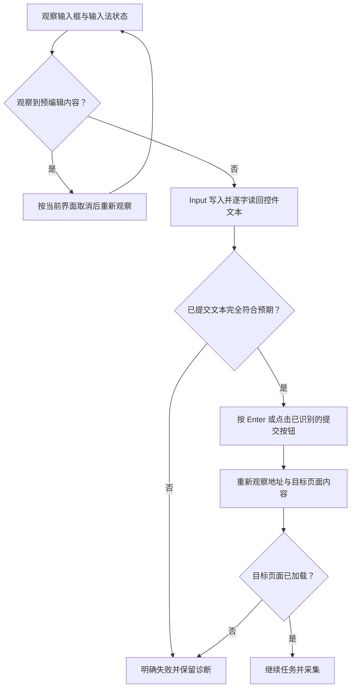

# 浏览器导航与文本输入

输入框收到完整文字、输入法结束预编辑、浏览器到达目标页面是不同状态。
`Input` 只验证控件已提交文本；浏览器导航还需要单独提交，并重新观察目标页面。
本次诊断保持同一个公开目标，不换网址来规避输入问题：
[华为开发者论坛 Worker 与 TaskPool 主题](https://developer.huawei.com/consumer/cn/forum/topic/0204227527468708198)，
完整 URL 为 72 个 ASCII 字符。

## 当前工具契约

输入通过 [Hypium 官方 Driver 模式](https://pypi.org/project/hypium/6.1.0.210/)接入现有 Python 桥接。
当前依赖固定为 `hypium==6.1.0.210`、`xdevice==6.0.7.210`、
`xdevice-ohos==6.1.0.210`、`xdevice-devicetest==6.1.0.210`，由 `requirements.txt` 安装。
组件粘贴使用官方 `InputTextMode().paste(True)`；带输入模式的接口要求 API level 至少为 20。
首次准备环境后执行 `python -m hypium telemetry disable`；本次实机验证已关闭该 SDK 的遥测。
连接使用官方原生代理；每次输入结束关闭驱动连接，临时报告和日志随后清理。

| 参数或结果 | 含义 |
| --- | --- |
| `locate` | 必填；SDK 解析为有限屏幕坐标后，绑定该点最高层普通应用窗口及其唯一焦点输入叶子 |
| `value` | 必填字符串，不将缺省值解释为清空 |
| `mode=replace` | 默认；组件粘贴 `addition(False)`，期望完整文本等于 `value` |
| `mode=append` | 组件粘贴 `addition(True)`，在末尾追加；期望完整文本等于操作前文本加 `value` |
| `mode=clear` | 使用官方组件清空接口；`value` 必须显式为空，读回结果也必须为空 |
| `autoDismissKeyboard` | 默认 `false`；为 `true` 时，仅在匹配验证结果后调用 SDK 关闭键盘 |
| `verified=true` | 控件已提交文本逐字匹配；返回窗口、模式、字符数和 SHA-256，不返回正文 |

覆盖和追加都允许显式空字符串，仍执行读回验证。旧 `typeOnly`、`inputStrategy`、
`keyboardTypeDelay` 不再接受。模型参数和执行时坐标分别校验，窗口或任务范围不匹配立即失败。
正文仅经桥接标准输入传递，工具反馈和审计隐藏正文与定位描述。
实现位于 `agent/text-input.ts`、`har_capture/native_input.py`，不修改第三方库，也没有 CLI 输入回退。

`KeyboardPress` 使用固定 Midscene Harmony 版本支持的单键映射，作用于当前焦点。
支持单个 ASCII 字母、数字，以及 `Enter`、`Backspace`、`Tab`、`Escape`、`Home`、
`ArrowUp`、`ArrowDown`、`ArrowLeft`、`ArrowRight`、`Space`、`Delete`、`Alt`、`Shift`、
`Control`、`Meta`、`Back`、`Power`。不接受组合键；连续修饰键和字母也不能表达组合。

流程不切换输入法或修改系统设置。观察到预编辑时，应按当前界面取消并再次观察；
不能保证一次 Escape、组件清空或粘贴能消除任意输入法的预编辑状态。
`verified=true` 不检测所有输入法状态，也不代表 Enter 已到达浏览器或网页已加载。

## 已有实机证据

以下为 2026-10-22 的独立诊断，原始证据位于本地 `artifacts/browser-navigation-20261022`。
该目录含原始页面和账号信息，不随仓库发布；下表只记录输入与页面身份所需的事实。

| 证据 | 实测事实 |
| --- | --- |
| `sdk-input-audit.md` | 旧运行最终被不受支持的 `Control+A` 中止；旧事件已隐藏输入值，无法还原每次原始字符串 |
| `sdk-replace-commands.json`、`sdk-replace-after-readback.json` | 后续受控重放明确发送完整 72 字符 URL，CLI 返回 `No Error`，浏览器 `searchInput` 仍为空 |
| `focused-text-commands.json`、`focused-text-after-layout.json` | CLI 的另一文本入口同样发送完整 URL；地址栏仍为空，已观测预编辑与候选节点均只含 62 字符前缀 |
| `hypium-paste/readback.json` | 官方组件粘贴后，地址栏逐字读回完整 72 字符 URL |
| `paste-enter-after-readback.json` | 随后 Enter 使残余预编辑合入地址栏，长度变为 134；单次完整读回不足以证明导航成功 |
| `native-input-bound-response.json`、`bound-enter-before-layout.json` | 前次 Enter 合入遗留预编辑且其节点消失后，再次粘贴；原生桥接返回 72 字符验证结果，提交前读回完整 URL |
| `bound-enter-commands.json`、`loaded-before/after-readback.json` 与对应布局 | 单独发送 Enter 后，后续观察保留目标 URL，并出现 Worker 与 TaskPool 主题的标题与页面内容 |

完整 URL 的 SHA-256 为 `7fd85e03eb96e597848d4a949cd980c37a8083793ece6f6464446205fbf2e7aa`。
上述诊断没有使用 Escape，也没有改变输入法、账号或系统设置。

## 最终注册工具验证

真实视觉模型运行位于 `registered-e2e-164722/runs/2026-10-22T16-47-30-300Z-870e892b-95c5-4303-bec4-b54a79e1e3f5`。
模型自主执行注册的 `Tap → Input → KeyboardPress Enter → Capture`。
`Input` 在 `2026-10-22T16:48:12.659Z` 返回 `verified=true`、72 字符及上述摘要；
Enter 在 `16:48:20.792Z` 完成。后续 `Capture` 因采集前后浏览器 Web 节点矩形变化被严格拒绝，
保留 `.failed` 目录，未发布样本、未降低采集验收。差异记录为 `registered-e2e-164722/layout-difference.json`。

为了独立保存字段及提交结果，再通过同一注册器、真实设备、真实 Python 桥接和官方驱动执行验证。
该次为确定性工具调用，未调用模型；每个动作前都绑定本次截图与当前 WMS 观察，
地址栏坐标来自实时控件树，没有复用前次模型坐标。
证据目录为 `registered-tool-proof-2026-10-22T16-51-24-196Z`：

| 证据 | 结果 |
| --- | --- |
| `events.jsonl` | 注册 `Tap`、`Input`、`KeyboardPress Enter` 均完成；输入正文及定位描述已隐藏 |
| `field.json`、`input-readback-layout.json`、`input-readback-screen.png` | 提交前 `searchInput` 聚焦，逐字等于完整 72 字符 URL；收据摘要匹配 |
| `submitted-0-screen.png` | 提交后仍在加载，未据此宣告页面成功 |
| `submitted-1-layout.json`、`submitted-1-screen.png` | 完整地址保留；Worker 与 TaskPool 标题、问题正文和“全部评论”可见，已人工核对截图 |
| `proof.json`、`released.json` | 导航证据摘要、零数据集发布及驱动关闭后的锁释放时间 |

最终验证证明当前注册工具的字段输入、独立提交及固定页面加载。
它不证明任意应用、密码框、不可读文本控件或已有预编辑状态都可完成输入；
不能精确读回的控件不会记录输入成功。真实模型采集运行仍因页面布局变化失败。

自动化回归为 Python 289 项、TypeScript 268 项全部通过，TypeScript 类型检查通过。
覆盖范围包括固定 SDK 的单键映射、模型与执行参数、标准输入传递、窗口与焦点绑定、
完整文本读回、驱动关闭、临时日志清理和异常正文不外泄。

Issue 8 原来的两轮、共 45 次尝试及其通过或失败状态保持原样；这些诊断不追加到原批次，
不改写旧失败目录，也不把导航成功计作完成正式采集。

## 官方接口依据

Midscene 1.16.5 的 [Harmony 输入实现](https://github.com/web-infra-dev/midscene/blob/v1.16.5/packages/harmony/src/device.ts)
经 [HDC 客户端](https://github.com/web-infra-dev/midscene/blob/v1.16.5/packages/harmony/src/hdc.ts)
调用 UiTest CLI。`inputStrategy=bulk` 在该路径不等于强制剪贴板粘贴。
固定 OpenHarmony 实现显示，[短且可映射的默认输入可走逐字按键](https://github.com/openharmony/testfwk_arkxtest/blob/2663426adad3c9c2cecdb75f0e5d23c852cf82d1/uitest/core/ui_driver.cpp#L617-L668)，
而 [Component.inputText 的显式粘贴选项](https://github.com/openharmony/docs/blob/f41b9345badd47c7ab0c263344cd7f4b5a549afb/zh-cn/application-dev/reference/apis-test-kit/js-apis-uitest.md#L2049-L2093)
提供本实现采用的正式入口。源码解释允许的行为，不能替代这台设备的状态读回。
