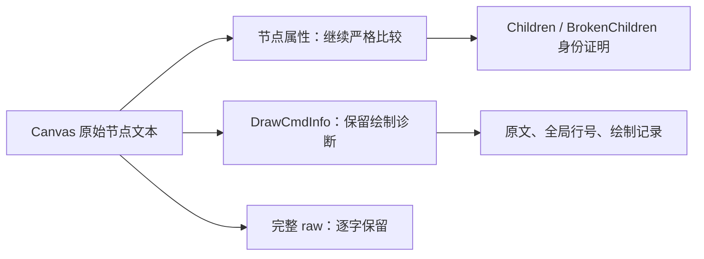

# Canvas 绘制历史与节点属性

完整 ArkUI 原文可能多次输出同一个 Canvas：实际父节点下标为 `Children`，另一个持有旧引用的节点下标为
`BrokenChildren`。两次输出仍须通过已有的原生父链、原始属性、子节点数量和客户端渲染身份校验。

`DrawCmdInfo` 是绘制历史。官方实现输出这些记录后清空历史，所以同一 Canvas 的首次输出可以包含记录，
随后输出只剩标题。绘制时间、命令列表尺寸和命令数量不属于组件布局或身份属性。



解析器只在 Canvas 自身的属性区识别独立的 `DrawCmdInfo:` 标题及紧随其后的完整记录：

```text
YYYY-MM-DD HH:MM:SS.mmm Canvas Size: [285.000000, 55.000000], Command Size: 46;
```

日期必须有效；尺寸必须是有限数值并使用官方六位小数格式；命令数量必须是无符号十进制整数。
记录使用与标题相同的属性包装，最多十条。空历史有效；重复标题、无效日期、非有限尺寸、损坏的记录格式和
超过官方上限的历史均失败。其他属性仍按原规则解析；解析器不会全局忽略时间戳键或未知字段。

Canvas 节点增加 `canvas_diagnostics`：

```json
{
  "source_line": 100,
  "raw": "DrawCmdInfo:\n2026-10-24 07:43:16.926 Canvas Size: [285.000000, 55.000000], Command Size: 46;\n",
  "records": [
    {
      "source_line": 101,
      "timestamp": "2026-10-24 07:43:16.926",
      "canvas_size": {"width": 285.0, "height": 55.0},
      "command_size": 46
    }
  ]
}
```

该块的标题和记录不进入 `attributes` 或 `source_attributes`。完整节点 `raw` 和块内 `raw` 均保留原始换行、
包装与文字；行号始终指向原始输入。独立 UIExtension 响应中的 Canvas 仍属于其自己的组件树。
没有标题的时间戳行以及非 Canvas 节点中的同名文字不获得这种语义。

这个区分只修正绘制历史被误当作属性的问题。它不会删除重复原文、选择第一个同名节点、放宽
`BrokenChildren` 证明、改变原生几何，或把 `Canvas Size` 当作布局矩形。

依据固定的 ArkUI 源码版本 `21b150e7bb1d5308846f8e5be8ef0482fb433315`：

- [CanvasModifier::onDraw 与 GetDumpInfo](https://github.com/openharmony/arkui_ace_engine/blob/21b150e7bb1d5308846f8e5be8ef0482fb433315/frameworks/core/components_ng/pattern/canvas/canvas_modifier.cpp#L59-L110)
  记录最近十次绘制，输出后清空历史。
- [CanvasPattern::DumpInfo](https://github.com/openharmony/arkui_ace_engine/blob/21b150e7bb1d5308846f8e5be8ef0482fb433315/frameworks/core/components_ng/pattern/canvas/canvas_pattern.cpp#L977-L989)
  将历史逐行送入节点诊断输出。
- [ConvertTimestampToStr](https://github.com/openharmony/arkui_ace_engine/blob/21b150e7bb1d5308846f8e5be8ef0482fb433315/frameworks/base/utils/time_util.cpp#L75-L88)
  使用本地日期时间和三位毫秒格式。
- [UINode::DumpTree](https://github.com/openharmony/arkui_ace_engine/blob/21b150e7bb1d5308846f8e5be8ef0482fb433315/frameworks/core/components_ng/base/ui_node.cpp#L1439-L1466)
  在停止 `BrokenChildren` 后代遍历之前仍调用本节点的诊断输出。
