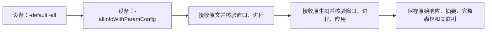

# 应用窗口来源的采集时序

应用窗口先在设备连续完成完整 ArkUI 原文和原生几何转储，再接收文件。
这样可避免将原文传输、主机读取和身份检查放在两次转储之间。
两种官方命令、输出格式、身份核验和完整性验收保持不变。

`tree_capture` 负责应用窗口的调用顺序；`geometry_capture` 分别负责设备原生转储和主机接收、核验、保存。
系统窗口继续使用原来的采集策略。每条命令和传输仍分别记录开始时间、结束时间与耗时。
远端路径在发起对应转储前登记，失败继续交由既有清理流程处理。
任一转储未确认完成、传输失败或来源身份不符，均中止本次采集，不生成成功窗口树。

## 一致性边界

连续转储不是原子快照。官方 `UIContentImpl::DumpInfo` 为每次调用分别提交 UI 线程任务；
文本和原生 JSON 在 `PipelineContext` 中是互斥的命令分支。
两次调用之间仍可能处理布局、动画或应用更新。
参见固定版本的[任务调度](https://github.com/openharmony/arkui_ace_engine/blob/21b150e7bb1d5308846f8e5be8ef0482fb433315/adapter/ohos/entrance/ui_content_impl.cpp#L4690-L4707)
和[命令分支](https://github.com/openharmony/arkui_ace_engine/blob/21b150e7bb1d5308846f8e5be8ef0482fb433315/frameworks/core/pipeline_ng/pipeline_context.cpp#L4546-L4591)。

LazyForEach 的 `GetChildren` 还可能加载子节点、调整缓存集合并请求布局；
即便未来提供同一 UI 任务内的两种序列化，也必须核验序列化本身的副作用。
参见[子节点访问](https://github.com/openharmony/arkui_ace_engine/blob/21b150e7bb1d5308846f8e5be8ef0482fb433315/frameworks/core/components_ng/syntax/lazy_for_each_node.cpp#L561-L636)
和[缓存调整](https://github.com/openharmony/arkui_ace_engine/blob/21b150e7bb1d5308846f8e5be8ef0482fb433315/frameworks/core/components_ng/syntax/lazy_for_each_builder.cpp#L367-L390)。

本次调整只减少可以避免的主机等待，不保证消除所有动态不一致，不增加重试或替代来源，
也不改变节点、父子关系或几何验收要求。微博 045 的冻结输入与失败结论保持不变；
新顺序的实机效果需要独立的新运行验证，不能用它追认旧运行成功。
