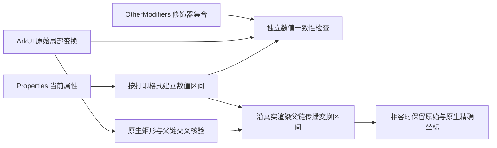

# 当前渲染变换与打印精度

窗口和控件的坐标来自同批原始 ArkUI、原生几何、实际渲染父链的交叉核验。
RS 当前属性是 `Properties` 段；`OtherModifiers` 是节点持有的修饰器集合，存在于其中不代表一定尚未应用。
两个来源分别核对，不能用修饰器值填补缺失的当前属性。

当前属性使用独立 `ScaleX`、`ScaleY`、`TranslateX`、`TranslateY`，轴心使用 `Pivot[x,y]`。
修饰器集合仍使用 `Scale:[x:... y:...]` 等组合格式。这是两个来源的不同语法；
旧的组合 current Scale/Translate 格式直接拒绝，不增加兼容解析。
依据为固定官方版本的 [RSProperties 当前属性转储](https://github.com/openharmony/graphic_graphic_2d/blob/c19cedf62fefde6bf184aa815feeaf0346aa4d49/rosen/modules/render_service_base/src/property/rs_properties.cpp#L4141-L4252)。

RS current 的这些字段打印一位小数。出现 `ScaleX[1.0]` 不能证明精确单位缩放，
它对应的打印区间包含 `1.001`。实际新现场的原始比例为 `1.001000`，
原生宽度为 `2562.56`，与 `2560×1.001` 一致；不能把它改成 `2560` 来匹配打印中心值。

代码从实际文本的小数位计算舍入半宽，分别验证每个来源的区间；矩阵计算传播区间并向外舍入，
覆盖浮点运算误差。旋转范围同时检查端点和区间内的三角函数极值。
固定的原生投影和局部几何余量没有增加，区间也没有用于替换输出坐标。
通过表示原生坐标与 RS 能表达的当前范围相容，**不表示已经恢复 RS 的精确内部浮点值**。

省略字段遵循官方条件。打印层的 `ROSEN_EQ` 默认比较使用 float epsilon；
在已验证的二维路径中，两轴 Scale 都省略时有效缩放操作跳过。
平移和旋转执行层的比较范围更宽，因此两轴 Translate 或 Rotation 被省略时也不会执行对应操作。
只有一轴省略时保留该轴的默认参数区间，轴心缺省同样保留区间。
依据为 [二维路径选择与执行顺序](https://github.com/openharmony/graphic_graphic_2d/blob/c19cedf62fefde6bf184aa815feeaf0346aa4d49/rosen/modules/render_service_base/src/common/rs_obj_abs_geometry.cpp#L65-L76)
及 [实际变换计算](https://github.com/openharmony/graphic_graphic_2d/blob/c19cedf62fefde6bf184aa815feeaf0346aa4d49/rosen/modules/render_service_base/src/common/rs_obj_abs_geometry.cpp#L193-L215)。

当前非默认三维字段即使打印成 `0.0`，也不能据此宣称二维路径。原有三维拒收继续执行，
仅保留已经独立证明的零尺寸、无绘制叶节点例外。
原文与原生矩形冲突、渲染父链冲突、轴值重复、缺少非默认轴、非有限值及未知变换仍拒收。

现场证据是顺序读取，原有 `atomic=false` 语义不变。
后续只读现场可以复现并验证修复，不能代替历史失败当时缺失的几何原文，也不能追认旧采集成功。
