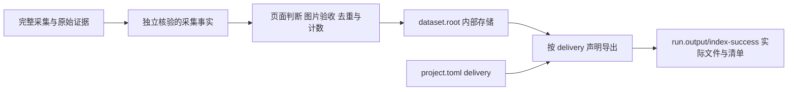

# 项目声明的交付文件

采集事实与交付文件分开。`dataset.root` 保存内部数据库、运行证据和已验收事实；
`run.output` 保存用户交付，使用同根递增的 `001-running`、`001-success`、`001-failed`。
成功目录直接包含本轮按项目声明导出的文件和 `manifest.json`，不使用并列 `.001` 入口。
已有目录、数据库行、原始配置摘要及收据不迁移或重写。



在现有 `project.toml` 增加必填的 `delivery` 声明。以下保留 LabelKit 的五种文件名：

```toml
[delivery]
directory = "."

[[delivery.artifacts]]
source = "accessibility"
path = "{app}_{page_id}_{scene}_{state_id}_tree.json"

[[delivery.artifacts]]
source = "application_accessibility"
path = "{app}_{page_id}_{scene}_{state_id}_windows_tree.json"

[[delivery.artifacts]]
source = "application_arkui"
path = "{app}_{page_id}_{scene}_{state_id}_windows_akui.json"

[[delivery.artifacts]]
source = "screenshot"
path = "{app}_{page_id}_{scene}_{state_id}_shot.png"

[[delivery.artifacts]]
source = "windows"
path = "{app}_{page_id}_{scene}_{state_id}_wms.json"
```

需要第六份已有采集元数据时，只增加以下声明：

```toml
[[delivery.artifacts]]
source = "capture_metadata"
path = "{app}_{page_id}_{scene}_{state_id}_metadata.json"
```

`directory = "."` 将本轮文件放在结果目录根部；`directory = "{capture_id}"`
或 `directory = "{app}/{capture_id}"` 按声明创建样本子目录。
`directory` 和 `path` 只支持 `{app}`、`{scene}`、`{task}`、`{capture_id}`、`{page_id}`、`{state_id}`
这些固定替换项，不支持表达式、格式运算或执行代码。路径必须相对，不能越界或覆盖运行清单。
每个来源最多声明一次，输出路径不得冲突；不声明文件数量。

| 来源 | 实际内容 |
| --- | --- |
| `screenshot` | 已验收且摘要匹配的最终 PNG，保留原来的打码事实 |
| `accessibility` | 所有已覆盖窗口的无障碍树，包含系统窗口 |
| `application_accessibility` | 已覆盖普通应用窗口的无障碍树 |
| `application_arkui` | 完整验证后的普通应用 ArkUI 树及屏幕几何 |
| `windows` | 窗口事实、采集检查与本次实际选定的配套树引用 |
| `capture_metadata` | 该帧保存的真实采集元数据 |
| `raw:<索引键>` | `metadata.files` 明确索引的原始文件，按原字节导出 |

少选文件不会减少全窗覆盖、原生几何、页面判断、隐私、最终图片验收或去重要求。
去重与页面、状态标识来自采集事实，不来自输出文件名。
输出规则不属于采集身份；改变交付文件集合、名字或组织不重新计数。
缺少来源或证明时明确拒绝，不补造数据，也不从缺少声明推断五件套。

## 已成功样本的离线导出

```powershell
npm run agent -- export --project project.toml --config config.toml --sample-id CAPTURE_ID
```

该入口只读现有已成功登记及原始证据，按当前 `delivery` 生成新的编号结果目录。
它不连接设备、不读取模型凭据、不重新图片验收、不增加已采计数，也不改原始数据库和收据。
需要核验历史项目来源时沿用显式 `--project-source PATH`。

`manifest.json` 列出每个样本本次真正导出的来源、相对路径、字节数和 SHA-256。
完整性核验依据该清单，原始采集事实另行核验。配套窗口树引用只指向本次确实声明的文件。
重新导出会复制已存在的最终图片；不能从打码前的摘要恢复已不存在的原图。

设计依据是 [Scrapy Feed Exports](https://docs.scrapy.org/en/latest/topics/feed-exports.html)
将采集项与声明的导出位置、格式分开；本工具只使用现有原生数据格式，不引入 Scrapy、插件或表达式语言。
