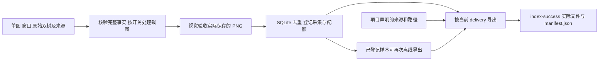

# 采集事实、交付与恢复

采集成功与交付文件分开登记。完整采集先通过覆盖、几何、页面判断、隐私和最终图片验收，
再经 SQLite 去重并增加一次已采计数；随后按当前项目声明导出文件。
少选文件不会减少采集检查，改变文件数量、名称或目录也不会产生新样本。



## 项目声明与存储

新运行的 `project.toml` 必须声明 `[delivery]`，其中 `directory` 和非空 `artifacts` 都必填。
每项产物只声明 `source` 和 `path`。以下片段仅选择已验收截图；完整采集和全部验收仍然执行：

```toml
[delivery]
directory = "{app}/{capture_id}"

[[delivery.artifacts]]
source = "screenshot"
path = "{capture_id}.png"
```

来源、固定替换项、路径规则及五份、六份文件的具体例子统一见
[项目声明的交付文件](declarative-delivery.md)。没有默认五件套，也没有文件数量开关。
未声明的文件不输出；来源不存在、重复来源、路径冲突或越界会明确拒绝。
窗口文件只引用本次确实选中的配套树，不生成指向未输出文件的引用。

`dataset.root` 继续使用项目已有的内部位置，保存数据库、已验收事实及新运行证据。
不要为了更换交付形式重置它，也不要搬移旧数据库、原始配置或收据。
新运行证据集中保存在 `<dataset.root>/runs/<UUID>/`；新登记的规范事实保存在
`<dataset.root>/samples/<capture_id>/capture.json`。
`run.output` 只用于本轮实际交付，目录布局与中断状态见[运行输出](run-output.md)。

每个项目仍须明确 `dataset.canvas`，每个任务仍须声明 `app`、`scene`、`privacy`、
任务描述、验收条件和目标数量。画布必须与实际截图一致，不拉伸图片满足声明。

## 完整事实与验收

`Capture` 必须明确 `target_window_id` 和 `target_bundle_name`，同应用多窗口不猜焦点。
原始截图、WMS、无障碍树、ArkUI、原生几何及渲染来源按同一 `capture_id` 配对。
普通应用 ArkUI 坐标须由同批原文、原生端点和实际渲染父链交叉证明；
不能证明的变换、裁剪、树归属或窗口覆盖明确拒收。
具体几何边界见[精确窗口映射](exact-window-mapping.md)。

Inspector 无障碍响应可以包含多个同级根。官方
[DumpTree](https://github.com/openharmony/arkui_ace_engine/blob/21b150e7bb1d5308846f8e5be8ef0482fb433315/adapter/ohos/osal/accessibility/accessibility_hidumper_osal.cpp#L579-L605)
会依次输出主渲染管线及子管线的根，使用相同深度。采集器完整解析这些根，
保留全部原文、属性和行号；系统窗口在全部根中按 `WindowScene` 的
`compid=session<window_id>` 与 WMS 会话的无障碍节点 ID 共同唯一选择。
跨根重复匹配、重复身份属性或任一根的格式错误均拒收，不取第一个根，不合成虚构父节点。
普通应用的逐窗 Inspector 响应如有多根，在缺少明确归属证据时拒收。
ArkUI 窗口树仍必须单根；所有子节点继续严格按两个空格递进，不放宽缩进规则。

像素、全量窗口和树的首尾差异只作诊断；内容拒收针对目标换页或主体空白。
首尾目标裁图仅在内存中比较，`page-stability.json` 绑定原观测摘要。
`unobservable` 表示观察不足，不宣称稳定已经证实；最终图片验收仍然独立。
`dataset.stability_regions` 只保存原项目声明，不屏蔽像素、不授予变化豁免，
也不要求系统叶子的路径、数量或文字相等。详见[目标页面稳定性](target-page-stability.md)。

当前本地处理接口分别承担这些职责：

| 操作 | 输入与结果 |
| --- | --- |
| `prepare_capture` | 输入原始证据目录、画布、稳定性声明和隐私规则；核验完整事实，返回内部事实清单与实际最终 PNG 信息 |
| `publish_capture` | 输入完整准备清单及绑定最终 PNG 摘要的视觉通过收据；去重、分配页面和状态标识，并登记采集一次 |
| `export_sample` | 输入已登记样本、当前交付声明和新结果目录；只读核验原事实，输出选中文件与清单，`new_samples=0` |

`prepare_capture.options` 只包含 `canvas` 和 `stability_regions`，隐私规则单独传入。
返回的 `manifest.files.capture` 明确索引规范事实，`manifest.screenshot` 提供实际 PNG 的绝对路径、
大小、SHA-256 和宽高；视觉验收读取这张图片，登记请求以 `acceptance.capture` 关联准备清单。
`export_sample` 返回原登记 `sample`、本轮 `export` 和零新增计数，
实际交付清单中的 `files` 按声明来源索引相对文件、字节数和摘要。

准备收据为 `capture-preparation.json`，规范事实实体为 `accepted/capture.json`。
登记时内部准备目录原子移入 `dataset.root/samples/<capture_id>/`；
原始截图和双树不因交付而移动，准备收据中原有来源也不改写。
对外文件集合由本轮 `manifest.json` 明确列出，导出不改写原始元数据中的来源引用。

最终视觉验收读取准备清单明确指向、大小和摘要均匹配的保存 PNG，不重拍设备屏幕。
每次新登记都核验完整采集事实并计算页面、状态签名，不从选中的交付文件重建采集身份。
例如只输出截图时，缺失 ArkUI 几何、窗口覆盖不全或无效页面收据仍会阻止验收。
截图和树是顺序读取，始终标记 `atomic=false`，这些检查不是硬件原子快照。

## 可选打码

任务的 `privacy.enabled` 是必填布尔开关，`reason` 必填。`regions` 若提供，必须为非空数组。

| 配置 | 处理与最终图片验收 |
| --- | --- |
| `enabled=false` | 保留原图，不执行选择器；可保留 `regions` 供再次启用 |
| `enabled=true`，未提供 `regions` | 保留原始证据，等待核实选择器，不登记采集 |
| `enabled=true`，提供 `regions` | 按全部声明选择器打码，核验后验收最终图片 |

选择器使用本次无障碍树的包名、`attributes.id` 和实际屏幕矩形，不复用上一帧坐标。
所有选择器必须匹配且具有可见面积；系统不自动推断任意应用的正文容器。
示例资源标识不能直接用于实机。只想保留原图时，可使用：

```toml
[tasks.privacy]
enabled = false
reason = "本次保留原始截图"
```

以下命令只处理已保存证据，不连接设备或模型：

```powershell
python redact.py selectors PATH_TO_CAPTURE
python redact.py apply PATH_TO_CAPTURE --project project.toml --task TASK_NAME
```

`selectors` 先核对原始无障碍文件的大小和摘要，只输出标识、类型及矩形，不打印正文。
开启 `apply` 时原地覆盖唯一采集 PNG，保存规则、区域及前后摘要，并删除含旧图的查看页；
关闭时记录原因和原图摘要。关闭开关不能恢复已经覆盖的像素。
已经准备的候选必须继续使用原准备规则，不能以新开关或新原因说明改写旧收据。

原始双树正文仍保留在本地；若声明树或原始来源，也会进入相应交付。
截图打码不等于树正文脱敏。导航截图已经发送给配置的视觉模型，采后打码不改变这些既有请求。
查看页只复制结构属性，其截图仍遵循本次隐私开关。

## 独立验收与离线导出

已有完整候选可在不连接设备的情况下验收：

```powershell
npm run agent -- finalize --capture PATH_TO_CAPTURE --task TASK_NAME `
  --project project.toml --config config.toml --env-file C:\config\deepseek.env
```

尚未登记的候选必须已有绑定目标及观测的页面判断收据；缺少末帧图片时不能离线补造判断。
单独 `capture.py` 生成的原始证据不能只靠增加 `--target-bundle` 追认为成功采集。
首次 `finalize` 通过最终图片验收后登记采集，再执行当前交付声明。
对已经登记的样本再次 `finalize`，按原明确事实核验后导出，不重复图片验收或增加计数。

只需要更换文件集合、名字或组织时，使用离线导出命令：

```powershell
npm run agent -- export --sample-id CAPTURE_ID --project project.toml --config config.toml
```

如需证明历史项目原文，可重复提供 `--project-source PATH`，路径可以是原项目文件或归档目录。
`export` 不需要设备或模型 key，不加载凭据环境文件，不调用模型，不增加采集计数；
它只读已成功登记、原始证据和原收据，写入新的编号交付目录及本轮内部导出收据。
同一个已验收帧可以先导出五份，再按新声明导出六份，原 DB、配置、证据和收据保持不变。
重新导出复制已存在的最终 PNG，不恢复被打码覆盖的原图，也不产生新的采集帧。

导出前必须核验完整原事实，不能通过省略窗口文件、树或截图绕过任一验收条件。
缺少来源、证明或实际文件时停止，不补造数据。
已经登记后才遇到导出错误，采集计数仍保留；本轮结果标记失败，可更正交付声明后再次离线导出。

## 身份与恢复边界

采集合同绑定运行名称、模型引用和配置、工具、任务身份、`app`、`scene`、包名范围、
画布、稳定性声明、隐私开关及区域等采集语义。
任务描述、视觉验收文字、目标数量、隐私原因说明和运行预算可以调整，剩余数量取当前目标减已采数量，最小为零。
`delivery` 规则和存储位置不进入采集合同；改变它们不清零配额。
`config.toml` 的原始摘要与选中的模型配置仍严格绑定。

位置不属于采集身份，不代表工具会搬移数据或自动重映射旧路径。
继续使用原 `dataset.root`，保留所有被引用的原始目录。
复制证据到其他布局不能使原引用自动有效，也不能改写旧清单中的路径来伪装恢复成功。

每次新运行保存原始 `project.toml` 和 `configuration.json`。
被引用的历史快照必须有真实 TOML 原文，字节 SHA-256 和解析内容均须匹配；
只读快照内自报的摘要不足以证明来源。
工具读取本次原文、明确保存的运行原文及显式 `--project-source` 来源，不补写旧原文。
旧 identity、数据库行、清单和收据按原明确事实核验，保留其原字节、摘要与来源路径。
历史项目没有交付声明时，也不据此猜测五件套；新运行仍必须明确声明当前交付规则。

采集登记中断后，只有原清单、实际字节及唯一来源位置足以证明时才完成原事务。
未知孤儿目录、缺文件、歧义和摘要不符均拒绝，不因目录存在就补记成功。
离线导出只接受已经成功登记的样本，不借导出操作修复数据库或追认未完成采集。
新导出依据持久计划逐项核对，已有冲突文件不会被覆盖；再次执行命令会保留旧结果并取得新编号。

`run --max-new-samples N` 只限制本轮新增的不同成功采集，跨任务累加，不改任务总目标。
`N=0` 仅恢复核验，不连接设备和模型。`run.json.new_samples` 不包含旧样本或离线导出；
`stop_reason=run_sample_limit` 表示本轮上限，只有 `quota_complete` 表示项目任务配额已满足。
命令失败不抹掉此前已登记的采集；失败原因及实际进度保存在内部 `run.json`。

旧版本的邮件阅读、打码开关和五文件实机记录保留在
[README 的历史记录](../README.md#历史五文件实机记录)。
这些记录不构成当前声明式交付、页面判断规则或所有应用的新一轮实机验收。
