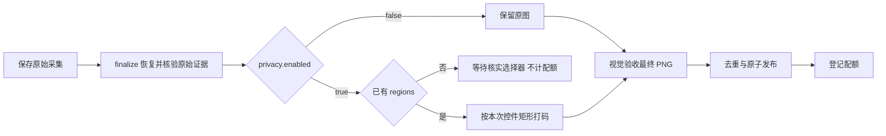
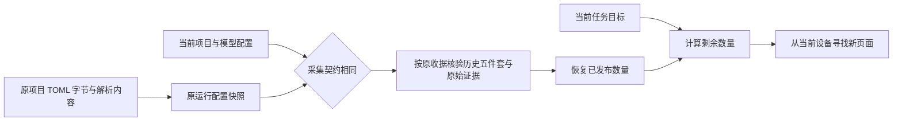

# 五件套、后处理与恢复的当前接口

原始采集、独立打码、离线视觉验收、去重发布和中断恢复已经接入。
原生坐标与系统窗口覆盖仍须逐帧通过实机证据验证；功能接入不代表整批采集已经验收。
在加入显式打码开关前的版本中，已在现有账号的邮件阅读页完成正式五件套、正文打码、
离线重复发布和恢复运行。新增 `enabled=false` 也已在真机验证原图摘要不变、五件套发布和重复运行不增计数；
开启与关闭的证据分别保留，不改写历史样本。
具体测量与限制见 [README 的当前实机验证](../README.md#当前五件套实机验证)。

每份 `project.toml` 必须声明正式数据集位置和画布，以及任务应用名、场景和打码规则：

```toml
[dataset]
root = "./output/my-task/dataset"
canvas = { width = 3120, height = 2080 }

[[tasks]]
name = "mail-reading"
app = "华为邮箱"
scene = "邮件页面"
instruction = "自主打开已登录邮箱中的一封邮件；只查看，不发送、删除或修改邮件。"
acceptance = "邮件阅读页面可见，有侧栏与阅读工具栏，不是登录、设置、空白或错误页。"
target_count = 1
bundle_names = ["com.huawei.hmos.email"]
privacy = { enabled = true, reason = "等待在真实页面核实正文容器标识后独立打码" }
```

内容稳定性按[目标页面稳定性](target-page-stability.md)判断。
`Capture` 必须明确 `target_window_id` 和 `target_bundle_name`；同应用多窗口不猜测焦点或层级。
像素、全量窗口和树差异仅作诊断；内容拒收只针对目标换页或主体空白。
首尾目标裁图暂存于内存，模型结论写入 `page-stability.json`，并随 WMS 导出。
`unobservable` 明确表示观察不足，本身不拒收，也不构成已证实稳定；最终图片验收仍然独立。

`dataset.stability_regions` 省略时为 `[]`，只接受 `bundle_name` 和 `resource_id` 声明，
随原项目及 `metadata.stability.rules` 保存以核对来源。它不再屏蔽像素，不授予变化豁免，
也不要求系统叶子的匹配数量、路径、边界或文字相等。原始截图和树保持不变。

`privacy.enabled` 是必填布尔开关，`reason` 是必填原因：

| 配置 | 后处理与最终验收 |
| --- | --- |
| `enabled=false` | 不改写截图，最终视觉验收使用原图；可以保留 `regions` 供再次启用 |
| `enabled=true`，省略 `regions` | 保存原始证据后等待核实选择器，不导出、不计配额 |
| `enabled=true`，提供非空 `regions` | 按全部选择器打码，核验后在最终图片上进行视觉验收 |

只有开启打码时才执行选择器匹配。`regions` 若提供则必须为非空数组；不接受空数组代替待核实状态。
取得真实控件标识后，可补充如下规则；示例标识不得直接用于实机：

```toml
privacy = { enabled = true, reason = "覆盖已核实的正文及输入容器", regions = [
  { bundle_name = "com.huawei.hmos.email", resource_id = "REPLACE_WITH_OBSERVED_BODY_ID" }
] }
```

规则匹配本次无障碍树中的 `attributes.id`，采用本次实际屏幕矩形，不复用上一帧坐标。
所有规则必须匹配并有可见面积；无法提供语义节点的 WebView 不会凭空产生正文标识。
需要保留原图时，把 `enabled` 改为 `false`，可保留同一组选择器。
最终视觉验收会收到本次打码开关状态。邮箱示例的 `acceptance` 只判断页面场景，
打码要求由开关和确定性核验表达，因此切换时不必修改验收描述。
自定义验收若额外写明“正文必须打码”，应与开关协调，否则原图可能无法通过该自定义断言。
当前没有自动识别任意应用正文区域的保证，也不把应用无正文标识解释为无需打码。

已有 `capture.py` 可单独采原始证据。以下打码命令不访问设备或模型：

```powershell
python redact.py selectors PATH_TO_CAPTURE
python redact.py apply PATH_TO_CAPTURE --project PATH_TO_PROJECT --task TASK_NAME
```

`selectors` 先核对无障碍原始文件的大小与 SHA-256，再输出包名、窗口、资源标识、类型和矩形，不打印正文。
`apply` 遵循同一个开关：开启时原地覆盖唯一 PNG，保存区域和前后摘要，移除包含旧图的查看页；
关闭时记录关闭原因与原图摘要。原始双树留在本地。
默认 agent 流程在 `Capture` 之后执行同一后处理，再验收最终 PNG，最后登记五件套。
导航使用设备已有登录状态；导航截图会发送给配置的视觉模型，后处理不会追溯改变既有模型请求。
动作执行时使用原参数；持久日志与规划反馈隐藏所有动作的定位描述及输入正文，保留已解析坐标。

离线验收与发布使用已实现的 `finalize` 命令：

```powershell
npm run agent -- finalize --capture PATH_TO_CAPTURE --task TASK_NAME `
  --project PATH_TO_PROJECT --config config.toml --env-file C:\config\deepseek.env
```

`finalize` 无需设备连接，只使用保存的原始证据与最终 PNG。它先恢复未完成的文件移动，
重新核验全部原始文件摘要、双树与几何文件引用、窗口覆盖和观测收据，再准备五件套。
未发布候选必须已有绑定本次目标和观测摘要的页面判断收据；没有末图时不能补造结论。
最终图片的视觉验收只使用按开关处理后的保存图片，关闭时就是原图；验收通过后原子发布，配额才增加。
直接由 `capture.py` 生成的原始采集没有自动页面判断收据，不能仅增加 `--target-bundle` 追认为正式样本。
已有 agent 候选则继续使用其中的任务、目标应用与窗口变化证据，不重做导航。



`dataset_status` 在 `dataset.sqlite3` 不存在时只校验配置身份并返回零计数，不创建目录或绑定空库。
因此仅完成等待选择器的原始采集时，可以补充 `regions`，沿用同一个 `dataset.root`
执行 `finalize`。首次进入正式发布时，数据库绑定的是修改后的项目和模型配置摘要及任务配额。
这不会保留尚未发布时的配置摘要。无数据库却存在非空 `samples/` 时明确拒绝。

数据库建立后，同一 `dataset.root` 严格属于同一采集契约和模型配置。
只允许调整任务 `instruction`、`acceptance`、`target_count`、`privacy.reason`，
以及 `run.max_actions`、`run.max_duration_seconds`；计数不清零，剩余数量为当前目标减已发布数量，最小为零。
其他项目字段保持严格相同，包含任务身份、应用、场景、包名、工具、画布、稳定性和隐私处理规则。
`config.toml` 原始 SHA-256 和选中的模型配置仍严格绑定，修改后须使用新目录。
数据库保留首次登记的三字段运行来源，每份清单保留发布时的运行摘要；不迁移数据库或重写旧记录。
恢复时根据原运行 `configuration.json` 核对稳定采集契约，再按原隐私与准备收据核验实际文件。
每次新运行保留原始 `project.toml` 和解析快照 `configuration.json`。
只读取当前项目原文、当前输出目录各运行保存的原文，以及显式 `--project-source PATH` 指定的文件或目录。
引用某次来源时，必须找到字节 SHA-256 一致的项目原文，并核对其解析内容；不能只相信快照内自报的摘要。
原文另存于归档时显式传入该路径，不移动目录、不补写旧文件；缺失或不匹配的来源直接拒绝。
改变视觉验收文字不会重新验收或追认历史样本。



已打码或已准备的单份采集还受打码和准备收据约束，重试必须使用相同开关与规则，不能换规则重新解释旧收据。
未发布且已准备的候选仍需要原准备规则，包含当时的 `privacy.reason`；调整原因说明后可以恢复已发布数据，
新采集使用新说明，不能用新说明覆盖旧候选的准备收据。
关闭开关不能恢复已经覆盖的像素；需要原图时应以关闭配置重新采集，不能复用旧打码收据。
独立项目各用独立 `dataset.root`，例如 `out/<task-name>/dataset`；运行证据可放在
`out/<task-name>/runs`。系统不限定应用或场景数量，项目层汇总应保留各数据集的独立身份和登记记录。

重复 `run` 会重新核验正式文件、验收收据和状态签名，再从当前设备观察并补齐缺额。
重复 `finalize` 会核验并返回已有发布收据，不重复增加配额，也不再次调用模型验收已发布样本。
准备与发布中断时，恢复过程验证规则摘要和每个文件的实际字节；无法唯一确认的证据明确失败。

`run --max-new-samples N` 只限制当前运行成功新增的不同正式样本数量，跨任务累加，不改写任务总目标。
`N=0` 只恢复核验，不连接设备和模型；省略参数不限制本轮新增数量。
`run.json.new_samples` 不含恢复的旧样本；`stop_reason=run_sample_limit` 表示达到本轮上限，
`stop_reason=quota_complete` 才表示所有任务已达到项目总目标。达到本轮上限属于正常完成。

正式 `samples/<capture_id>/` 严格只有 `_tree.json`、`_windows_tree.json`、
`_windows_akui.json`、`_shot.png`、`_wms.json`；四份 JSON 共享采集标识和画布。
原始证据、打码收据、用量、查看页不放进这个五文件目录。
页面编号由目标应用结构签名生成，状态序号在发布事务内分配；文件名及 WMS 内部双树引用一起更新。
`_tree.json` 包含实际可见系统窗口；两份应用树与 `app_windows` 使用同一组实际可见应用窗口。
原始双树正文保留在本地证据与五件套 JSON 中；打码作用于截图，查看页仅复制结构属性。

单轴 `-1` 且另一轴为正的 ArkUI 节点须同时通过完整原生投影与 RS 无绘制叶节点证明。
原始属性和结构保留，已验证几何可以为正面积但标记 `rendered=false`；不以此放宽裁剪或误差门槛。
具体接收条件见[单轴负尺寸节点](mixed-dimension-nodes.md)，旧失败采集不会因此被追认为正式成功。
正式登记前必须通过窗口覆盖、原生 ArkUI 坐标、截图后处理、采集稳定性和最终图片视觉验收。
截图与树仍为顺序读取，`atomic=false`；前后检查不等于硬件原子快照。

原生坐标采用 `-element`、`-allInfo` 的 `$rect` 和 RenderService 渲染树交叉验证。
不能证明的变换、裁剪或可见窗口缺树将明确拒收，不填假坐标，也不靠忽略节点凑齐。
应用 ArkUI 的 `screen_bounds` 是裁剪前的轴对齐组件边界；`clip_chain` 保留矩形及圆角裁剪，
不表示实际遮挡后的像素区域。离屏渲染节点有明确的 `rendered=false` 证据，非布局节点保留为不适用。
父级 Surface 与应用根可以具有不同尺寸：映射使用真实父级变换，`rectangular_clip_bounds` 单独记录
组件边界与实际裁剪链的矩形交集。原始组件尺寸不因此被改写；内层父级和裁剪均须独立核验，
详见[父级视口与应用根](exact-window-mapping.md#父级视口和应用根尺寸不同)。
零尺寸容器的无穷大 RS 矩形在完整无绘制子树证据通过后，可以保留其原生零尺寸边界并标记不绘制；
不删除容器或子节点，不把无穷大值用作屏幕坐标，也不单凭跳过准备状态认定无绘制。
无绘制节点使用 `render_state_source=RenderService.no_draw_content`，
`geometry.source.no_draw_render_node_ids` 保留经核验的实际渲染节点标识。
系统窗口保留独立原生双树；当前正式应用 ArkUI 的坐标校验不等于系统树全部节点均已转换坐标。
