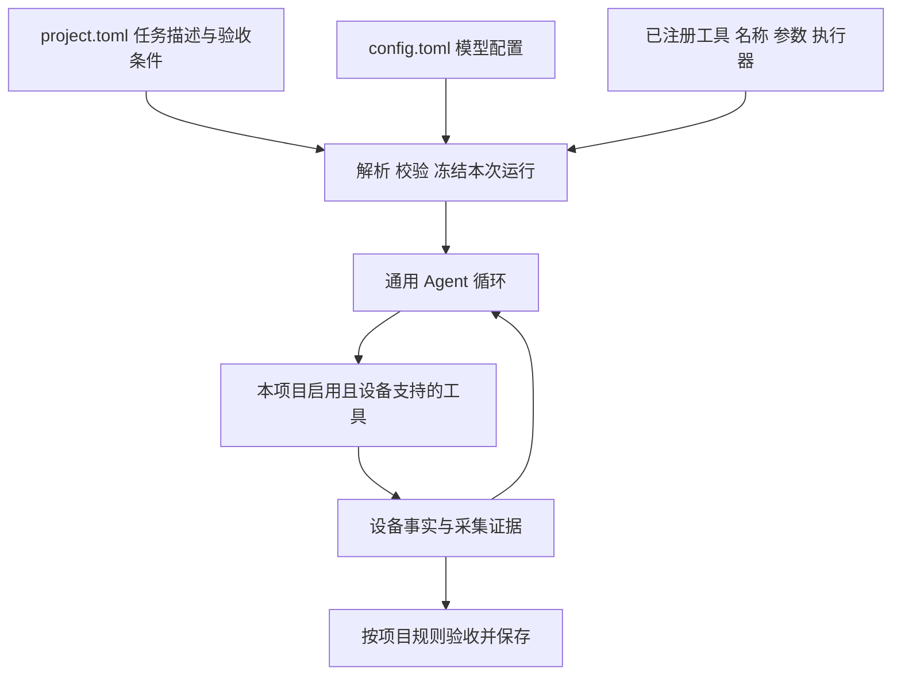
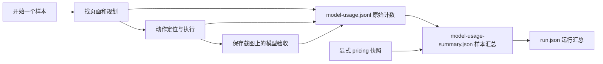
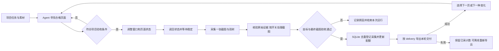
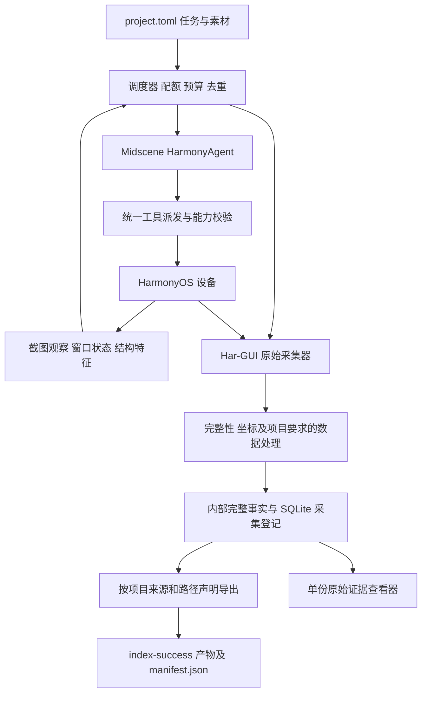
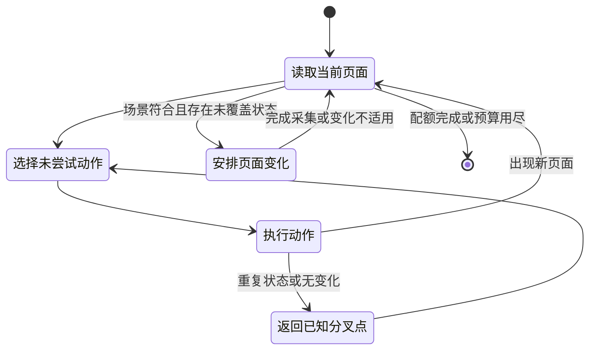
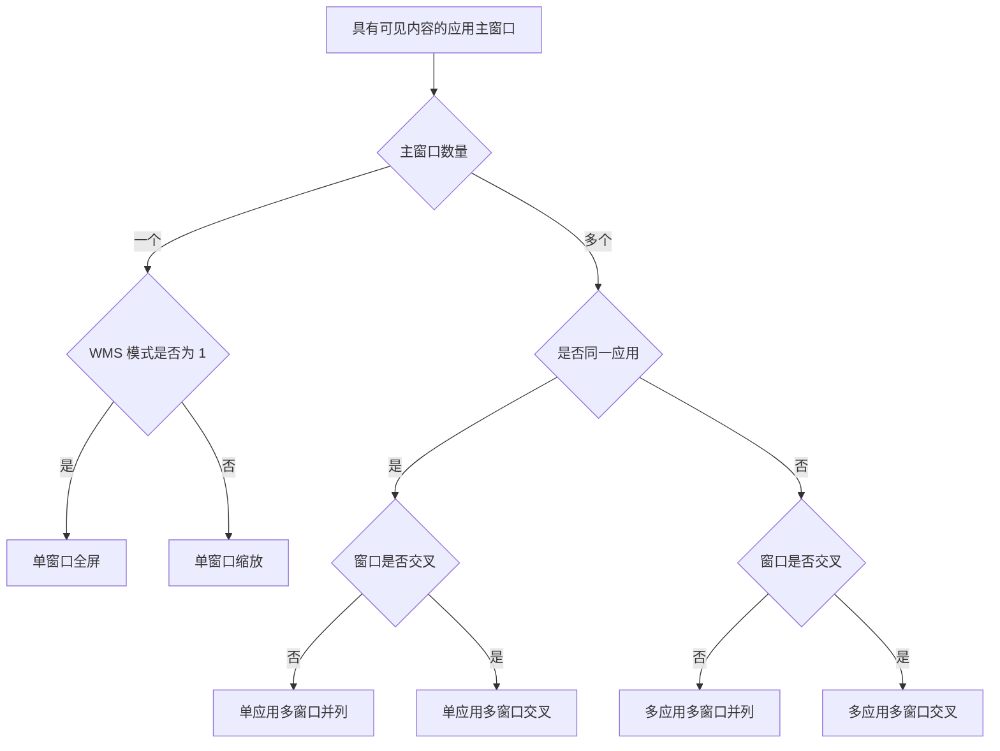
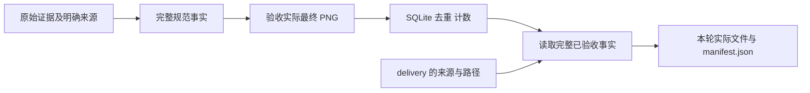

# HarmonyOS 通用场景自动化采集设计

更新日期：2026-10-23。本文保留通用采集系统的设计依据，并按当前实现说明边界。
页面导航、窗口移动、指定尺寸和主动遮挡，以及邮件阅读、打码开关和五文件发布，均有旧版本实机记录。
这些历史记录不构成当前声明式交付或目标页面判断规则的新一轮真机验收。
当前交付解耦的验证包括离线动作、匿名完整流程及已验收副本导出；不能据此宣称真实模型必然选择正确动作。

可执行配置见仓库根目录 `project.toml`、`config.example.toml` 和 [README](../../README.md)。
交付来源及路径语法以[项目声明的交付文件](../declarative-delivery.md)为准，
采集验收及恢复边界见[交付契约](../delivery-contract.md)，历史实测见
[README 的历史五文件记录](../../README.md#历史五文件实机记录)。
已接入 Midscene HarmonyAgent、严格 TOML 装载、显式工具注册、窗口变化、完整采集、可选打码、
保存图片上的视觉验收、SQLite 去重登记、按声明导出和实际模型用量记录。
文中的持久页面状态图、导航路径重放和未提供的工具仍属于设计目标。
窗口工具使用无障碍身份定位和官方 `uinput` 鼠标输入，再以实际读回核验；
指定尺寸受应用与系统限制，内容缩放尚无专用工具。

系统是面向 HarmonyOS 的通用自动化采集运行器。用户在 `project.toml` 中描述采集任务，
在 `config.toml` 中配置模型，agent 根据任务自主发现应用和页面、调用工具制造变化，再采集证据。
应用、场景、数量和验收条件都来自项目，核心不包含固定应用名单或固定场景枚举。

推荐使用 **Midscene HarmonyAgent 负责找页面和操作，Har-GUI 负责采集与数据验收**。
窗口变化由确定性的操作模块执行，是否成功以设备读回的状态为准。每次采集只保存一张主 PNG。

## 系统 项目与工具的边界



| 所属层 | 内容 | 增加需求时如何修改 |
| --- | --- | --- |
| 系统核心 | 任务装载、模型调用、工具派发、状态记录、执行预算、证据关联与发布 | 不根据应用名称或场景标签增加分支 |
| 采集项目 | 任务描述、应用范围、场景定义、目标数量、变化要求、验收与输出规则 | 修改 `project.toml` 及其引用的项目文件 |
| 模型部署 | 模型名称、服务地址、协议、凭据引用与模型能力 | 修改 `config.toml`；项目按模型配置名称引用 |
| 工具模块 | 查询设备、界面操作、窗口操作、采集等实际能力 | 实现工具并注册，项目选择启用；不修改 agent 主循环 |

[Issue #8](https://github.com/HoldThatThgt/LabelKit-DataSet/issues/8) 是第一个采集项目的需求来源，
用于确定首批工具和检验完整流程。它的 30 个应用、44 个组合、9 类场景、每项 200 版面，
都只是该项目的数据，不是系统能力上限，也不是系统启动时自动生成的任务清单。
另一个项目可以只描述“寻找已安装应用中的图片详情页面”，并使用完全不同的场景与数量。

系统不预设应用与场景如何组合。项目可显式声明任务，也可让 agent 在描述的范围内发现应用和页面。
每次采集只保存一张主 PNG；截图、窗口事实和相应控件树的真实性与关联校验属于系统约束。
任务配额、场景语义和内容处理属于项目约束。完整采集事实独立核验与登记，
对外交付只按必填 `delivery` 声明选择已有来源、名字和目录，不预设五文件。

## 参考 LabelKit 的配置分工

已对照本地 LabelKit 的配置模型与装载器，基准提交为 `d0afd606decbc3f4aa64c64ef5339586120c5a7a`。
复用其“部署配置与任务意图分开、按名称引用模型、启动时校验并冻结”的方式，
不复制标注专用算子、配置继承链、密钥池或旧格式兼容行为。

| 配置 | 本系统的职责 | LabelKit 依据 |
| --- | --- | --- |
| `config.toml` | `[llm.<name>]` 声明模型连接与能力，跨项目复用；不包含应用或场景清单 | LabelKit 的 `labelkit/common/config/model.py` 中 `LLMProfile` |
| `project.toml` | 描述任务、输出、模型引用、可用工具、验收和运行预算 | LabelKit 的 `docs/manual/07-project-toml.md`、`examples/ui/project.toml` |
| 装载结果 | 聚合配置错误，记录配置摘要，得到只读的本次运行配置 | LabelKit 的 `labelkit/common/config/loader.py` |

以下 TOML 使用当前 agent 的配置字段；独立 `capture.py` 仍通过自己的 CLI 接收原始采集参数。

### project.toml 描述采集任务

```toml
schema_version = 1

[run]
name = "image-detail-collection"
output = "./output"
max_actions = 300
max_duration_seconds = 3600

[dataset]
root = "./dataset/image-detail"
canvas = { width = 3120, height = 2080 }

[delivery]
directory = "{app}/{capture_id}"

[[delivery.artifacts]]
source = "screenshot"
path = "{capture_id}_shot.png"

[[delivery.artifacts]]
source = "application_arkui"
path = "{capture_id}_arkui.json"

[agent]
llm = "default"

[tools]
enabled = [
  "ListApplications", "ReadApplication", "LaunchApplication", "ReadWindows",
  "Tap", "Input", "Scroll", "DragAndDrop", "KeyboardPress",
  "ToggleWindowSize", "MoveWindow", "ResizeWindow", "OccludeWindow", "Capture"
]

[[tasks]]
name = "image-detail"
app = "图片应用"
scene = "图片详情"
instruction = """
在已安装应用中寻找图片浏览或图片详情页面。
自主发现入口，尝试调整窗口大小和其他窗口的局部遮挡。
使用项目提供的测试图片；记录实际成功的变化。
"""
target_count = 24
acceptance = """
画面包含可辨认的图片主体。纯导航、加载失败和空状态不算有效页面。
同一页面的不同有效状态可保留，重复状态不计数。
每份样本必须有一张截图、窗口信息、ArkUI JSON 和无障碍控件树。
"""
privacy = { enabled = false, reason = "项目提供的测试图片无需遮盖正文" }
```

`tasks` 是普通任务集合，名称与描述开放，不预设九类场景。
`instruction` 告诉 agent 要寻找和改变什么，`acceptance` 定义什么结果可以计数。
`target_count` 是该任务的目标有效样本数，不存在固定 200 的系统默认。
任务可选 `bundle_names` 来限制应用；不填写时允许 agent 从设备已安装应用中发现符合描述的目标。
`app` 和 `scene` 用于样本命名与任务归属，实际目标由 `Capture.target_window_id` 与
`Capture.target_bundle_name` 明确给出。
当前任务描述与验收条件直接写入 TOML，没有外部规则文件引用、`seed`、`output.format` 或 `[data]` 字段；
这些早期设想未实现，配置装载会拒绝它们。输出由必填 `[delivery]` 的 `directory` 与
`artifacts = [{ source, path }]` 声明，完整来源和固定替换项见交付声明文档。
上例只输出截图和应用 ArkUI，不减少采集的全窗口双树或其他验收要求。
示例路径用于新项目；已有项目保留原 `dataset.root` 及数据，不为改交付形式重新建库。
素材入口可以写进任务描述，导航动作仍受工具与任务范围限制。

`dataset.canvas` 必须与实际截图一致，不自动缩放截图。`dataset.stability_regions` 可选，默认空数组，
只作为项目声明随来源记录保存，不屏蔽像素或决定内容是否稳定；截图与树保持原样。
任务 `privacy` 必填，使用 `enabled` 布尔开关并填写 `reason`。
关闭时保留原图；开启且未提供 `regions` 时等待核实选择器；开启并提供非空 `regions` 时，
按本次无障碍树中的包名、资源标识与实际矩形打码。关闭时可保留选择器，具体约束见交付契约。

### config.toml 配置模型

```toml
schema_version = 1

[llm.default]
provider = "openai_compatible"
base_url = "http://127.0.0.1:8000/v1"
model = "Qwen2.5-VL-7B-Instruct"
model_family = "qwen2.5-vl"
api_key_env = "HAR_GUI_MODEL_KEY"
supports_vision = true
```

该示例只是配置形状，不表示本机已部署或验证这个模型。
`agent.llm="default"` 精确引用 `[llm.default]`，同一项目更换部署只需提供另一份 `config.toml`。
模型配置名称可自定义；首版共用一个视觉模型完成规划、定位与语义判断，不先增加多角色模型路由。
需要独立判定模型时，增加明确的模型引用字段并校验，不隐式回落到其他模型。

`provider`、`base_url`、`model`、`api_key_env` 和 `supports_vision` 沿用 LabelKit 的含义。
`model_family` 是当前 Midscene 适配所需字段，用于选择框架已有的模型处理方式。
只接受当前执行框架实际支持的协议与字段；超时、输出预算、采样或 thinking 等参数要有明确的 SDK 映射后才开放，
不能接受配置却静默忽略。调用时由装载结果生成显式 `modelConfig`，不再从另一套环境变量读模型地址和名称。

模型可部署在本地或远端，系统不把部署地点固定为本地。项目的数据处理规则决定哪些内容可以进入该模型。
Issue 项目的树文本限制仍然有效，不能因为模型换成远端就改变数据处理方式。
密钥值仅在实际运行时从 `api_key_env` 指定的环境变量取得，不写入配置、快照、日志或工具结果。

### 模型用量与价格快照

当前运行器通过 Midscene 的 `createOpenAIClient` 接入点，记录实际非流式模型请求的服务商 usage。
`model-usage.jsonl` 逐次保存调用标识、请求与响应模型、起止时间、成功或失败状态，
以及输入、输出、总量、输入缓存命中和未命中的原始计数；不保存请求正文、响应正文或凭据。
请求前同步保存 `running`，结束追加同一 `call_id` 的最终记录；离线汇总按调用标识取最后状态。
缺失计数保存为 `null`，不根据工具次数、截图尺寸或其他字段推算。

可在 `[llm.<name>.pricing]` 显式配置价格快照，字段为 `currency="USD"`、
`input_cache_hit_per_million`、`input_cache_miss_per_million`、`output_per_million`，单位为每百万 token。
这些字段已实现且可省略；示例快照及来源日期见根目录 `config.example.toml`。
运行使用被冻结的价格，不自动获取最新价、推断模型价格或切换峰谷时段。
未配置时 `configured_cost=null`；配置后费用仍是估算，原样保留本次使用的单价，不称为服务商账单。
单次调用缺少计价所需的计数时，该调用和总费用均保持 `null`，失败请求也不能当作免费请求。



每个样本的统计区间覆盖导航、执行和验收，摘要通过 `call_ids` 指向运行级原始计数。
候选目录内保存 `model-usage-summary.json`；验收成功后也写入 `sample.json.model_usage`。
失败仍在 `events.jsonl` 的 `sample_usage` 中留有记录；若候选目录尚未产生，则不会伪造样本目录。
整个运行的用量和估价写入 `run.json.model_usage`。此前没有记录服务商 usage 的运行无法还原实际 token 或费用。

### 装载与运行快照

启动时完成 TOML 解析、字段与引用校验、模型视觉能力校验和工具名称解析，聚合报告错误。
未知字段、缺失模型、未注册工具和不支持的模型参数都报配置错误，不提供旧字段别名或静默兼容。
实际运行前再检查设备是否支持项目需要的能力；静态校验不操作设备、不调用模型、不读取密钥值。

项目相对路径以 `project.toml` 所在目录为基点，配置文件的相对路径以该配置文件所在目录为基点，
CLI 显式路径以调用目录为基点。CLI 只开放设备、输出位置等明确参数，不引入任意键覆盖和多层继承。
保存两份配置及其原始字节摘要、选定模型与工具清单，得到本次运行快照。
首次成功采集时登记项目来源及模型配置摘要；恢复时核对采集语义、原始项目和原明确收据。
运行名称、模型、工具、任务身份、应用、场景、包名、画布与隐私处理等仍绑定。
任务描述、验收文字、目标数量、原因说明和预算可调整，交付规则与存储位置不决定采集身份。
改变位置不提供自动搬移或路径重映射；原 `dataset.root` 和被引用来源必须保留。
新采集从当前设备补齐缺额，不复用旧观察或旧坐标。

## 使用方式

用户提供项目文件、模型配置和已连接设备，并明确允许使用的素材与账号状态。
当前邮件项目使用设备已有登录账号，先采集再独立打码；系统不要求创建测试账号。
例如：“在华为浏览器中寻找在线文档正文，采集不同窗口大小和遮挡状态。”
网页入口和测试文件属于采集素材，agent 可以自行导航；不要求用户提供每一步操作。

当前通过 CLI 启动运行，运行记录保存任务计数、动作、用量与失败原因；本地查看器检查单份样本。
运行可中断后以相同配置再次启动，已有证据可通过 `finalize` 离线处理；尚无暂停按钮或任务进度页面。



## 复用现成能力

本项目只有 Pillow 这一项 Python 第三方依赖，HDC 调用、JSON、摘要、进程和文件管理已用标准库实现。
保留这些模块。Node.js 调度进程使用 `@midscene/harmony`；当前窗口操作使用官方 `uinput` 鼠标输入。
不再自写视觉定位模型、规划循环或通用跨平台驱动，也不同时引入多套 agent 框架。

| 现成实现 | 已有能力与本方案选择 |
| --- | --- |
| [Midscene HarmonyOS](https://midscenejs.com/platforms/harmonyos) | 官方集成 HDC、HarmonyAgent、自然语言操作与查询，支持自定义动作；选作界面操作框架 |
| [Open-AutoGLM](https://github.com/zai-org/Open-AutoGLM/blob/main/phone_agent/hdc/device.py) | 已有 Python HDC 动作实现，可作为行为参考；当前任务仍需补窗口变化、双树采集和配额管理 |
| [Mobile-Agent-v3](https://github.com/X-PLUG/MobileAgent/blob/main/Mobile-Agent-v3/mobile_v3/utils/harmonyos_controller.py) | 存在 HarmonyOSController；其控制层不能直接等同于本任务的桌面采集能力 |
| [Appium HarmonyOS driver](https://github.com/zhihu/appium-harmonyos-driver) | 知乎维护的真实项目，依赖 hypium-driver；本方案不叠加此驱动层 |
| [DroidBot](https://github.com/honeynet/droidbot) | 借鉴页面状态图、动作记录与路径重放，不移植 Android 运行时 |

Midscene 的 Harmony 支持不等于已经验证这台 PC 的所有窗口行为。
使用其 JavaScript SDK 接入当前 HDC 路径和设备标识；应用级动作、窗口级动作、采集动作共用一个设备执行队列。
视觉模型由 `config.toml` 提供并由项目显式引用，首版用单模型完成规划和识别。
正式运行锁定模型版本、SDK 版本和任务规则；只将配置映射到框架已有能力，不另设提供商路由层。

## 模块和运行边界



| 模块 | 责任 |
| --- | --- |
| 配置装载 | 解析两个 TOML，冻结任务、模型引用、打码规则与工具清单 |
| 调度器 | 选择尚未完成的任务、发现页面、安排变化、记录进度与预算；模型不能直接增加成功计数 |
| HarmonyAgent | 根据当前截图理解页面、定位入口、操作控件；每次只接收有边界的页面目标 |
| 工具注册与派发 | 按名称查找工具、校验参数、检查设备能力、执行并校验结果；不按应用或场景分支 |
| 窗口工具 | 移动、调整尺寸、切换前后顺序；使用具体窗口标识并读取操作结果 |
| 原始采集器 | 沿用截图、WMS、无障碍和 ArkUI 获取逻辑，保留原文、来源、时间和文件摘要 |
| 采集事实与验收 | 完整核验覆盖、归属、几何、页面、隐私及最终图片，去重登记采集一次 |
| 交付导出 | 从已验收事实选择声明来源，保存实际文件及相对路径清单，不增加采集计数 |
| 检查器 | 显示唯一截图、窗口矩形、包名、层叠顺序和两类树；正文不内嵌到查看页 |

Har-GUI 继续提供本机进程接口：标准输出返回结果目录，标准错误输出英文日志，退出码表示成功或失败。
不为本机调用增加 HTTP 服务。调度器对单设备串行执行动作和采集，采集期间暂停所有 agent 输入。
正式样本、状态签名、验收收据与配额保存在 `dataset.sqlite3` 中，运行日志另存于运行证据目录。
本轮实际交付由 `manifest.json` 逐样本列出来源、相对路径、大小和摘要；
采集身份及验收事实由内部数据库、原始证据和收据独立核验。
用现有 Python 标准库 `sqlite3` 管理事务，不引入队列服务、数据库服务器或通用工作流引擎。

设备接入类继承 `HarmonyDevice`，覆写公开的 `actionSpace()`，只提供采集任务允许的动作，
并将每个动作的执行接入同一串行队列。`RunHdcShell` 和 `Terminate` 不暴露给模型；
窗口操作与采集由受约束的自定义动作调用，模型不能绕过采集期间的输入锁直接运行命令。
`customActions` 只能增加动作，不能当作动作白名单；`waitForActionReady` 在成功执行后运行，
也不能充当执行前拦截。接入使用现有公开扩展点，不修改 SDK 或另造驱动协议。
依据：[设备源码](https://github.com/web-infra-dev/midscene/blob/main/packages/harmony/src/device.ts)、
[自定义接口文档](https://midscenejs.com/integrate-with-any-interface)。

## 工具注册与扩展

首批工具围绕当前 spec 的设备查询、页面操作、窗口变化和采集需求实现。
它们是注册表中的初始模块，不是核心里不可增加的动作枚举；场景名称也不作为工具名称。
项目只选择工具，不在 TOML 里复制工具参数 Schema、注入 shell 命令或编写执行器。

采用一个显式的本机工具注册表。每个工具模块提供以下定义：

| 字段 | 责任 |
| --- | --- |
| `action.name`、`action.description` | 稳定唯一名称，以及模型可理解的用途、前置条件和副作用 |
| `action.paramSchema` | 工具参数的唯一 Zod 定义，直接交给 Midscene；不另写一份可能漂移的参数格式 |
| `resultSchema` | Har-GUI 校验结构化执行结果的 Zod 定义；这是本系统的执行约定，并非 Midscene 内置字段 |
| `mutates` | 动作成功后是否使此前设备观察失效 |
| `action.call(parameters, context)` | 在当前设备和运行上下文中执行，返回事实、产物引用或明确失败，不自行修改项目配额 |

复用 Midscene 的 `defineAction`、`DeviceAction` 和 `actionSpace()` 作为模型动作入口，
Har-GUI 包装器负责能力检查与结果校验。复用框架已有 Zod，不自行实现 Schema 校验器。
工具定义由代码模块显式注册，重名即启动错误；当前不增加自动扫描、热加载或插件生命周期框架。
新增工具只需增加实现、注册它并在项目中启用，参数和返回值通过同一边界。


派发时再次核对窗口是否仍存在、动作是否适用和项目数据边界。
启动已通过检查也不意味着窗口不会消失。任何失败记录英文错误与相关调用标识，
抛出明确错误并终止本次运行；已改变设备但未完成验证时不得声称动作成功，重试必须重新观察。
不得为了让调用看似成功而切换备用工具或重复可能已生效的操作。

成功结果包含调用标识、工具名称、起止时间、实际观测值和证据引用。
工具结果与样本是否验收通过分开，`Capture` 返回采集事实，正式计数由项目验收与提交阶段决定。
可用工具集合为“代码已注册、项目已启用、当前设备支持”的交集；项目必需能力缺失必须明确报告，
不能悄悄完成一个删减后的任务。具体窗口的能力在该次调用前检查。

Midscene 的 `call` 返回值主要用于执行记录，不能假定返回 JSON 就自动进入模型上下文。
包装器在结果校验后，根据项目数据规则生成有界摘要，通过 `context.task.planningFeedback`
送入后续规划；大树保留为本地产物引用，不直接塞进反馈。容量不够时明确标记摘要范围，不能截断窗口标识等必需字段。
`planningFeedbackMaxLength` 使用已核对的框架选项，反馈预算纳入工具定义与运行快照。
依据：[Midscene 自定义动作反馈](https://midscenejs.com/integrate-with-any-interface)。
反馈在当前动作批次结束后进入下一轮规划，不会改变同一批次已生成的动作参数。
依赖查询结果的动作必须在之后的规划轮生成；执行器拒绝基于过期观察或尚未返回目标的操作。

### 首批工具清单

下面区分已注册工具和后续接口；实际可用名称以 `npm run agent -- tools` 为准。
`target` 包含最近一次观察标识和该观察中的目标坐标或控件引用；执行前校验，避免使用旧坐标。
所有依赖界面状态的调用都由派发器绑定规划开始时的观察标识，放入只读执行上下文，
包括只显式接收 `window_id` 的窗口工具。执行前核对设备、显示器、窗口所属进程、会话身份和相关状态，
不能只检查窗口 ID 仍存在，也不能在执行时把旧调用重新绑定到最新观察。
窗口重建、ID 复用或此前动作改变了目标状态时拒绝执行，让 agent 根据新观察重新规划。

| 工具 | 参数 | 结果与边界 |
| --- | --- | --- |
| `ListApplications` | 可选 `query`、`offset`、`limit` | 分页返回实际安装包和用户标识；不内置 Issue 应用名单 |
| `ReadApplication` | `bundle_name` | 查询真实 UI Ability；多个入口由 agent 明确选择 |
| `LaunchApplication` | `bundle_name`、可选 `ability_name` | 从设备包元数据解析真实入口并核验启动结果 |
| `ReadWindows` | 无 | 显示器零的当前观察标识、窗口身份、包名、边界、z_order 与焦点 |
| `Tap`、`DoubleClick` | SDK 定位参数 | 点击执行结果；沿用 Midscene 输入定义 |
| `Input` | `locate`、`value` | 输入结果；使用 Midscene 原生命名 |
| `Scroll` | `target`、`direction`、`distance` | 滚动后实际状态，不承诺加载了多少条内容 |
| `DragAndDrop` | `from`、`to` | 拖动执行结果；使用 SDK 支持的参数，不把触摸拖动等同于窗口 resize |
| `KeyboardPress` | `keyName` | 按键执行结果；使用 Midscene 原生命名与设备支持的键值 |
| `ToggleWindowSize` | `window_id` | 从已核实的普通及兼容窗口最大化控件中唯一选择，核验系统标题栏归属和 WMS 边界变化 |
| `MoveWindow` | `window_id`、`x`、`y` | 移动浮动窗口，连续两次读回请求的精确矩形 |
| `ResizeWindow` | `window_id`、`width`、`height` | 调整浮动窗口宽高并保持左上角，连续两次读回请求的精确矩形 |
| `OccludeWindow` | `window_id`、`target_window_id`、`x`、`y` | 移动前景窗口，验证它与目标窗口不同、z_order 更高且形成部分矩形交集 |
| `Capture` | `page_name`、`variation`、`target_window_id`、`target_bundle_name` | 保存候选并返回 `pending_acceptance=true`；打码、验收和去重发布成功后才计数 |

以下接口尚未注册，不可写入当前项目的 `tools.enabled`：

| 后续工具 | 目标职责 |
| --- | --- |
| `Observe` | 如需开放为显式工具，返回内存截图与观察引用；当前观察由运行器和 SDK 执行 |
| `ReadAccessibility`、`ReadArkUI` | 提供独立查询及受项目数据规则约束的结果摘要；当前两类树在正式采集中读取 |
| `FocusWindow` | 单独聚焦并核验焦点和层叠顺序；当前遮挡工具只验证自身拖动后的层叠关系 |
| `SetContentZoom` | 操作可验证的应用内容缩放控件，并保存真实缩放证据 |

例如，新增“旋转屏幕”需要一个新的设备工具模块；新增“日历周视图”场景通常只需要新的项目任务。
如果以后接入独立进程或第三方服务，再采用成熟协议实现工具模块，不先为假设中的工具搭建服务框架。
无论工具来自何处，都经过相同的参数、能力、执行记录和结果反馈边界。

## Agent 如何自己找页面

当前规划先检查页面是否已满足采集要求，满足时直接 `Capture`，不进行无关的最小化、关闭或窗口变化。
目标应用缺席时，经已启用的应用查询和真实入口启动，再以新观察和 `ReadWindows` 核实窗口。
`ReadWindows.task_scope` 提供范围内普通窗口和缺席包名的事实，不判断页面是否合格。
系统 Dock 不作为受限应用的导航路线；错误仍中止运行。实现与证据边界见
[应用导航](../navigation-guidance.md)，没有自动恢复、范围豁免或另一套规划循环。

应用清单从实际设备读取，在项目指定范围内匹配目标；未限定包名的任务按描述自主发现目标应用。
记录实际 bundle name、应用版本和可启动 Ability。
不得统一假设启动入口叫 `EntryAbility`。[官方 bm 工具](https://github.com/openharmony/docs/blob/master/zh-cn/application-dev/tools/bm-tool.md)
提供应用信息查询依据。

当前由 Midscene 根据截图和有界工具反馈导航，运行器记录实际动作与窗口变化，
每次候选必须显式执行 `Capture`。发布计数恢复后重新观察设备，不重放旧坐标。
以下页面状态图、分叉点回退与导航路径重放是进一步探索的设计目标，当前没有持久状态图或重放接口。
如果实现重放，应重新定位目标并检查页面身份，不复用失效窗口 ID、节点 ID 或坐标。



当前工具反馈提供应用和窗口事实，原始树正文不进入规划输入；视觉模型从当前设备截图理解页面。
尚未实现基于完整树结构的候选动作生成。未访问入口和未探索滚动区域的优先级属于上述探索目标，
中间导航页能否成为正式样本仍由项目验收条件决定。
按照 [DroidBot 的状态图实现](https://github.com/honeynet/droidbot/blob/master/droidbot/utg.py)
记录已尝试动作，防止只在同几个入口间循环。

当前配置限制动作次数与最长运行时间，模型调用用量持续记录，没有独立的模型调用次数配额。
预算耗尽或候选失败会结束本次运行并报告缺额，不以重复截图补数。
应用未安装、未登录或没有可查看内容时按任务要求停止；现有登录账号和内容可由项目明确允许使用。
发送消息、邮件、提交表单和删除内容不属于“寻找页面”的隐含动作。

## 项目验收与首个项目的场景规则

运行器从当前项目读取任务描述和完整验收规则，不能只用场景名称提示模型。
模型在按打码开关处理后的保存图片上执行项目语义断言，关闭时验收原图；
程序检查目标包名、窗口变化、完整性、坐标与稳定性。
持久化视觉结果只保留通过状态与检查类型，不保存可能复述正文的模型说明。
未通过断言的样本保留本地证据、不计配额；当前没有人工复核队列。

下面的场景表仅描述 Issue 项目的规则示例。对应九个标签只进入该项目的任务与规则文件，
不进入系统核心的枚举或提示词。该项目引用的原始规格未附在 Issue 中，以下以已读取的 Issue 正文为依据。

| 场景 | 必须落实的边界 |
| --- | --- |
| 通讯页面 | 消息正文与输入区；会话列表、通讯录、评论区不计入 |
| 邮件页面 | 阅读正文或写信正文；邮件列表、主题输入行、账号设置不计入 |
| 文档页面 | 文档、笔记、PDF 正文与表格数据；非浏览器评论区不计入 |
| 文管目录页面 | 文件列表、文件夹列表、文件图标；导航与工具栏不计入 |
| 浏览器在线文档 | 在线文档或表格的数据与编辑区域；文件列表和格式工具栏不计入 |
| 浏览器评论区 | 实际用户评论内容；单独的操作按钮行与发帖输入区不计入 |
| 浏览器表单 | 实际可填写区域；登录注册、搜索、地址栏、AI 对话框不计入 |
| WPS编辑区域 | 保留 Issue 的按应用判定例外，WPS 文件管理等界面也可计入 |
| 新闻资讯 | 正文与资讯内容；个人主页、设置、搜索、登录和引导区不计入 |

通用的“排除设置和空白页”不能覆盖 WPS 例外；在线文档允许的空白编辑页也不能被一律过滤。
Issue 对小红书正文在文档与资讯规则中存在交叉描述，而配额表只给小红书分配新闻资讯任务。
该项目以任务行约束可计入场景，同一帧不重复计数；仍无法确定主功能时拒绝计数。
在该项目中，一个版面表示一次合格整屏状态，多应用同屏帧计入一条主任务，其余应用作为上下文保存。
当前发布契约统一要求每帧只归属一条主任务，其他项目仍可自由定义任务名称、应用范围与场景。

## 页面变化与实际验收

先找到页面，再安排变化。变化任务记录预期值与设备实际值，实际值没有变化则不产生新样本。
窗口尺寸改变、内容缩放和系统显示缩放是三个不同因素，图像处理软件缩放 PNG 不算其中任何一种。

| 变化 | 操作方式 | 成功证据 |
| --- | --- | --- |
| 窗口大小 | `ToggleWindowSize` 还原；`ResizeWindow` 用官方鼠标输入拖动右下边框 | WMS 连续两次达到指定矩形；页面仍符合目标场景 |
| 窗口位置 | `MoveWindow` 从当前无障碍树定位系统标题栏并执行鼠标拖动 | WMS 连续两次达到指定矩形；整个窗口位于屏幕内 |
| 内容缩放 | 尚无专用工具；拟操作应用实际提供的缩放菜单、按钮或快捷键 | 可读缩放值或可验证布局变化；记录无法读取数值的原因 |
| 滚动和展开 | 滚动内容、展开区域、切换正文视图 | 内容状态或结构发生有效变化，而非仅改变焦点 |
| 遮挡 | `OccludeWindow` 将另一真实应用窗口移到指定位置 | 两个窗口不同，前景 z_order 更高，目标矩形交集比例严格大于零且小于一 |
| 前后顺序 | 聚焦指定窗口 | WMS 中实际层叠顺序改变；不能只记录 click 成功 |
| 同应用多窗口 | 操作应用提供的“新窗口”或独立文档窗口入口 | 相同 bundle name、不同主窗口标识；不以菜单或对话框凑数 |
| 多应用并列 | 打开并排列两个以上应用窗口 | 不同 bundle name，主要窗口矩形不交叉且内容区域可见 |
| 系统显示缩放 | 单独安排设备显示配置任务 | 显示配置和坐标映射重新验证后开始一批新采集 |

当前设备已经确认 `/bin/uinput` 支持官方鼠标拖动，命令为
`hdc -t <serial> shell uinput -M -g <x1> <y1> <x2> <y2> <duration_ms>`。
坐标使用屏幕物理像素；当前执行器固定使用 800 毫秒拖动，不向模型公开任意 shell。
参见 [官方 uinput 文档](https://github.com/openharmony/docs/blob/master/zh-cn/application-dev/dfx/uinput.md)。
官方 [UiWindow 操作实现](https://github.com/openharmony/testfwk_arkxtest/blob/master/uitest/core/window_operator.cpp)
同样通过标题栏或边框拖动完成移动和调整尺寸；当前采用已在这台 PC 验证的原生鼠标路径，
不要求额外部署 TestKit 运行器，也没有直接设置任意窗口矩形的隐藏接口。

移动、调整尺寸和主动遮挡要求被拖动的普通应用窗口处于浮动模式，即 WMS `window_mode=102`。
目标边界必须完整位于当前物理屏幕内。移动通过 `hostWindowId` 与可见的 `containerModalButtonRowId`
定位唯一 `ContainerModal` 祖先，再验证包含按钮行的首个直接 `Row` 是系统标题栏。
拖动点为窗口左侧向内 30 像素、标题栏中线，必须位于可见边界内且避开按钮行；不按应用标题猜测位置，
也不要求最大化按钮存在。调整尺寸使用当前 WMS 右下角，执行前拒绝起点被另一普通应用窗口覆盖。

工具保存操作前身份和矩形，执行后要求 WMS 连续两次读回请求的精确矩形，并核对进程、包名、会话节点与显示器。
窗口消失、身份改变或系统尺寸限制使请求未实现时中止，记录实际值；不接受近似尺寸，不换工具或补做其他拖动。
命令退出成功不能替代这些状态验证。应用最小尺寸、最大尺寸和可调整能力仍由系统约束。

以下为正式五件套检查加入前的操作验证，不能据此推断这些旧样本已通过当前发布契约。
2026-10-22 的独立实机验证将设置窗口从 1596×1468 调整为 2000×1500，随后移动到 `(500, 200)`，
两步均取得精确匹配的 WMS 结果。`examples/window-occlusion.project.toml` 使用设置与计算器，
组合指定尺寸、位置、部分遮挡和单图双树采集；完整 agent 流程已通过验证。
成功运行 `2026-10-22T11-10-57-580Z-c150a543-232a-4fba-bcfc-2b36a4401ea6` 中，
agent 将设置窗口改为 1950×1480 并移动到 `(400, 180)`，计算器移动到 `(750, 320)`；
最终矩形重叠比例为 74.29%，两者 z_order 分别为 112、113。
本次页面已打开，保存了设置、计算器、小红书和 Dock 的双树，以及唯一截图。
十次实际模型请求的低峰估算为 $0.004413528，完整样本流程耗时 132.444 秒；
费用取决于页面探索步数和缓存命中，详细来源、失败运行及未知用量保留在费用报告中。

`aa start` 的位置、尺寸参数受 2in1、开发者模式和目标应用调试签名限制，不能作为任意商用应用的统一方法。
参见 [官方 aa 文档](https://github.com/openharmony/docs/blob/master/zh-cn/application-dev/tools/aa-tool.md)。
Midscene Harmony 的 Pinch 能力与官方 TestKit 多指能力也不能混为一谈；应用缩放优先走可见的应用控件。

当前保存本次成功窗口变化的前后事实，不自动恢复基准布局。任务可明确要求还原和再次调整，
实际成功与否仍通过 WMS 读回验证。自动安排“基准状态 → 变化 → 验收 → 恢复”属于后续探索目标。
后续可以在分别覆盖尺寸、遮挡位置、前后顺序后再安排有效组合，参考
[组合测试的成对覆盖原则](https://csrc.nist.gov/projects/automated-combinatorial-testing-for-software/faqs)
控制组合数；不要求对每页穷举所有组合。
只报告实际完成的覆盖，不把不支持多窗口的应用计为已覆盖同应用多窗口。

## 首个项目的窗口模式与通用几何工具

Issue 的六类 `window_mode` 是整屏分类，不能直接复制 WMS 每个窗口的数值型 Mode。
六类标签与分类规则属于这个项目的验收和导出函数；窗口矩形、所属关系、焦点与层叠顺序是通用工具返回的事实。
先通过会话信息区分系统窗口和应用主窗口，记录弹窗的所属关系；Dock、输入法等仍保留在整屏证据中，
但不作为单独应用参与六类模式计数。

模式计数使用应用主窗口集合，双树导出使用全部可见应用窗口集合。
可见子窗口和对话框即使不参与模式计数，也必须保留窗口元数据和对应的两类树。
`isSystem` 只能区分系统会话，主窗口判定和父子归属还必须读取经过验证的窗口类型与所属关系，
不能仅凭这个布尔值或名称推断。



当前实现将单个可见应用主窗口的 WMS `window_mode=1` 归入“单窗口全屏”，包括最大化工作区，
其余模式归入“单窗口缩放”；保留原生模式，不能仅凭矩形把最大化和原生全屏当成同一操作。
无主窗口、窗口归属不明和无法判定可见性的情况直接拒收。上述分类依据保存在窗口事实中，选择 `windows` 来源时随其导出。

当前 `OccludeWindow` 返回指定前景窗口与目标矩形的交集面积除以目标面积，字段为
`bounding_box_overlap_fraction`，并保存两个窗口标识与 WMS 的 z_order。
后续如需评估多个前景窗口的总遮挡率，应使用裁剪到显示器内的交集并集，避免重叠区域重复计数。
两种结果都必须标注为矩形几何估计。
透明区域、圆角、阴影、系统浮层和变换使它不等于真实遮挡像素；这类状态不能用几何估计冒充像素真值。
完全遮挡窗口只有在同次原生可见性证据确认后才可从可见树集合排除，并保留完整窗口清单与排除原因。
主任务目标不再可见时不计样本；任何仍可见窗口缺树都会拒收，绝不复用遮挡前的树与新截图配对。

## 一张截图如何与窗口和树配对

每份样本保存一张正式截图，并顺序读取窗口、无障碍树、ArkUI 与原生几何证据。
采集末尾会再次截屏，像素差只作诊断；目标首尾裁图暂存于内存用于页面判断后释放。
“保存一张”不表示只调用一次 `screenCap`。
同时复查窗口与可见树状态，统一 `capture_id` 并保留各通道时间和文件摘要。
系统接口不提供原子快照，因此成功样本仍保持 `consistency.atomic=false`。

`Capture` 显式选择目标窗口标识与包名，复用 Midscene 参考图片接口判断目标是否换页或主体变空。
光标、同页局部更新、滚动、动画、背景窗口变化以及全树摘要差异均不直接触发内容拒收。
像素与树保留全部差异，不使用容差、屏蔽区域或固定应用名单。
页面结论和来源摘要存为独立收据；观察不足时记录 `unobservable`，不宣称稳定性已证实。
身份、文件、覆盖、输出格式和原生坐标继续独立验证，详见[目标页面稳定性](../target-page-stability.md)。
未发布候选缺少页面判断收据时，离线 `finalize` 不补造已经丢失的末图或结论。

导航观察不计作数据集帧，截图不写进任务报告或历史图片目录；临时设备文件在接收后清理。
Midscene 使用 `generateReport=false`、`persistExecutionDump=false`、关闭缓存及图像调试落盘，
防止框架默认报告另外保存步骤截图。接入时检查 SDK 的全部文件产物，包括内嵌 base64 图像。
这些选项与动作后的 `waitForActionReady` 钩子见 [Midscene API](https://midscenejs.com/reference/)。

仅关闭报告不足以保证观察图片不落盘。当前
[HarmonyDevice 截图实现](https://github.com/web-infra-dev/midscene/blob/main/packages/harmony/src/device.ts)
会创建设备端 `ms_screen.jpeg` 和本机临时 JPEG。
同一设备接入类必须覆写公开的 `screenshotBase64()`，使用 Har-GUI 管理的唯一临时路径获取观察图，
读取到内存后在 `finally` 中清理主机和设备文件，清理失败记录错误并停止继续观察。
不调用默认截图实现后再假定文件已被删除。正式 PNG 仍只由原始采集器生成。

## 完整采集事实与声明式交付

原始采集保留唯一 PNG、WMS、无障碍、逐窗口 ArkUI、原生几何和渲染来源。
完整事实通过覆盖、坐标、目标页面、隐私及最终保存图片的视觉验收后，经 SQLite 去重登记一次。
输出文件不是采集事实的替代物；即使只选择截图，也必须具备并核验完整双树和几何证明。

`prepare_capture` 生成规范事实及实际最终 PNG 清单；`publish_capture` 绑定视觉收据并登记配额；
`export_sample` 读取已登记样本，按当前 `delivery` 生成实际交付，始终返回 `new_samples=0`。
没有额外的格式注册器或表达式层，也不从缺少声明推断五件套。
来源、固定路径替换项及具体命名例子统一见[交付声明](../declarative-delivery.md)。



内部与对外目录分开保存：

```text
dataset.root/
  dataset.sqlite3
  samples/<capture_id>/capture.json
  runs/<UUID>/
    project.toml
    configuration.json
    run.json
    events.jsonl
    model-usage.jsonl
    captures/<capture_id>/
      screenshot.png
      metadata.json
      commands.json
      windows.txt
      session-details.txt
      accessibility.json
      arkui/
      candidate.json
      page-observation.json
      page-stability.json
      privacy.json
      capture-preparation.json
      publication.json
      sample.json
      viewer.html
    exports/<capture_id>.json

run.output/
  001-success/
    manifest.json
    <声明的实际文件或样本子目录>
  002-failed/
    manifest.json
    <失败前已写出的文件，如有>
```

`dataset.root` 继续使用原值，新运行集中于其 `runs/<UUID>`；旧数据库、文件和路径不搬移。
`run`、`finalize`、`export` 共享输出根的递增编号，不创建新的并列 `.001`。
详细状态只存内部 `run.json`，其中 `run_index` 与 `artifacts_directory` 标识本轮及稳定证据位置。
对外清单只保留实际交付和相对引用，结果改名不改变证据或数据库来源，详见[运行输出](../run-output.md)。

页面 ID 来自目标应用结构签名，状态序号在采集登记事务中分配。
`app`、`scene` 和任务身份来自原任务；改变文件名、数量或目录不改变这些采集事实。
窗口来源只引用本次确实选择的配套树；不选择某类树时不写悬空引用。
包含系统窗口的无障碍来源与普通应用双树来源分别保留实际范围，不能混称为全部应用内部节点。
原始树与 `FrameProxy` 等未展开证据按实际输出保留，缺失来源不能补造。

导出复制已存在且摘要匹配的最终 PNG，不移动原图或改写原始元数据的来源引用。
开启打码已覆盖的像素不能由旧摘要恢复。原始双树正文仍在本地，选中的树或原始来源也会进入交付；
截图打码不等于树文本脱敏，查看器只复制结构属性。

普通应用的 WebView、Canvas、自绘界面可能只暴露少量宿主节点。
取得 ArkUI JSON 文件与取得完整内容语义是不同条件；若任务要求正文级节点而系统未提供，
不能把该页面追认为完整正文控件树。

## 坐标与去重

通用工具读取设备的实际画布和坐标单位，不在核心中固定宽高。
当前设备截图为 3120 × 2080 像素，Issue 项目以同尺寸、同原点的画布建立一一对应映射。
这是该项目的导出坐标约定，分辨率相同不能证明系统的逻辑单位或 vp 与像素天然相等。
无障碍 bounds 已处于显示器坐标；WMS 矩形、变换、树边界分别保存。
ArkUI `FrameRect` 是局部布局值，不能给所有节点简单加窗口左上角就当成屏幕边界。
当前用 `-element`、`-allInfo` 的 `$rect` 及 RenderService 渲染树交叉验证应用节点。
`geometry.screen_bounds` 表示裁剪前的轴对齐组件边界，矩形和圆角裁剪保存在 `clip_chain`，
不冒充经过其他窗口遮挡后的像素轮廓。未挂载节点依据 `allNodeNotOnTree` 保留 `rendered=false`，
非布局节点标记不适用；不能证明的变换或裁剪明确拒收。系统树的独立采集不代表其全部节点已转换坐标。
父 Surface 和应用根尺寸分别保留，使用实际父级变换及独立裁剪。零尺寸无绘制容器可在完整子树证明
通过后保留原生边界与全部节点。已观察的零尺寸帧须完整划分为实际挂载和明确未挂载两组，
分别验证来源与后代覆盖；隐藏节点声明的逻辑后代和 `FrameProxy` 保留，不补造未输出节点。
详见[精确窗口映射](../exact-window-mapping.md)。

通用采集器可以读取其他设备的原始画布；Issue 任务在画布不符时停止接收样本。
其他项目可声明设备原始分辨率。当前没有画布转换处理器，画布不符就停止发布，不拉伸截图满足规格。

页面结构签名用类型、稳定资源标识、父子关系和顺序计算，去除文本、运行时节点标识、PID、时间和绝对位置。
无障碍和 ArkUI 分别规范化结构后合并计算每窗摘要；目标应用的窗口结构组合决定页面组，
整屏应用窗口状态决定去重签名，两个用途分别保存。
签名相同表示结构近似，不保证内容相同；阅读不同文档或滚动到新内容可属于同页不同状态。

状态去重覆盖同一数据集的全部任务，综合实际画布、窗口模式、矩形、变换、相对层级与两类树状态。
滚动、展开、编辑等显式属性及正文内容摘要可区分同页有效变化；正文仅在本地计算摘要。
时间戳、运行身份、光标闪烁与识别为时钟的文字变化不产生新状态；正文摘要使相同结构下的新内容可被保留。
当前不使用 PNG 图像相似度去重，也没有可配置的每页状态上限或自动批次分布报告。
一份正式样本只归属一条任务；相同状态不能在另一任务重复计数。Issue 项目的版面目标也不等于独立页面数。

## 数据处理与失败恢复

当前使用设备已有登录账号，导航截图会发送给 `config.toml` 配置的视觉模型，原始树正文不作为提示外发。
采集先保存原始证据，随后由独立后处理执行任务的 `privacy.enabled`；采后打码不追溯改变导航请求。
关闭开关时保留原图，最终视觉验收也使用原图；开启但尚未提供区域时保留原始证据等待核实，不发布、不计配额。
开启并声明区域时，先核验原始无障碍文件大小与摘要，再按包名、资源标识和实际矩形覆盖唯一 PNG，
记录规则、区域和前后摘要，删除包含旧图的查看页。任何选择器未匹配或没有可见面积都会拒绝处理。
系统没有自动推断任意应用正文区域的保证，不把模型自称打码成功当作证据。

开关关闭时可保留选择器，之后重新开启无需重写区域。示例的视觉验收只检查页面场景，
打码要求由开关与确定性校验表达；自定义验收若明确要求遮盖正文，应与开关保持一致。
截图打码不改变几何，原始双树正文仍保存在本地证据与正式 JSON 中，用于训练和审计。
查看器只复制结构属性，不内嵌树正文；其截图仍遵循本次开关，不能把关闭打码的查看页称为脱敏页面。

采集完整性或目标页面判断失败时保留原因，不增加采集计数。
窗口消失、PID 改变、原始导出未刷新、树归属冲突、缺必需树、目标换页或主体变空、坐标不符分别记录错误。
这些情况需要重新观察和采集，不能拼接旧树与新截图。
完整证据的选择器核实和最终图片验收可通过 `finalize` 离线完成，但缺失首尾页面收据时不能补造判断。

登记先验证完整规范事实和最终图片通过收据，再在 SQLite 事务中核对配额与唯一状态，
持久化准备计划后完成内部样本目录。中断后按原明确清单、实际字节和来源核验，
只有唯一可确认的状态才完成原事务；未知孤儿、歧义和摘要不符均拒绝。
失败不会抹掉此前已登记的采集。已经登记后才发生交付错误，本轮标记失败，已采计数仍保留。

同一候选再次 `finalize`，对已登记采集核验原事实后执行当前导出，不重新调用视觉模型或计数。
只修改交付集合、名字或组织时，使用：

```powershell
npm run agent -- export --sample-id CAPTURE_ID --project project.toml --config config.toml
```

`export` 不连接设备、不需要模型 key、不加载凭据环境文件、不调用模型、不增加配额。
它只读已经成功登记的样本、原始证据和收据，写新的编号结果及本轮内部导出收据。
同帧五份、六份导出是同一次采集的不同交付，不得重复进入去重登记。
`export` 不代替数据库中断恢复，也不追认未完成采集。

采集合同保留运行名称、任务 app/scene/bundle、模型与配置、工具、画布、稳定性和隐私处理语义。
描述、验收文字、目标数量、隐私原因说明和预算可以调整；交付规则及存储位置不进入采集合同。
已有 identity、原始配置摘要、数据库行、清单与收据保持原字节和路径，不迁移、不补写、不重新验收历史图片。
被引用快照须有真实项目原文，原始摘要和解析内容都须匹配；有归档时显式使用 `--project-source PATH`。
历史缺少交付字段不代表默认五件套，实际文件按原明确清单验证。

保留原 `dataset.root` 及所有被引用位置，不能通过移动副本或修改原清单中的路径伪装来源有效。
当前接口没有通用的复制布局路径重映射；本轮副本内记录的外部绝对路径只作审计，没有跟随读取。
已经准备的候选继续要求原准备规则，关闭隐私开关不能恢复覆盖像素。
更详细的准备、登记、导出与恢复边界见[交付契约](../delivery-contract.md)。

## 最小端到端实现与验收

先用一个最小 `project.toml` 和一个模型配置打通真实场景，再增加工具和项目规模。
建议用浏览器测试文档项目验证找页面、窗口变化与双树采集，再切换到不属于 Issue 范围的图片详情项目，
验证只改项目配置即可工作。另增加一个独立工具模块，验证启用新工具不需要修改 agent 主循环。
当前先验收完整采集事实并登记，再按声明导出；项目的应用、场景、配额与交付文件均来自配置。
不依赖 Issue 应用清单，少选交付文件也不减少采集验收。
当前窗口操作已采用实机验证的官方 `uinput` 路径；每次仍检查具体窗口的浮动模式、起点与实际读回结果。

| 阶段 | 完成条件 |
| --- | --- |
| 单场景闭环 | 找到正文、真实变化、单图双树保存、无失败样本混入成功集合；自动恢复基准仍属目标 |
| 配置分离 | 同一项目可切换模型配置，同一模型配置可运行不同项目；模型参数没有埋入项目规则 |
| 数据契约 | 通用证据关联、坐标、原文追溯、状态去重、崩溃恢复通过验收；特殊命名与打码按项目验证 |
| 工具扩展 | 增加工具实现并注册即可启用；未知工具、参数错误、能力缺失和无效结果明确失败 |
| 多场景探索 | 复用同一循环加入任意项目的规则、素材和配额，不为每个应用重写采集器 |
| 正式采集 | 按当前项目的任务和目标数量报告完成数与缺口；Issue 项目可声明其 44 条任务及各 200 版面的目标 |

验收必须包含重启应用后的路径重放、同应用多窗口、不同应用遮挡、完全遮挡缺树、动态页面、
树导出期间窗口变化、正文打码遗漏检测、重复页面不同状态，以及中断后不重复计数。
这些是完整方案的验收要求，不能由已通过的设置页面和主动遮挡样本推断全部完成。
显示设置、声音设置与主动遮挡任务通过的是早期操作和原始采集验证。
邮件阅读的五文件证据属于旧接口的历史记录，具体范围、费用与限制见 README。
当前声明式交付的离线验证不构成新一轮真机、真实模型或整批场景验收。

历史单截图实机记录中，设置与 Dock 分别取得 1664 和 740 个 ArkUI 节点，
以及 612 和 211 个无障碍节点；这些只证明当时两个窗口的采集链路有效。
两份配置装载、工具注册与反馈、自主页面导航、样本验收和模型用量记录已经接入。
窗口移动、指定尺寸、主动遮挡、按声明导出、选择器打码、跨运行去重和中断恢复已经接入。
内容缩放专用工具、自动正文区域识别、持久页面状态图与导航路径重放尚未实现，不能由单份邮件样本推断这些能力。
