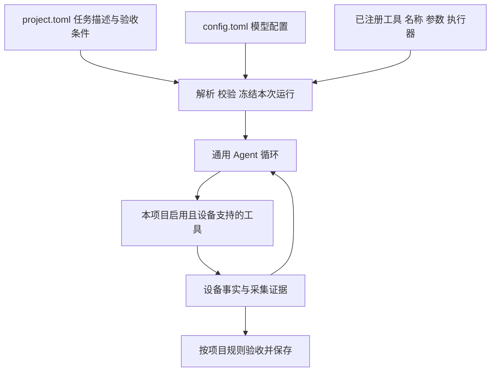
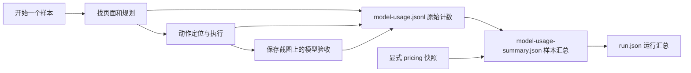
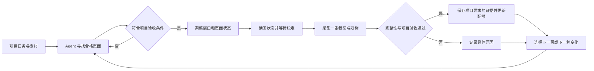
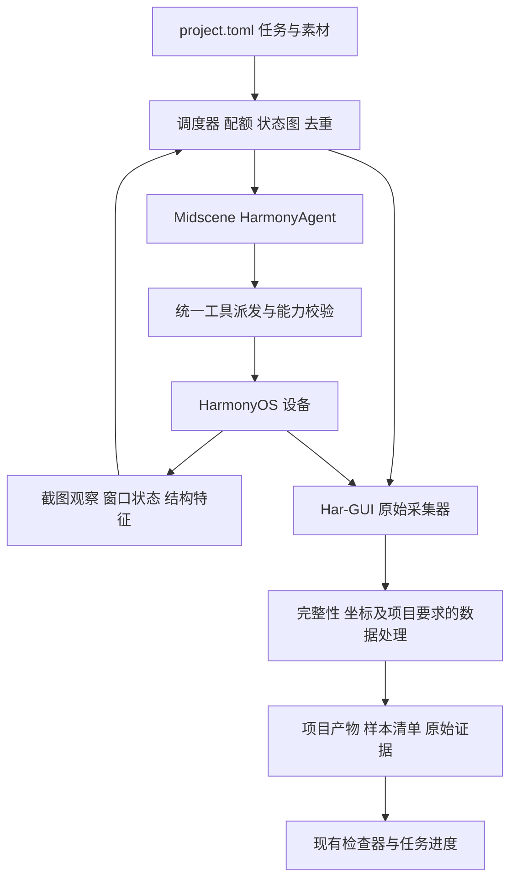
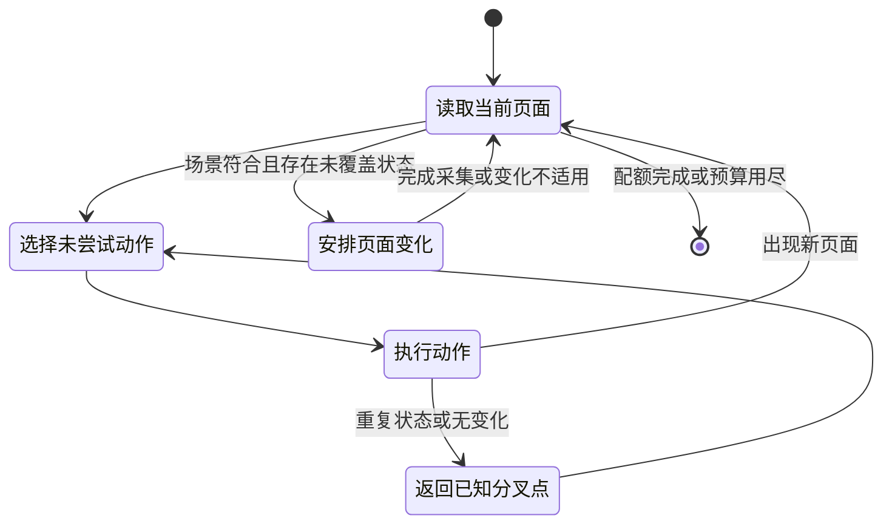
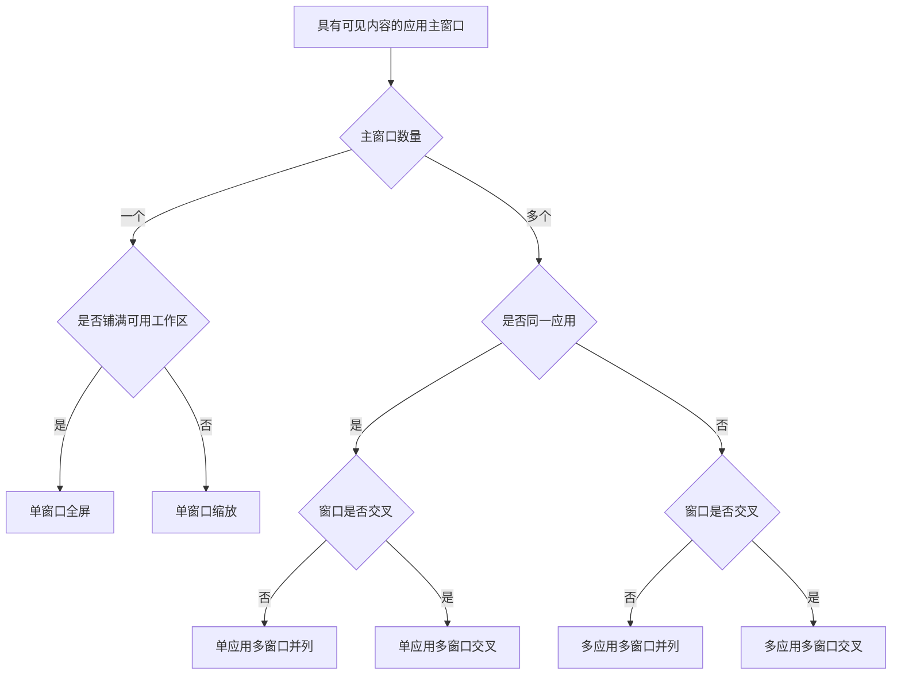

# HarmonyOS 通用场景自动化采集设计

日期：2026-10-22。状态：页面导航、窗口大小切换和单图双树采集已通过 Harmony PC 端到端验证；
移动、指定尺寸及主动遮挡的完整采集流程也已通过实机、文件完整性和视觉验收。

当前可执行配置以仓库根目录 `project.toml`、`config.example.toml` 和 README 为准。
已接入 Midscene HarmonyAgent、严格 TOML 装载、显式工具注册、窗口变化、
原始证据采集、保存截图上的视觉验收及逐次模型用量记录。下文是完整目标设计，不表示所有配置字段已可用。
当前窗口工具使用无障碍身份定位和官方 `uinput` 鼠标输入，再以 WMS 实际读回验证结果；
指定尺寸仍受应用和操作系统限制，内容缩放尚无专用工具。

系统是面向 HarmonyOS 的通用自动化采集运行器。用户在 `project.toml` 中描述采集任务，
在 `config.toml` 中配置模型，agent 根据任务自主发现应用和页面、调用工具制造变化，再采集证据。
应用、场景、数量和验收条件都来自项目，核心不包含固定应用名单或固定场景枚举。

推荐使用 **Midscene HarmonyAgent 负责找页面和操作，Har-GUI 负责采集与数据验收**。
窗口变化由确定性的操作模块执行，是否成功以设备读回的状态为准。每个正式样本只保留一张截图。

## 系统 项目与工具的边界



| 所属层 | 内容 | 增加需求时如何修改 |
| --- | --- | --- |
| 系统核心 | 任务装载、模型调用、工具派发、状态记录、执行预算、证据关联与发布 | 不根据应用名称或场景标签增加分支 |
| 采集项目 | 任务描述、应用范围、场景定义、目标数量、变化要求、验收与输出规则 | 修改 `project.toml` 及其引用的项目文件 |
| 模型部署 | 模型名称、服务地址、协议、凭据引用与模型能力 | 修改 `config.toml`；项目按模型配置名称引用 |
| 工具模块 | 查询设备、界面操作、窗口操作、采集等实际能力 | 实现工具并注册，项目选择启用；不修改 agent 主循环 |

[Issue #8](https://github.com/HoldThatThgt/LabelKit-DataSet/issues/8) 是第一个采集项目的需求来源，
用于确定首批工具和检验完整流程。它的 30 个应用、44 个组合、9 类场景、每项 200 版面，
都只是该项目的数据，不是系统能力上限，也不是系统启动时自动生成的任务清单。
另一个项目可以只描述“寻找已安装应用中的图片详情页面”，并使用完全不同的场景与数量。

系统不预设应用与场景如何组合。项目可显式声明任务，也可让 agent 在描述的范围内发现应用和页面。
每个正式样本只保存一张截图；截图、窗口事实和相应控件树的真实性与关联校验属于系统约束。
任务配额、场景语义、内容处理与导出形式属于项目约束。

## 参考 LabelKit 的配置分工

已对照本地 LabelKit 的配置模型与装载器，基准提交为 `d0afd606decbc3f4aa64c64ef5339586120c5a7a`。
复用其“部署配置与任务意图分开、按名称引用模型、启动时校验并冻结”的方式，
不复制标注专用算子、配置继承链、密钥池或旧格式兼容行为。

| 配置 | 本系统的职责 | LabelKit 依据 |
| --- | --- | --- |
| `config.toml` | `[llm.<name>]` 声明模型连接与能力，跨项目复用；不包含应用或场景清单 | LabelKit 的 `labelkit/common/config/model.py` 中 `LLMProfile` |
| `project.toml` | 描述任务、输出、模型引用、可用工具、验收和运行预算 | LabelKit 的 `docs/manual/07-project-toml.md`、`examples/ui/project.toml` |
| 装载结果 | 聚合配置错误，记录配置摘要，得到只读的本次运行配置 | LabelKit 的 `labelkit/common/config/loader.py` |

以下 TOML 是本系统拟采用的配置契约，不是现有 `capture.py` 已支持的参数。

### project.toml 描述采集任务

```toml
schema_version = 1

[run]
name = "image-detail-collection"
output = "./output"
seed = 42
max_actions = 300
max_duration_seconds = 3600

[agent]
llm = "default"

[tools]
enabled = [
  "ListApplications", "LaunchApplication", "Observe", "ReadWindows",
  "Tap", "Input", "Scroll", "DragAndDrop", "KeyboardPress",
  "MoveWindow", "ResizeWindow", "FocusWindow", "SetContentZoom", "Capture"
]

[output]
format = "capture"

[[tasks]]
name = "image-detail"
instruction = """
在已安装应用中寻找图片浏览或图片详情页面。
自主发现入口，尝试调整窗口大小、图片缩放和其他窗口的局部遮挡。
使用项目提供的测试图片；记录实际成功的变化。
"""
target_count = 24
acceptance = """
画面包含可辨认的图片主体。纯导航、加载失败和空状态不算有效页面。
同一页面的不同有效状态可保留，重复状态不计数。
每份样本必须有一张截图、窗口信息、ArkUI JSON 和无障碍控件树。
"""
```

`tasks` 是普通任务集合，名称与描述开放，不预设九类场景。
`instruction` 告诉 agent 要寻找和改变什么，`acceptance` 定义什么结果可以计数。
`target_count` 是该任务的目标有效样本数，不存在固定 200 的系统默认。
任务可选 `bundle_names` 来限制应用；不填写时允许 agent 从设备已安装应用中发现符合描述的目标。
任务可以引用项目目录中的说明、素材和结构化验收文件，引用路径显式声明，不要求长规则全部内嵌 TOML。

`output.format="capture"` 选择通用证据包；本次 Issue 项目选择实现后的 `screen_capture_spec` 导出器。
画布、场景类别、遮挡要求和正文处理规则由对应项目声明，核心不把它们固定成系统枚举。
项目可在 `[data]` 中明确 `model_inputs` 和 `processors`：前者选择允许进入模型的数据类型，
后者引用已实现并注册的数据处理函数。任务规则决定需要怎样处理，处理器负责实际执行；
不能仅把“请脱敏”写进提示词就视为已完成。工具的完整原始结果和提供给模型的结果分别记录引用。
`seed` 只约束本机调度和抽样，不承诺模型响应或实时应用内容可逐字复现。

### config.toml 配置模型

```toml
schema_version = 1

[llm.default]
provider = "openai_compatible"
base_url = "http://127.0.0.1:8000/v1"
model = "Qwen2.5-VL-7B-Instruct"
model_family = "qwen2.5-vl"
api_key_env = "HAR_GUI_MODEL_KEY"
supports_vision = true
```

该示例只是配置形状，不表示本机已部署或验证这个模型。
`agent.llm="default"` 精确引用 `[llm.default]`，同一项目更换部署只需提供另一份 `config.toml`。
模型配置名称可自定义；首版共用一个视觉模型完成规划、定位与语义判断，不先增加多角色模型路由。
需要独立判定模型时，增加明确的模型引用字段并校验，不隐式回落到其他模型。

`provider`、`base_url`、`model`、`api_key_env` 和 `supports_vision` 沿用 LabelKit 的含义。
`model_family` 是当前 Midscene 适配所需字段，用于选择框架已有的模型处理方式。
只接受当前执行框架实际支持的协议与字段；超时、输出预算、采样或 thinking 等参数要有明确的 SDK 映射后才开放，
不能接受配置却静默忽略。调用时由装载结果生成显式 `modelConfig`，不再从另一套环境变量读模型地址和名称。

模型可部署在本地或远端，系统不把部署地点固定为本地。项目的数据处理规则决定哪些内容可以进入该模型。
Issue 项目的树文本限制仍然有效，不能因为模型换成远端就改变数据处理方式。
密钥值仅在实际运行时从 `api_key_env` 指定的环境变量取得，不写入配置、快照、日志或工具结果。

### 模型用量与价格快照

当前运行器通过 Midscene 的 `createOpenAIClient` 接入点，记录实际非流式模型请求的服务商 usage。
`model-usage.jsonl` 逐次保存调用标识、请求与响应模型、起止时间、成功或失败状态，
以及输入、输出、总量、输入缓存命中和未命中的原始计数；不保存请求正文、响应正文或凭据。
请求前同步保存 `running`，结束追加同一 `call_id` 的最终记录；离线汇总按调用标识取最后状态。
缺失计数保存为 `null`，不根据工具次数、截图尺寸或其他字段推算。

可在 `[llm.<name>.pricing]` 显式配置价格快照，字段为 `currency="USD"`、
`input_cache_hit_per_million`、`input_cache_miss_per_million`、`output_per_million`，单位为每百万 token。
这些字段已实现且可省略；示例快照及来源日期见根目录 `config.example.toml`。
运行使用被冻结的价格，不自动获取最新价、推断模型价格或切换峰谷时段。
未配置时 `configured_cost=null`；配置后费用仍是估算，原样保留本次使用的单价，不称为服务商账单。
单次调用缺少计价所需的计数时，该调用和总费用均保持 `null`，失败请求也不能当作免费请求。



每个样本的统计区间覆盖导航、执行和验收，摘要通过 `call_ids` 指向运行级原始计数。
候选目录内保存 `model-usage-summary.json`；验收成功后也写入 `sample.json.model_usage`。
失败仍在 `events.jsonl` 的 `sample_usage` 中留有记录；若候选目录尚未产生，则不会伪造样本目录。
整个运行的用量和估价写入 `run.json.model_usage`。此前没有记录服务商 usage 的运行无法还原实际 token 或费用。

### 装载与运行快照

启动时完成 TOML 解析、字段与引用校验、模型视觉能力校验和工具名称解析，聚合报告错误。
未知字段、缺失模型、未注册工具和不支持的模型参数都报配置错误，不提供旧字段别名或静默兼容。
实际运行前再检查设备是否支持项目需要的能力；静态校验不操作设备、不调用模型、不读取密钥值。

项目相对路径以 `project.toml` 所在目录为基点，配置文件的相对路径以该配置文件所在目录为基点，
CLI 显式路径以调用目录为基点。CLI 只开放设备、输出位置等明确参数，不引入任意键覆盖和多层继承。
保存两份配置及引用规则的摘要、实际模型配置名称和版本、工具清单及实现版本，得到只读运行快照。
暂停恢复使用该快照；修改项目、模型或工具后开始新运行，不让正在执行的任务悄悄改变含义。

## 使用方式

用户提供项目文件、模型配置和已连接设备，并准备项目需要的测试素材与账号状态。
例如：“在华为浏览器中寻找在线文档正文，采集不同窗口大小和遮挡状态。”
网页入口和测试文件属于采集素材，agent 可以自行导航；不要求用户提供每一步操作。

运行页面显示当前应用、正在寻找的场景、已发现页面、已完成数量、正在尝试的变化与失败原因。
用户可以暂停、恢复、停止和检查样本。恢复时重新读取实际设备状态，不能接着点击上次保存的旧坐标。



## 复用现成能力

本项目只有 Pillow 这一项 Python 第三方依赖，HDC 调用、JSON、摘要、进程和文件管理已用标准库实现。
保留这些模块。Node.js 调度进程使用 `@midscene/harmony`；当前窗口操作使用官方 `uinput` 鼠标输入。
不再自写视觉定位模型、规划循环或通用跨平台驱动，也不同时引入多套 agent 框架。

| 现成实现 | 已有能力与本方案选择 |
| --- | --- |
| [Midscene HarmonyOS](https://midscenejs.com/platforms/harmonyos) | 官方集成 HDC、HarmonyAgent、自然语言操作与查询，支持自定义动作；选作界面操作框架 |
| [Open-AutoGLM](https://github.com/zai-org/Open-AutoGLM/blob/main/phone_agent/hdc/device.py) | 已有 Python HDC 动作实现，可作为行为参考；当前任务仍需补窗口变化、双树采集和配额管理 |
| [Mobile-Agent-v3](https://github.com/X-PLUG/MobileAgent/blob/main/Mobile-Agent-v3/mobile_v3/utils/harmonyos_controller.py) | 存在 HarmonyOSController；其控制层不能直接等同于本任务的桌面采集能力 |
| [Appium HarmonyOS driver](https://github.com/zhihu/appium-harmonyos-driver) | 知乎维护的真实项目，依赖 hypium-driver；本方案不叠加此驱动层 |
| [DroidBot](https://github.com/honeynet/droidbot) | 借鉴页面状态图、动作记录与路径重放，不移植 Android 运行时 |

Midscene 的 Harmony 支持不等于已经验证这台 PC 的所有窗口行为。
使用其 JavaScript SDK 接入当前 HDC 路径和设备标识；应用级动作、窗口级动作、采集动作共用一个设备执行队列。
视觉模型由 `config.toml` 提供并由项目显式引用，首版用单模型完成规划和识别。
正式运行锁定模型版本、SDK 版本和任务规则；只将配置映射到框架已有能力，不另设提供商路由层。

## 模块和运行边界



| 模块 | 责任 |
| --- | --- |
| 配置装载 | 解析两个 TOML，冻结任务、模型引用与工具清单，校验项目引用文件 |
| 调度器 | 选择尚未完成的任务、发现页面、安排变化、记录进度与预算；模型不能直接增加成功计数 |
| HarmonyAgent | 根据当前截图理解页面、定位入口、操作控件；每次只接收有边界的页面目标 |
| 工具注册与派发 | 按名称查找工具、校验参数、检查设备能力、执行并校验结果；不按应用或场景分支 |
| 窗口工具 | 移动、调整尺寸、切换前后顺序；使用具体窗口标识并读取操作结果 |
| 原始采集器 | 沿用截图、WMS、无障碍和 ArkUI 获取逻辑，保留原文、来源、时间和文件摘要 |
| 数据验收与导出 | 应用项目验收与输出规则；保证证据完整、归属正确，按项目格式发布 |
| 检查器 | 显示唯一截图、每个窗口的矩形、包名、层叠顺序和两类树，以及页面与变体关系 |

Har-GUI 继续提供本机进程接口：标准输出返回结果目录，标准错误输出英文日志，退出码表示成功或失败。
不为本机调用增加 HTTP 服务。调度器对单设备串行执行动作和采集，采集期间暂停所有 agent 输入。
状态与配额保存在同一个本地 SQLite 数据库中；JSONL 样本清单从已提交记录导出。
用现有 Python 标准库 `sqlite3` 管理事务，不引入队列服务、数据库服务器或通用工作流引擎。

设备接入类继承 `HarmonyDevice`，覆写公开的 `actionSpace()`，只提供采集任务允许的动作，
并将每个动作的执行接入同一串行队列。`RunHdcShell` 和 `Terminate` 不暴露给模型；
窗口操作与采集由受约束的自定义动作调用，模型不能绕过采集期间的输入锁直接运行命令。
`customActions` 只能增加动作，不能当作动作白名单；`waitForActionReady` 在成功执行后运行，
也不能充当执行前拦截。接入使用现有公开扩展点，不修改 SDK 或另造驱动协议。
依据：[设备源码](https://github.com/web-infra-dev/midscene/blob/main/packages/harmony/src/device.ts)、
[自定义接口文档](https://midscenejs.com/integrate-with-any-interface)。

## 工具注册与扩展

首批工具围绕当前 spec 的设备查询、页面操作、窗口变化和采集需求实现。
它们是注册表中的初始模块，不是核心里不可增加的动作枚举；场景名称也不作为工具名称。
项目只选择工具，不在 TOML 里复制工具参数 Schema、注入 shell 命令或编写执行器。

采用一个显式的本机工具注册表。每个工具模块提供以下定义：

| 字段 | 责任 |
| --- | --- |
| `name`、`description` | 稳定唯一名称，以及模型可理解的用途、前置条件和副作用 |
| `paramSchema` | 工具参数的唯一 Zod 定义，直接交给 Midscene；不另写一份可能漂移的参数格式 |
| `resultSchema` | Har-GUI 校验结构化执行结果的 Zod 定义；这是本系统的执行约定，并非 Midscene 内置字段 |
| `requirements` | 使用设备能力的明确声明，供启动检查及执行前检查使用 |
| `call(parameters, context)` | 在当前设备和运行上下文中执行，返回事实、产物引用或明确失败，不自行修改项目配额 |

复用 Midscene 的 `defineAction`、`DeviceAction` 和 `actionSpace()` 作为模型动作入口，
Har-GUI 包装器负责能力检查与结果校验。复用框架已有 Zod，不自行实现 Schema 校验器。
工具定义由代码模块显式注册，重名即启动错误；当前不增加自动扫描、热加载或插件生命周期框架。
新增工具只需增加实现、注册它并在项目中启用，参数和返回值通过同一边界。


派发时再次核对窗口是否仍存在、动作是否适用和项目数据边界。
启动已通过检查也不意味着窗口不会消失。任何失败记录英文错误与相关调用标识，
返回 `success=false` 和明确原因；已改变设备但未完成验证时标记结果不确定，重新观察后再规划。
不得为了让调用看似成功而切换备用工具或重复可能已生效的操作。

成功结果包含调用标识、工具名称、起止时间、实际观测值和证据引用。
工具结果与样本是否验收通过分开，`Capture` 返回采集事实，正式计数由项目验收与提交阶段决定。
可用工具集合为“代码已注册、项目已启用、当前设备支持”的交集；项目必需能力缺失必须明确报告，
不能悄悄完成一个删减后的任务。具体窗口的能力在该次调用前检查。

Midscene 的 `call` 返回值主要用于执行记录，不能假定返回 JSON 就自动进入模型上下文。
包装器在结果校验后，根据项目数据规则生成有界摘要，通过 `context.task.planningFeedback`
送入后续规划；大树保留为本地产物引用，不直接塞进反馈。容量不够时明确标记摘要范围，不能截断窗口标识等必需字段。
`planningFeedbackMaxLength` 使用已核对的框架选项，反馈预算纳入工具定义与运行快照。
依据：[Midscene 自定义动作反馈](https://midscenejs.com/integrate-with-any-interface)。
反馈在当前动作批次结束后进入下一轮规划，不会改变同一批次已生成的动作参数。
依赖查询结果的动作必须在之后的规划轮生成；执行器拒绝基于过期观察或尚未返回目标的操作。

### 首批工具清单

下面区分已注册工具和后续接口；实际可用名称以 `npm run agent -- tools` 为准。
`target` 包含最近一次观察标识和该观察中的目标坐标或控件引用；执行前校验，避免使用旧坐标。
所有依赖界面状态的调用都由派发器绑定规划开始时的观察标识，放入只读执行上下文，
包括只显式接收 `window_id` 的窗口工具。执行前核对设备、显示器、窗口所属进程、会话身份和相关状态，
不能只检查窗口 ID 仍存在，也不能在执行时把旧调用重新绑定到最新观察。
窗口重建、ID 复用或此前动作改变了目标状态时拒绝执行，让 agent 根据新观察重新规划。

| 工具 | 参数 | 结果与边界 |
| --- | --- | --- |
| `ListApplications` | 可选 `query`、`offset`、`limit` | 分页返回实际安装包和用户标识；不内置 Issue 应用名单 |
| `LaunchApplication` | `bundle_name`、可选 `ability_name` | 从设备包元数据解析真实入口并核验启动结果 |
| `ReadWindows` | 无 | 显示器零的当前观察标识、窗口身份、包名、边界、z_order 与焦点 |
| `Tap`、`DoubleClick` | SDK 定位参数 | 点击执行结果；沿用 Midscene 输入定义 |
| `Input` | `locate`、`value` | 输入结果；使用 Midscene 原生命名 |
| `Scroll` | `target`、`direction`、`distance` | 滚动后实际状态，不承诺加载了多少条内容 |
| `DragAndDrop` | `from`、`to` | 拖动执行结果；使用 SDK 支持的参数，不把触摸拖动等同于窗口 resize |
| `KeyboardPress` | `keyName` | 按键执行结果；使用 Midscene 原生命名与设备支持的键值 |
| `ToggleWindowSize` | `window_id` | 使用唯一可操作的系统 `EnhanceMaximizeBtn` 切换最大化或还原，再核验 WMS 边界变化 |
| `MoveWindow` | `window_id`、`x`、`y` | 移动浮动窗口，连续两次读回请求的精确矩形 |
| `ResizeWindow` | `window_id`、`width`、`height` | 调整浮动窗口宽高并保持左上角，连续两次读回请求的精确矩形 |
| `OccludeWindow` | `window_id`、`target_window_id`、`x`、`y` | 移动前景窗口，验证它与目标窗口不同、z_order 更高且形成部分矩形交集 |
| `Capture` | `page_name`、`variation` | 调用当前任务的单图双树采集；样本经完整性与视觉验收后计数 |

以下接口尚未注册，不可写入当前项目的 `tools.enabled`：

| 后续工具 | 目标职责 |
| --- | --- |
| `Observe` | 如需开放为显式工具，返回内存截图与观察引用；当前观察由运行器和 SDK 执行 |
| `ReadAccessibility`、`ReadArkUI` | 提供独立查询及受项目数据规则约束的结果摘要；当前两类树在正式采集中读取 |
| `FocusWindow` | 单独聚焦并核验焦点和层叠顺序；当前遮挡工具只验证自身拖动后的层叠关系 |
| `SetContentZoom` | 操作可验证的应用内容缩放控件，并保存真实缩放证据 |

例如，新增“旋转屏幕”需要一个新的设备工具模块；新增“日历周视图”场景通常只需要新的项目任务。
如果以后接入独立进程或第三方服务，再采用成熟协议实现工具模块，不先为假设中的工具搭建服务框架。
无论工具来自何处，都经过相同的参数、能力、执行记录和结果反馈边界。

## Agent 如何自己找页面

应用清单从实际设备读取，在项目指定范围内匹配目标；未限定包名的任务按描述自主发现目标应用。
记录实际 bundle name、应用版本和可启动 Ability。
不得统一假设启动入口叫 `EntryAbility`。[官方 bm 工具](https://github.com/openharmony/docs/blob/master/zh-cn/application-dev/tools/bm-tool.md)
提供应用信息查询依据。

Agent 维护页面状态图：节点是观察到的页面，边是实际执行的点击、滚动、输入或返回。
每条边保存动作目标、执行结果、起止时间和前后状态标识。成功导航保存为可重放路径；
重放时重新定位目标并检查页面身份，不复用失效窗口 ID、节点 ID 或坐标。



结构化候选来自本地提取的类型、边界、启用状态、可点击性和滚动能力；是否提供文本按项目数据规则决定。
Issue 项目禁止树文本进入规划输入。视觉模型从允许提供的当前截图理解页面。
优先尝试未访问入口和未探索滚动区域，中间导航页是否属于采集目标也由项目验收条件决定。
按照 [DroidBot 的状态图实现](https://github.com/honeynet/droidbot/blob/master/droidbot/utg.py)
记录已尝试动作，防止只在同几个入口间循环。

任务开始时确定动作次数、模型调用量与最长运行时间预算。连续无变化达到任务上限后返回已知分叉点；
预算耗尽则明确报告尚缺版面，不以重复截图填满配额。应用未安装、未登录、没有测试素材分别记录原因。
运行按项目声明的数据与动作范围执行；Issue 项目要求使用测试素材。
发送消息、邮件、提交表单和删除内容不属于“寻找页面”的隐含动作。

## 项目验收与首个项目的场景规则

运行器从当前项目读取任务描述和完整验收规则，不能只用场景名称提示模型。
判定结果包括场景、主内容区域、支持证据与排除项；证据指向本次截图区域及本地树节点位置。
模型负责语义判断，程序检查任务匹配、证据边界、明确的排除项和数据完整性。
语义不确定的样本进入待复核队列，不计入已完成数量。

下面的场景表仅描述 Issue 项目的规则示例。对应九个标签只进入该项目的任务与规则文件，
不进入系统核心的枚举或提示词。该项目引用的原始规格未附在 Issue 中，以下以已读取的 Issue 正文为依据。

| 场景 | 必须落实的边界 |
| --- | --- |
| 通讯页面 | 消息正文与输入区；会话列表、通讯录、评论区不计入 |
| 邮件页面 | 阅读正文或写信正文；邮件列表、主题输入行、账号设置不计入 |
| 文档页面 | 文档、笔记、PDF 正文与表格数据；非浏览器评论区不计入 |
| 文管目录页面 | 文件列表、文件夹列表、文件图标；导航与工具栏不计入 |
| 浏览器在线文档 | 在线文档或表格的数据与编辑区域；文件列表和格式工具栏不计入 |
| 浏览器评论区 | 实际用户评论内容；单独的操作按钮行与发帖输入区不计入 |
| 浏览器表单 | 实际可填写区域；登录注册、搜索、地址栏、AI 对话框不计入 |
| WPS编辑区域 | 保留 Issue 的按应用判定例外，WPS 文件管理等界面也可计入 |
| 新闻资讯 | 正文与资讯内容；个人主页、设置、搜索、登录和引导区不计入 |

通用的“排除设置和空白页”不能覆盖 WPS 例外；在线文档允许的空白编辑页也不能被一律过滤。
Issue 对小红书正文在文档与资讯规则中存在交叉描述，而配额表只给小红书分配新闻资讯任务。
该项目以任务行约束可计入场景，同一帧不重复计数；仍无法确定主功能时交给复核。
在该项目中，一个版面表示一次合格整屏状态，多应用同屏帧计入一条主任务，其余应用作为上下文保存。
这是项目的建议计数口径，不限制其他项目定义不同的任务归属与计数规则。

## 页面变化与实际验收

先找到页面，再安排变化。变化任务记录预期值与设备实际值，实际值没有变化则不产生新样本。
窗口尺寸改变、内容缩放和系统显示缩放是三个不同因素，图像处理软件缩放 PNG 不算其中任何一种。

| 变化 | 操作方式 | 成功证据 |
| --- | --- | --- |
| 窗口大小 | `ToggleWindowSize` 还原；`ResizeWindow` 用官方鼠标输入拖动右下边框 | WMS 连续两次达到指定矩形；页面仍符合目标场景 |
| 窗口位置 | `MoveWindow` 从当前无障碍树定位系统标题栏并执行鼠标拖动 | WMS 连续两次达到指定矩形；整个窗口位于屏幕内 |
| 内容缩放 | 尚无专用工具；拟操作应用实际提供的缩放菜单、按钮或快捷键 | 可读缩放值或可验证布局变化；记录无法读取数值的原因 |
| 滚动和展开 | 滚动内容、展开区域、切换正文视图 | 内容状态或结构发生有效变化，而非仅改变焦点 |
| 遮挡 | `OccludeWindow` 将另一真实应用窗口移到指定位置 | 两个窗口不同，前景 z_order 更高，目标矩形交集比例严格大于零且小于一 |
| 前后顺序 | 聚焦指定窗口 | WMS 中实际层叠顺序改变；不能只记录 click 成功 |
| 同应用多窗口 | 操作应用提供的“新窗口”或独立文档窗口入口 | 相同 bundle name、不同主窗口标识；不以菜单或对话框凑数 |
| 多应用并列 | 打开并排列两个以上应用窗口 | 不同 bundle name，主要窗口矩形不交叉且内容区域可见 |
| 系统显示缩放 | 单独安排设备显示配置任务 | 显示配置和坐标映射重新验证后开始一批新采集 |

当前设备已经确认 `/bin/uinput` 支持官方鼠标拖动，命令为
`hdc -t <serial> shell uinput -M -g <x1> <y1> <x2> <y2> <duration_ms>`。
坐标使用屏幕物理像素；当前执行器固定使用 800 毫秒拖动，不向模型公开任意 shell。
参见 [官方 uinput 文档](https://github.com/openharmony/docs/blob/master/zh-cn/application-dev/dfx/uinput.md)。
官方 [UiWindow 操作实现](https://github.com/openharmony/testfwk_arkxtest/blob/master/uitest/core/window_operator.cpp)
同样通过标题栏或边框拖动完成移动和调整尺寸；当前采用已在这台 PC 验证的原生鼠标路径，
不要求额外部署 TestKit 运行器，也没有直接设置任意窗口矩形的隐藏接口。

移动、调整尺寸和主动遮挡要求被拖动的普通应用窗口处于浮动模式，即 WMS `window_mode=102`。
目标边界必须完整位于当前物理屏幕内。移动通过 `hostWindowId` 与可见的 `containerModalButtonRowId`
定位唯一 `ContainerModal` 祖先，再验证包含按钮行的首个直接 `Row` 是系统标题栏。
拖动点为窗口左侧向内 30 像素、标题栏中线，必须位于可见边界内且避开按钮行；不按应用标题猜测位置，
也不要求最大化按钮存在。调整尺寸使用当前 WMS 右下角，执行前拒绝起点被另一普通应用窗口覆盖。

工具保存操作前身份和矩形，执行后要求 WMS 连续两次读回请求的精确矩形，并核对进程、包名、会话节点与显示器。
窗口消失、身份改变或系统尺寸限制使请求未实现时中止，记录实际值；不接受近似尺寸，不换工具或补做其他拖动。
命令退出成功不能替代这些状态验证。应用最小尺寸、最大尺寸和可调整能力仍由系统约束。

2026-10-22 的独立实机验证将设置窗口从 1596×1468 调整为 2000×1500，随后移动到 `(500, 200)`，
两步均取得精确匹配的 WMS 结果。`examples/window-occlusion.project.toml` 使用设置与计算器，
组合指定尺寸、位置、部分遮挡和单图双树采集；完整 agent 流程已通过验证。
成功运行 `2026-10-22T11-10-57-580Z-c150a543-232a-4fba-bcfc-2b36a4401ea6` 中，
agent 将设置窗口改为 1950×1480 并移动到 `(400, 180)`，计算器移动到 `(750, 320)`；
最终矩形重叠比例为 74.29%，两者 z_order 分别为 112、113。
本次页面已打开，保存了设置、计算器、小红书和 Dock 的双树，以及唯一截图。
十次实际模型请求的低峰估算为 $0.004413528，完整样本流程耗时 132.444 秒；
费用取决于页面探索步数和缓存命中，详细来源、失败运行及未知用量保留在费用报告中。

`aa start` 的位置、尺寸参数受 2in1、开发者模式和目标应用调试签名限制，不能作为任意商用应用的统一方法。
参见 [官方 aa 文档](https://github.com/openharmony/docs/blob/master/zh-cn/application-dev/tools/aa-tool.md)。
Midscene Harmony 的 Pinch 能力与官方 TestKit 多指能力也不能混为一谈；应用缩放优先走可见的应用控件。

变化按“页面基准状态 → 一种变化 → 验收 → 恢复基准状态”执行，避免连续修改后不知道当前状态的来源。
尺寸、遮挡位置、前后顺序分别覆盖后，再补有效因素组合。采用
[组合测试的成对覆盖原则](https://csrc.nist.gov/projects/automated-combinatorial-testing-for-software/faqs)
控制组合数；不要求对每页穷举所有组合。
只报告实际完成的覆盖，不把不支持多窗口的应用计为已覆盖同应用多窗口。

## 首个项目的窗口模式与通用几何工具

Issue 的六类 `window_mode` 是整屏分类，不能直接复制 WMS 每个窗口的数值型 Mode。
六类标签与分类规则属于这个项目的验收和导出函数；窗口矩形、所属关系、焦点与层叠顺序是通用工具返回的事实。
先通过会话信息区分系统窗口和应用主窗口，记录弹窗的所属关系；Dock、输入法等仍保留在整屏证据中，
但不作为单独应用参与六类模式计数。

模式计数使用应用主窗口集合，双树导出使用全部可见应用窗口集合。
可见子窗口和对话框即使不参与模式计数，也必须保留窗口元数据和对应的两类树。
`isSystem` 只能区分系统会话，主窗口判定和父子归属还必须读取经过验证的窗口类型与所属关系，
不能仅凭这个布尔值或名称推断。



把铺满工作区的最大化窗口归入“单窗口全屏”是本方案建议的分类口径；原生全屏状态另存，
不能仅凭矩形把最大化和原生全屏当成同一操作。无主窗口、窗口归属不明和无法判定可见性的情况不强塞入六类。
Issue 未附“有效窗口”原文，弹窗归属和上述全屏口径需在正式验收规则中明确。

当前 `OccludeWindow` 返回指定前景窗口与目标矩形的交集面积除以目标面积，字段为
`bounding_box_overlap_fraction`，并保存两个窗口标识与 WMS 的 z_order。
后续如需评估多个前景窗口的总遮挡率，应使用裁剪到显示器内的交集并集，避免重叠区域重复计数。
两种结果都必须标注为矩形几何估计。
透明区域、圆角、阴影、系统浮层和变换使它不等于真实遮挡像素；这类状态不能用几何估计冒充像素真值。
完全遮挡导致目标树不可读时，本次变化不计入合格样本，绝不复用遮挡前的树与新截图配对。

## 一张截图如何与窗口和树配对

正式样本调用一次 `screenCap`，随后顺序读取窗口、无障碍树和 ArkUI。
统一的 `capture_id` 表示同一次采集，保留每个通道的起止时间与原始文件摘要。
系统接口不提供原子快照，因此即使成功也保持 `consistency.atomic=false`。

进入正式采集前暂停操作，通过轻量 WMS 与结构观测检查稳定性，必要的视觉观察只在内存中保留。
可以复用 Pillow 的 [ImageChops.difference](https://pillow.readthedocs.io/en/stable/reference/ImageChops.html)
检查变化；比较间隔、阈值和允许的动态区域必须写入任务记录，不能据此宣称逐像素原子一致。
正式采集之后只复查窗口列表、矩形、层叠顺序和页面结构，**不增加第二张正式截图**。
若状态发生变化，则整次样本作废并以新的 `capture_id` 重采，不覆盖旧树或拼接两次采集。

导航观察不计作数据集帧，截图不写进任务报告或历史图片目录；临时设备文件在接收后清理。
Midscene 使用 `generateReport=false`、`persistExecutionDump=false`、关闭缓存及图像调试落盘，
防止框架默认报告另外保存步骤截图。接入时检查 SDK 的全部文件产物，包括内嵌 base64 图像。
这些选项与动作后的 `waitForActionReady` 钩子见 [Midscene API](https://midscenejs.com/reference/)。

仅关闭报告不足以保证观察图片不落盘。当前
[HarmonyDevice 截图实现](https://github.com/web-infra-dev/midscene/blob/main/packages/harmony/src/device.ts)
会创建设备端 `ms_screen.jpeg` 和本机临时 JPEG。
同一设备接入类必须覆写公开的 `screenshotBase64()`，使用 Har-GUI 管理的唯一临时路径获取观察图，
读取到内存后在 `finally` 中清理主机和设备文件，清理失败记录错误并停止继续观察。
不调用默认截图实现后再假定文件已被删除。正式 PNG 仍只由原始采集器生成。

## 通用采集证据与首个项目的五件套

当前 Har-GUI 已产出唯一截图、原始 WMS、无障碍树和逐窗口 ArkUI JSON；
这是通用采集证据底座。五件套是 Issue 项目的命名、聚合和导出要求，不固定为所有项目的输出格式。
核心通过样本标识、产物类型、路径、摘要、时间、来源与窗口关联保存证据；新增工具可以追加新的产物类型，
不改变唯一截图与已有窗口、树的对应关系。导出器从已校验的证据生成项目要求的文件，不重新采集。

项目通过 `output.format` 选择显式注册的导出器，按同一输入契约消费证据并返回最终产物清单。
增加特殊导出格式只增加导出模块；agent 主循环不识别五件套文件后缀。
当前工具还没有 Issue 要求的导出器。下面的目录和字段是该项目拟采用的输出契约。
正式样本的截图从采集暂存区移到最终文件名，不在证据目录复制另一张 PNG。

```text
dataset/
  manifest.jsonl
  run.sqlite
  samples/<样本标识>/
    {App}_{页面ID}_{场景}_{状态序号}_tree.json
    {App}_{页面ID}_{场景}_{状态序号}_windows_tree.json
    {App}_{页面ID}_{场景}_{状态序号}_windows_akui.json
    {App}_{页面ID}_{场景}_{状态序号}_shot.png
    {App}_{页面ID}_{场景}_{状态序号}_wms.json
  evidence/<样本标识>/
    metadata.json
    commands.json
    windows.txt
    session-details.txt
    accessibility.json
    layout.json
    arkui/
  rejected/<采集标识>/
    error.json
```

文件后缀 `_windows_akui.json` 保持 Issue 的拼写，正文概念统一称为 ArkUI。
`App` 使用主任务的应用名称，多窗口中的其他应用仍完整记录在窗口列表中。
页面 ID 在本次任务库中分配，状态序号仅用于命名，完整身份和摘要保存在样本清单中。

| 文件 | 明确的生成规则 |
| --- | --- |
| `_tree.json` | 将本次系统实际返回的无障碍窗口数组置于明确标注为派生节点的显示器根下，保留应用与系统窗口和原始顺序 |
| `_windows_tree.json` | 按已确认的可见应用窗口集合，从同次无障碍数组取树；每项包含 window_id、bundle_name、z_order 和 root |
| `_windows_akui.json` | 合并同一集合的逐窗口 ArkUI JSON；保留源文件、原始属性与节点顺序，禁止以 SceneBoard 总树替代目标应用树 |
| `_shot.png` | 本次唯一截图，正文打码只修改该图中的敏感区域；不输出未打码副本 |
| `_wms.json` | 包含整屏 window_mode 和 app_windows；另保留 WMS 的完整窗口表、窗口身份、几何、变换和缺树状态 |

四份 JSON 均带相同的采集标识和坐标说明；PNG 通过相同前缀和 manifest 中的 SHA-256 配对。
manifest 每行记录任务、样本标识、页面 ID、父样本、变化预期与实际值、场景判定、应用版本、
可读页面名、导航路径、设备信息、通道时间区间、五件套路径与摘要、脱敏区域、验收结果及规则版本。
动作日志保留结构化操作记录和失败原因，不把树正文或输入正文写入日志。

改名、移动或打码后，导出器重新计算最终 PNG 的摘要，并更新正式元数据中的唯一截图路径。
采集时的原始截图摘要只保留在来源记录中，不再作为可打开文件的引用。
正式数据检查器按产物清单读取唯一 PNG 和最终摘要，不依赖具体项目的文件名或五件套后缀；
不能通过保留第二张 PNG 或旧格式兼容分支解决路径变化。

“整屏无障碍树”指系统返回窗口的整屏组合，不代表获得了每个应用的所有内部节点。
当前 `-i` 输出也不能宣称是全部原生无障碍字段。WMS 前景列表包含被完全遮挡的窗口，
不能把 `z_order >= 0` 直接等同于可见应用集合。
该项目发布前必须核对有可见内容的应用窗口都具备两类树；缺失或可见性不明进入失败或复核记录，
不凭截图生成替代树，不从包名猜窗口归属。

普通应用的 WebView、Canvas、自绘界面可能只有少量宿主节点。
保留系统实际暴露的结果，并记录目标内容区域的树覆盖限制；如果训练要求正文级节点而接口不提供，
该页面不能按“完整内容控件树”验收。取得 ArkUI JSON 文件与取得完整内容语义是两件不同的事。

## 坐标与去重

通用工具读取设备的实际画布和坐标单位，不在核心中固定宽高。
当前设备截图为 3120 × 2080 像素，Issue 项目以同尺寸、同原点的画布建立一一对应映射。
这是该项目的导出坐标约定，分辨率相同不能证明系统的逻辑单位或 vp 与像素天然相等。
无障碍 bounds 已处于显示器坐标；WMS 矩形、变换、树边界分别保存。
ArkUI `FrameRect` 是局部布局值，不能给所有节点简单加窗口左上角就当成屏幕边界。
必须验证父子变换、滚动和裁剪后才能输出节点的整屏边界；无法证明的节点保留原值并标注坐标不可用。
要求所有节点均具备整屏坐标的训练任务应据此拒收，不能把当前原始 ArkUI JSON 直接称为坐标合规。

通用采集器可以读取其他设备的原始画布；Issue 任务在画布不符时停止接收样本。
其他项目可直接使用设备原始分辨率。项目若要求转换画布，必须选择实际实现并验证的坐标转换处理器，
同时变换截图与全部可用屏幕坐标，并保留变换矩阵；不自动拉伸截图满足规格。

页面结构签名用类型、稳定资源标识、父子关系和顺序计算，去除文本、运行时节点标识、PID、时间和绝对位置。
以无障碍结构为页面分组依据，ArkUI 结构作为附加特征；两类树分别计算，不能混成一个不透明摘要。
签名相同表示结构近似，不保证内容相同；阅读不同文档或滚动到新内容可属于同页不同状态。

样本去重在同一任务和页面组内进行，综合实际窗口模式、矩形、遮挡关系、内容缩放、
展开或滚动状态、非文本结构与脱敏后的图像差异。原始文件 SHA-256 只负责完整性，
时间戳、随机 ID、光标闪烁和系统时钟变化不能让重复样本成为新状态。
批次报告同时给出独立页面组数、状态数和每页状态分布，防止用一个页面的轻微抖动填满目标数量。
每页可接受的状态数量与去重判据属于项目规则。Issue 项目没有规定每页最多保留多少状态，
不能擅自将其 200 版面目标解释为 200 个独立页面。

## 数据处理与失败恢复

数据处理器按项目规则作用于每次观察、采集与导出，处理结果可检查，不能只依赖 LLM 的承诺。
以下为 Issue 项目的处理要求：使用测试账号与脱敏素材，聊天和邮件正文在本地定位区域后覆盖打码，记录矩形与处理方式。
正文区域定位不确定时不发布样本；自动打码的抽检结果计入质量报告，模型自称完成打码不算验收证据。
截图打码不得改变几何，树文本则保留在受限的本地训练数据与证据目录，不进入 agent 提示、外部服务或公开检查器。

该项目只向所选视觉模型提供数据规则允许的截图与必要的非文本窗口信息，原始树文本不外发。
模型部署由 `config.toml` 决定，输入允许范围由项目决定；不满足项目数据规则的组合在运行前报错。
导航帧和失败帧也执行同样的数据边界。正式 PNG 只保存打码后的一个版本，未打码像素仅在临时处理期间存在。
如需对外提供检查页面，只从已脱敏导出构建，不把原始树内嵌到可分享 HTML。
现有原始检查器继续用于本机诊断，不直接作为对外数据交付页面。

采集失败保留原因和必要原始树证据，但不计配额。窗口消失、PID 改变、原始导出未刷新、
树归属冲突、缺必需树、状态变化和坐标不符分别记录英文错误代码。
修复原因后重新观察并开始一条新采集，不能重新使用上次的树文件。

正式发布先在暂存目录验证项目要求的产物，再原子重命名目录并将样本登记到数据库事务。
进程崩溃后按采集标识核对已发布但未登记的目录，校验通过后补登记；
未发布目录只作为未完成记录，不增加配额。这是正常运行的恢复流程，不读取或转换旧版本采集格式。
停止任务时保存当前工作进度与窗口实际状态；恢复基准窗口布局失败时明确报告，不强制关闭用户窗口。

## 最小端到端实现与验收

先用一个最小 `project.toml` 和一个模型配置打通真实场景，再增加工具和项目规模。
建议用浏览器测试文档项目验证找页面、窗口变化与双树采集，再切换到不属于 Issue 范围的图片详情项目，
验证只改项目配置即可工作。另增加一个独立工具模块，验证启用新工具不需要修改 agent 主循环。
Issue 的五件套通过项目导出模块验收，不作为所有项目的固定发布步骤。
当前窗口操作已采用实机验证的官方 `uinput` 路径；每次仍检查具体窗口的浮动模式、起点与实际读回结果。

| 阶段 | 完成条件 |
| --- | --- |
| 单场景闭环 | 找到正文、真实变化、恢复基准、单图双树保存、无失败样本混入成功集合 |
| 配置分离 | 同一项目可切换模型配置，同一模型配置可运行不同项目；模型参数没有埋入项目规则 |
| 数据契约 | 通用证据关联、坐标、原文追溯、状态去重、崩溃恢复通过验收；特殊命名与打码按项目验证 |
| 工具扩展 | 增加工具实现并注册即可启用；未知工具、参数错误、能力缺失和无效结果明确失败 |
| 多场景探索 | 复用同一循环加入任意项目的规则、素材和配额，不为每个应用重写采集器 |
| 正式采集 | 按当前项目的任务和目标数量报告完成数与缺口；Issue 项目可声明其 44 条任务及各 200 版面的目标 |

验收必须包含重启应用后的路径重放、同应用多窗口、不同应用遮挡、完全遮挡缺树、动态页面、
树导出期间窗口变化、正文打码遗漏检测、重复页面不同状态，以及中断后不重复计数。
这些是完整方案的验收要求，不能由已通过的设置页面和主动遮挡样本推断全部完成。
当前 agent 已运行显示设置、声音设置与主动遮挡任务，均完成端到端验证。

当前单截图采集已在真机验证，设置与 Dock 分别取得 1664 和 740 个 ArkUI 节点，
以及 612 和 211 个无障碍节点；这些只证明当前两个窗口的采集链路有效。
两份配置装载、工具注册与反馈、自主页面导航、样本验收和模型用量记录已经接入。
窗口移动、指定尺寸与主动遮挡已实现；内容缩放专用工具、五件套导出、自动脱敏及完整去重恢复机制仍属后续工作。
