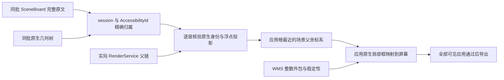

# 精确窗口映射与证据边界

正式应用 ArkUI 坐标使用同批 SceneBoard 的浮点变换及实际 RenderService 父链。
WMS 继续提供窗口身份、模式、层级、稳定性与整数外包校验，不再把其比例当作精确绘制缩放。
缺少完整来源或无法证明映射时拒绝导出。

## 为什么整数窗口边界不能直接用于控件映射

官方 [FillWindowSceneInfo](https://github.com/openharmony/arkui_ace_engine/blob/21b150e7bb1d5308846f8e5be8ef0482fb433315/frameworks/core/components_ng/pattern/window_scene/scene/window_scene_layout_manager.cpp)
取全局外包矩形，并以外包宽高除以逻辑尺寸得到 WMS 比例。
[RenderService 外包实现](https://github.com/openharmony/graphic_graphic_2d/blob/c19cedf62fefde6bf184aa815feeaf0346aa4d49/rosen/modules/render_service_base/src/common/rs_obj_abs_geometry.cpp)
对边界向外取整；这个整数矩形不包含精确浮点变换。

冻结 UC 兼容最大化证据中，SceneBoard 原点为 `203.30`、逻辑宽度为 `2048`，
实际缩放为 `0.876682`，屏幕右边界约为 `1998.744736`。
WMS 输出整数原点 `203`，其横向比例 `0.876953` 对应整数外包宽 `1796`。
正确控件映射宽度为 `1795.444736`，不能拿整数外包宽替代，也不能只扩大原点校验阈值。

## 当前来源与验证流程

采集器复用已经取得的完整系统原文与原生几何，不新增设备命令。
每个窗口的 `trees.arkui.coordinate_evidence.scene_sources` 明确记录真实来源窗口、进程、显示器，
以及完整原文和原生几何的文件名、字节数、SHA-256。
同一批次共享文件只读取、核验和建立原文索引一次。
来源窗口可以与首次请求几何的窗口不同；记录保留两者的真实文件归属。

装载器按 `compid=session<窗口ID>` 和 `AccessibilityId=uiNodeId` 选择唯一完整父链。
逐层验证原生节点的类型、标识、父关系、组件身份与浮点矩形，并保留源文件行号。
随后将实际 RS 祖先与这些节点关联，验证屏幕、显示器、父链顺序、局部矩形和变换打印区间。
普通应用的渲染标识不能冒用 SceneBoard 节点。

普通应用使用实际应用根最近的场景父坐标系，包含 session 之下应用 Surface 的偏移与缩放，
并核验其视口尺寸。应用自身的局部根偏移照常参与变换。
系统窗口已在场景屏幕空间，使用其场景父变换进行原生交叉核验，不重复缩放。
每个 Frame 的 `geometry.source.window_mapping` 保存来源文件及 session、viewport、显示器和屏幕标识。
外层裁剪按实际 RS 节点身份使用同一精确矩形，保留圆角和内容裁剪的来源。

普通已挂载 Frame 也交叉核验局部矩形、Scale、Translate 以及影响几何的 Pivot。
打印数值以各自明确的小数精度区间交叉核验；原生投影和裁剪的既有误差阈值未扩大。
Skew、Persp、未知裁剪和活动动画继续拒收。

## WMS 比例的发布语义

WMS 比例还可能保留旧值，不能要求每次移动后都精确等于当前整数外包宽除以逻辑宽。
官方 [UpdateScaleInner](https://github.com/openharmony/window_window_manager/blob/8b0d8fe1b973d865904c942c286b3d2a3b9b08e7/window_scene/session/host/src/scene_session.cpp#L9559-L9566)
在无需更新变换时保留存量比例；
[IsTransformNeedUpdate](https://github.com/openharmony/window_window_manager/blob/8b0d8fe1b973d865904c942c286b3d2a3b9b08e7/window_scene/session/host/src/layout_controller.cpp#L253-L259)
使用 [float NearEqual 的 `<=0.001f` 门槛](https://github.com/openharmony/window_window_manager/blob/8b0d8fe1b973d865904c942c286b3d2a3b9b08e7/window_scene/interfaces/include/ws_common.h#L780-L783)。

本次 UC 从 `(203.3,203.3)` 移到 `(300,300)`，SceneBoard 精确尺寸保持
`1470.885888×1601.59938`，当前整数外包宽从 `1472` 变为 `1471`。
WMS 仍发布 `0.71875`，对应旧的 `1472/2048`；与当前 `1471/2048` 的差为 `0.00048828125`，
符合官方保留规则，冻结开始与结束的 WMS 也一致。

核验现在在归一化比例空间执行官方 float32 门槛，并计入实际 WMS 输出精度。
屏幕几何仍完全来自同批 SceneBoard、原生几何与真实渲染父链，
不拿 WMS 比例重建坐标；逻辑尺寸、整数原点、原生投影、裁剪与身份校验保持原要求。

## 非渲染节点

实际 RS 父链不能跳过已挂载的场景 Frame。
缺失 Frame 只有在明确懒加载未物化或位于独立未挂载树、且其局部仿射变换严格恒等时才可省略。
它们不贡献屏幕变换；未挂载节点的无效 Bounds 不作为活跃几何，也不改读待应用属性代替它。

部分零面积节点仍挂在 RS 树上，官方 Bounds 和 Frame 均为 `-inf`。
只有原始与原生投影均零面积、实际 RS 无子节点、`hasDrawContent=0`、
`hasChildrenDrawContent=0` 同时成立时，才保留其原生框并标记 `rendered=false`。
这证明没有绘制，不表示 PrepareSeq 为零。正面积、存在子节点或缺少绘制证据时继续拒收。
负尺寸占位框只在原文与 RS 局部值一致、明确无绘制且没有 RS 子节点时保留其原生四角包围框。

## 接口与现有采集

`scene_sources` 是新采集必须提供的证据。缺失、摘要不符、跨进程或跨显示器、重复目标、
重复渲染标识和原生父关系冲突均拒收，没有 WMS 近似映射或旧格式兼容路径。
现有失败采集与正式样本保持原样；独立离线重放结果不会把历史失败改成正式成功。

所有可见应用继续参与验收。窗口映射通过不代表整帧可交付：任意背景应用的原文与原生树覆盖不一致，
仍会阻止五件套准备与配额登记。截图和树仍顺序采集，前后稳定性检查不等于硬件原子快照。

打码开关继续位于 `project.toml` 每个任务的 `privacy.enabled`。
关闭时保留原图，开启时按声明区域处理；原始双树保留，开关不改变坐标和全窗覆盖门槛。

## 本次验证结果

| 证据 | UC Frame | 全部可见应用 | 交付状态 |
| --- | --- | --- | --- |
| 冻结兼容最大化帧 | 113/113 | 7/7 个窗口、696/696 个 Frame 通过 | 只读离线验证，历史失败保持不变 |
| 冻结还原帧 | 113/113 | 7/8 个窗口通过 | 背景百度窗口原文与原生树集合不一致，继续拒收 |
| 新独立还原帧 | 113/113 | 7/8 个窗口通过 | 原始采集、覆盖与稳定性通过，本地准备被同一百度窗口拒绝 |

新帧标识为 `20261022T202959.706021Z-00411e48`。
两份还原帧中的百度窗口均为原生独有节点 `2457,2551,2645`，不能靠排除该窗口完成交付。
本轮没有正式发布、配额变化、模型请求或窗口输入操作。
冻结最大化证据的独立副本在补入明确来源引用后，也通过原始证据复核、五文件导出和导出后复核。
这个副本仅用于离线接口验证，不是新真机成功采集，也没有修改原来的失败目录或收据。

UC 最大化后的精确框为 `(203.3, 0, 1795.444736, 1955.00086)`；
还原后的精确框为 `(203.3, 203.3, 1470.885888, 1601.59938)`。
普通窗口与兼容最大化使用同一套规则，没有按应用或模式特判。
