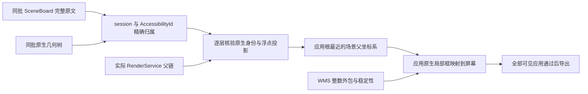
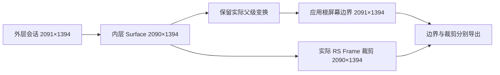
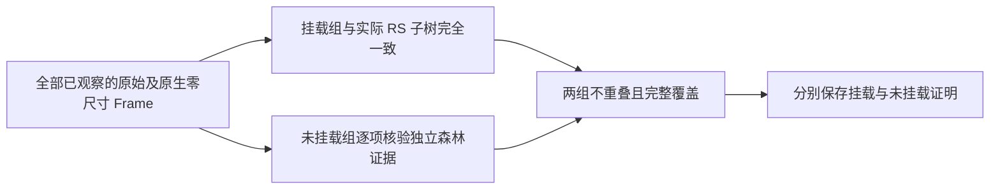

# 精确窗口映射与证据边界

正式应用 ArkUI 坐标使用同批 SceneBoard 的浮点变换及实际 RenderService 父链。
WMS 继续提供窗口身份、模式、层级、稳定性与整数外包校验，不再把其比例当作精确绘制缩放。
缺少完整来源或无法证明映射时拒绝导出。

## 为什么整数窗口边界不能直接用于控件映射

官方 [FillWindowSceneInfo](https://github.com/openharmony/arkui_ace_engine/blob/21b150e7bb1d5308846f8e5be8ef0482fb433315/frameworks/core/components_ng/pattern/window_scene/scene/window_scene_layout_manager.cpp)
取全局外包矩形，并以外包宽高除以逻辑尺寸得到 WMS 比例。
[RenderService 外包实现](https://github.com/openharmony/graphic_graphic_2d/blob/c19cedf62fefde6bf184aa815feeaf0346aa4d49/rosen/modules/render_service_base/src/common/rs_obj_abs_geometry.cpp)
对边界向外取整；这个整数矩形不包含精确浮点变换。

冻结 UC 兼容最大化证据中，SceneBoard 原点为 `203.30`、逻辑宽度为 `2048`，
实际缩放为 `0.876682`，屏幕右边界约为 `1998.744736`。
WMS 输出整数原点 `203`，其横向比例 `0.876953` 对应整数外包宽 `1796`。
正确控件映射宽度为 `1795.444736`，不能拿整数外包宽替代，也不能只扩大原点校验阈值。

## 当前来源与验证流程

采集器复用已经取得的完整系统原文与原生几何，不新增设备命令。
每个窗口的 `trees.arkui.coordinate_evidence.scene_sources` 明确记录真实来源窗口、进程、显示器，
以及完整原文和原生几何的文件名、字节数、SHA-256。
同一批次共享文件只读取、核验和建立原文索引一次。
来源窗口可以与首次请求几何的窗口不同；记录保留两者的真实文件归属。

装载器按 `compid=session<窗口ID>` 和 `AccessibilityId=uiNodeId` 选择唯一完整父链。
逐层验证原生节点的类型、标识、父关系、组件身份与浮点矩形，并保留源文件行号。
随后将实际 RS 祖先与这些节点关联，验证屏幕、显示器、父链顺序、局部矩形和变换打印区间。
普通应用的渲染标识不能冒用 SceneBoard 节点。

普通应用使用实际应用根最近的场景父坐标系，包含 session 之下应用 Surface 的偏移与缩放，
逐层交叉核验场景、原生投影和实际 RS 属性。父级视口和应用根各自保留尺寸，不要求二者相等。
应用自身的局部根偏移照常参与变换。
系统窗口已在场景屏幕空间，使用其场景父变换进行原生交叉核验，不重复缩放。
每个 Frame 的 `geometry.source.window_mapping` 保存来源文件及 session、viewport、显示器和屏幕标识。
外层裁剪按实际 RS 节点身份使用同一精确矩形，保留圆角和内容裁剪的来源。

普通已挂载 Frame 也交叉核验局部矩形、Scale、Translate 以及影响几何的 Pivot。
打印数值以各自明确的小数精度区间交叉核验；原生投影和裁剪的既有误差阈值未扩大。
Skew、Persp、未知裁剪和活动动画继续拒收。

## 父级视口和应用根尺寸不同

父级视口决定坐标变换和裁剪，应用根保留自己的局部边界。
官方 [RS 父级矩阵合成](https://github.com/openharmony/graphic_graphic_2d/blob/c19cedf62fefde6bf184aa815feeaf0346aa4d49/rosen/modules/render_service_base/src/pipeline/rs_render_node.cpp#L2248-L2283)
使用父级绝对矩阵；[几何更新](https://github.com/openharmony/graphic_graphic_2d/blob/c19cedf62fefde6bf184aa815feeaf0346aa4d49/rosen/modules/render_service_base/src/property/rs_properties.cpp#L545-L552)
将该矩阵传给当前节点，不要求父子宽高相等。
[ClipToFrame](https://github.com/openharmony/graphic_graphic_2d/blob/c19cedf62fefde6bf184aa815feeaf0346aa4d49/rosen/modules/render_service_base/src/drawable/rs_property_drawable.cpp#L257-L276)
按当前 RS Frame 做交集裁剪，不改写子节点的原始边界。

冻结今日头条窗口中，应用根和外层会话均为 `2091×1394`，内层 Surface 的实际 RS Bounds/Frame
均为 `2090×1394`，并启用 `ClipToFrame`。应用根通过父级平移得到
`screen_bounds={x:546,y:204,width:2091,height:1394}`，有效矩形裁剪为
`rectangular_clip_bounds={x:546,y:204,width:2090,height:1394}`。
内层 Surface 保留在真实父链与 `clip_chain` 中，不改选更高的同尺寸祖先，也不按宽高比缩放。

该内层场景节点的布局 `FrameRect` 为 `2090.40×1393.60`，绘制 `PaintRect` 为 `2090×1394`。
官方 [GetPaintRectWithoutTransform](https://github.com/openharmony/arkui_ace_engine/blob/21b150e7bb1d5308846f8e5be8ef0482fb433315/frameworks/core/components_ng/render/adapter/rosen_render_context.cpp#L3254-L3259)
返回绘制框；[SavePaintRect](https://github.com/openharmony/arkui_ace_engine/blob/21b150e7bb1d5308846f8e5be8ef0482fb433315/frameworks/core/components_ng/render/adapter/rosen_render_context.cpp#L8341-L8364)
从像素网格处理后的偏移和尺寸保存该框。这说明布局框与绘制框可以不同；本次核验采用实际绘制框、
原生投影和 RS 属性，不从差值推断设备执行了哪一条舍入分支。

只删除跨父子节点的尺寸相等要求；原有身份、父链、原生投影、局部变换、RS 属性与裁剪校验继续执行，
打印精度和误差阈值未改变。尺寸不同不授予其他几何错误豁免。

## WMS 比例的发布语义

WMS 比例还可能保留旧值，不能要求每次移动后都精确等于当前整数外包宽除以逻辑宽。
官方 [UpdateScaleInner](https://github.com/openharmony/window_window_manager/blob/8b0d8fe1b973d865904c942c286b3d2a3b9b08e7/window_scene/session/host/src/scene_session.cpp#L9559-L9566)
在无需更新变换时保留存量比例；
[IsTransformNeedUpdate](https://github.com/openharmony/window_window_manager/blob/8b0d8fe1b973d865904c942c286b3d2a3b9b08e7/window_scene/session/host/src/layout_controller.cpp#L253-L259)
使用 [float NearEqual 的 `<=0.001f` 门槛](https://github.com/openharmony/window_window_manager/blob/8b0d8fe1b973d865904c942c286b3d2a3b9b08e7/window_scene/interfaces/include/ws_common.h#L780-L783)。

本次 UC 从 `(203.3,203.3)` 移到 `(300,300)`，SceneBoard 精确尺寸保持
`1470.885888×1601.59938`，当前整数外包宽从 `1472` 变为 `1471`。
WMS 仍发布 `0.71875`，对应旧的 `1472/2048`；与当前 `1471/2048` 的差为 `0.00048828125`，
符合官方保留规则，冻结开始与结束的 WMS 也一致。

核验现在在归一化比例空间执行官方 float32 门槛，并计入实际 WMS 输出精度。
屏幕几何仍完全来自同批 SceneBoard、原生几何与真实渲染父链，
不拿 WMS 比例重建坐标；逻辑尺寸、整数原点、原生投影、裁剪与身份校验保持原要求。

## 非渲染节点

实际 RS 父链不能跳过已挂载的场景 Frame。
缺失 Frame 只有在明确懒加载未物化或位于独立未挂载树、且其局部仿射变换严格恒等时才可省略。
它们不贡献屏幕变换；未挂载节点的无效 Bounds 不作为活跃几何，也不改读待应用属性代替它。
应用无绘制子树的父关系同样按实际挂载链核验：经过明确未挂载或未物化的恒等帧后，
首个实际挂载的原生帧必须与当前 RS 父节点一致，不能跳过仍在渲染树上的帧或任意选择更高祖先。

部分零面积节点仍挂在 RS 树上，官方 Bounds 和 Frame 均为 `-inf`。
原始与原生投影的宽高均为零，并有唯一的 `hasDrawContent=0` 和 `hasChildrenDrawContent=0`，
才可以保留原生框并标记 `rendered=false`。非叶节点还须验证实际 RS 子树：每个渲染后代都唯一关联
原始和原生零尺寸 Frame，父关系一致，均有完整无绘制标记，并通过局部变换与裁剪检查。
有结构子节点不等于存在绘制内容；正面积、后代绘制、身份冲突、缺少证明或未知变换裁剪仍拒收。

原始组件父子关系不等于实际渲染挂载关系。已观察到的原始及原生零尺寸 Frame 必须完整划分为
挂载子树和有明确 `allNodeNotOnTree` 来源的未挂载森林，两组不重叠，合集覆盖全部已观察 Frame。
挂载组必须与实际 RS 子树完全一致；未挂载组逐项核验身份、原生投影、实际父关系、完整后代、
双零绘制标记和局部变换裁剪。未挂载森林根保留独立根边界，非根仍须匹配原生帧父链。
完整子树证明中的当前 Bounds/Frame 必须同时为全 `-inf`，或均为与原始绘制框一致的有限零尺寸框；
混合无穷与有限框、正面积或原点冲突都不能作为空帧证明。
未知、缺失、额外节点或挂载状态冲突均拒收，不能用隐藏或懒加载标记替代未挂载来源。

`geometry.source.no_draw_render_node_ids` 只记录经核验的挂载节点，
`geometry.source.no_draw_detached_render_node_ids` 单独记录该证明中明确未挂载的节点。
节点自身的挂载状态和原始树结构照常保留，不把未挂载后代伪装成挂载子树成员。

官方 [DumpTree](https://github.com/openharmony/arkui_ace_engine/blob/21b150e7bb1d5308846f8e5be8ef0482fb433315/frameworks/core/components_ng/base/ui_node.cpp#L1419-L1447)
先输出自身及声明的子节点数量，在隐藏且非全部节点模式下停止展开；
[DumpSimplifyTree](https://github.com/openharmony/arkui_ace_engine/blob/21b150e7bb1d5308846f8e5be8ef0482fb433315/frameworks/core/components_ng/base/ui_node.cpp#L1778-L1793)
也在隐藏节点处停止遍历。因此声明数量可以大于实际输出的子节点数量。
[FrameProxy 输出](https://github.com/openharmony/arkui_ace_engine/blob/21b150e7bb1d5308846f8e5be8ef0482fb433315/frameworks/core/components_ng/base/frame_node.cpp#L595-L620)
记录逻辑子节点和缓存索引；它不能补造未输出的原始或原生节点。
`declared_child_count`、`FrameProxy` 和原文全部保留，不据此声称逻辑后代不存在。

官方 [RS 树输出](https://github.com/openharmony/graphic_graphic_2d/blob/c19cedf62fefde6bf184aa815feeaf0346aa4d49/rosen/modules/render_service_base/src/pipeline/rs_render_node.cpp#L1288-L1296)
分别记录自身绘制内容、后代绘制内容和准备跳过状态。
[绘制内容计算](https://github.com/openharmony/graphic_graphic_2d/blob/c19cedf62fefde6bf184aa815feeaf0346aa4d49/rosen/modules/render_service_base/src/feature/dynamic_layer_skip/rs_dynamic_layer_skip_controller.cpp#L87-L155)
将后代绘制状态汇总为 `SUBTREE`；它并不以是否存在子节点作为无绘制定义。
`PrepareSeq` 和 `IsSubTreeSkipped` 均不能单独证明无绘制。无穷大 RS 矩形不会被当作坐标使用。
双非正尺寸占位框沿用原有严格无绘制验证。
单轴负尺寸仅支持明确的 `-1`、另一轴为正，并同时核验 RS Bounds/Frame、真正叶节点及唯一的双零绘制标记。
完整带符号端点投影必须匹配原生框，自身未证明裁剪仍拒收；详见[单轴负尺寸节点](mixed-dimension-nodes.md)。

## 接口与现有采集

`scene_sources` 是新采集必须提供的证据。缺失、摘要不符、跨进程或跨显示器、重复目标、
重复渲染标识和原生父关系冲突均拒收，没有 WMS 近似映射或旧格式兼容路径。
现有失败采集与正式样本保持原样；独立离线重放结果不会把历史失败改成正式成功。

所有可见应用继续参与验收。窗口映射通过不代表整帧可交付：任意背景应用的原文与原生树覆盖不一致，
仍会阻止完整采集事实准备与配额登记。截图和树仍顺序采集，前后稳定性检查不等于硬件原子快照。

打码开关继续位于 `project.toml` 每个任务的 `privacy.enabled`。
关闭时保留原图，开启时按声明区域处理；原始双树保留，开关不改变坐标和全窗覆盖门槛。

## 当前离线验证

2026-10-23 对完整冻结成功样本 `20261023T100640.360348Z-1b1dd376` 使用当前生产坐标接口重放，
4 个应用窗口的 764/764 个 Frame 全部通过，重建 ArkUI 与原成功交付逐对象一致。
其中包含下述浏览器与今日头条零尺寸节点；它们已按完整无绘制证据处理，不再阻止 ArkUI 导出。
77 份源文件及输入索引的字节、SHA-256 和修改时间均保持不变。
该检查使用本地冻结来源，没有跟随记录中的业务原目录绝对路径，也没有重新登记或增加采集计数。

2026-10-23 使用冻结浏览器窗口的完整 ArkUI 树及同批坐标来源，在独立副本上调用生产
`normalized_arkui` 导出接口成功：原始 1341 个节点全部保留，636/636 个 Frame 验证通过，
705 个非布局节点原样保留，没有剩余坐标问题。此前已通过的 635 个 Frame 核心几何保持不变。

`Row 438` 的实际挂载子树只含自身，`Column 439` 明确位于未挂载树。两者的原生零尺寸位置
`(1631,201)` 均映射为屏幕 `(3095,447,0,0)`，分别保存挂载与未挂载来源并标记不绘制。
`Column 439` 仍声明一个逻辑子节点，保留 `FrameProxy` 中的 `440`，已观察子节点数组仍为空，
没有伪造未输出的节点。全部 Frame 与独立原生矩形经实际父变换后的逐字段最大差为 `0.0`。

13 份原文件及附带索引的字节、摘要和修改时间保持不变。本轮没有连接设备、重新采集或调用模型。
提供的输入是坐标分析子集，完整窗口的 ArkUI JSON 已实际导出；未补造缺失截图或无障碍树，
未生成正式五件套、发布样本或改变配额。原始失败记录保持原样。

## 既有离线验证

2026-10-23 使用冻结今日头条窗口的完整 ArkUI 树及同批坐标来源，在独立副本上调用生产
`normalized_arkui` 导出接口成功：原始 133 个节点全部保留，90/90 个 Frame 验证通过，
43 个非布局节点原样保留，没有坐标问题。
应用根宽度保留 `2091`，实际矩形裁剪宽度为 `2090`。

零尺寸容器 `1363` 与子节点 `1364` 均保留原生位置 `[0,169]`，屏幕边界为 `(546,373,0,0)`，
并按完整无绘制证据标记不绘制。中间 `Stack 1360` 有明确未挂载证据且变换为恒等，
实际父关系核验经过该帧后关联到挂载的 `Column 1359`，没有接受任意祖先。
全部已验证组件边界与独立原生矩形经实际父变换后的逐字段最大差为 `0.0`。

13 份原文件及附带索引的字节、摘要和修改时间保持不变。本轮没有连接设备、重新采集或调用模型。
提供的输入是坐标分析子集，完整窗口的 ArkUI JSON 已实际导出；未补造缺失截图或无障碍树，
未生成正式五件套、发布样本或改变配额。原始失败记录保持原样。

## 既有验证记录

| 证据 | UC Frame | 全部可见应用 | 交付状态 |
| --- | --- | --- | --- |
| 冻结兼容最大化帧 | 113/113 | 7/7 个窗口、696/696 个 Frame 通过 | 只读离线验证，历史失败保持不变 |
| 冻结还原帧 | 113/113 | 7/8 个窗口通过 | 背景百度窗口原文与原生树集合不一致，继续拒收 |
| 新独立还原帧 | 113/113 | 7/8 个窗口通过 | 原始采集、覆盖与稳定性通过，本地准备被同一百度窗口拒绝 |

新帧标识为 `20261022T202959.706021Z-00411e48`。
两份还原帧中的百度窗口均为原生独有节点 `2457,2551,2645`，不能靠排除该窗口完成交付。
本轮没有正式发布、配额变化、模型请求或窗口输入操作。
冻结最大化证据的独立副本在补入明确来源引用后，也通过原始证据复核、五文件导出和导出后复核。
这个副本仅用于离线接口验证，不是新真机成功采集，也没有修改原来的失败目录或收据。

UC 最大化后的精确框为 `(203.3, 0, 1795.444736, 1955.00086)`；
还原后的精确框为 `(203.3, 203.3, 1470.885888, 1601.59938)`。
普通窗口与兼容最大化使用同一套规则，没有按应用或模式特判。
