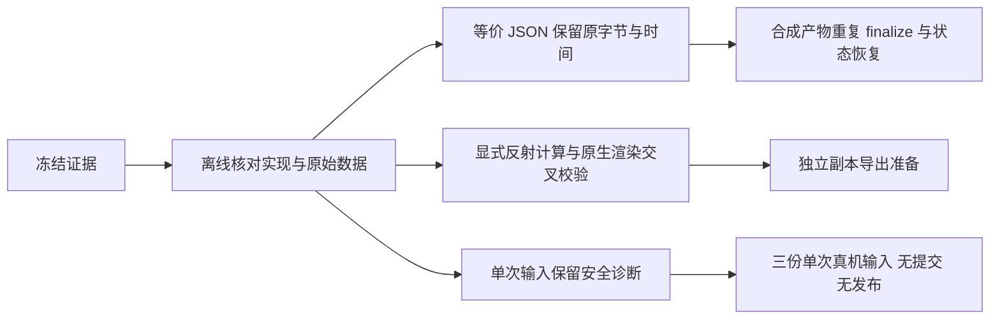

# 后续试采问题修复与验证

本次从 `e845ac6dc0c2b2c4e3eefc567f646c4d7bbe520a` 开始，分别处理无变化发布重写、
原生坐标拒收及输入诊断。没有改写旧试采结果；原批次仍为 5/44。
新增验证使用合成产物、独立副本及独立设备诊断目录，不增加原任务配额。
现有依赖及其固定版本保持不变。

## 无变化重复发布

旧实现中 `synchronize_publication` 和 `save_preparation` 都会调用 `atomic_json`。
后者无条件重新序列化并替换文件，等价 JSON 也会改变修改时间；键序、缩进或转义不同还会改变字节。
独立合成复现确认：准备重试会重写两份 JSON，已发布恢复会重写四份 JSON，其 JSON 值均未改变。

`atomic_json` 现在先比较规范 JSON 值：内容未变时保留现有字节和修改时间；
真实变更仍原子替换，布尔值与数值不混同，损坏 JSON 记录错误并拒绝覆盖。
没有新增发布流程、收据转换或兼容分支。

真实 TypeScript → Python 集成测试先发布合成样本，再改变收据的键序、缩进、换行和等价转义。
随后两次实际 `finalize` 及零剩余配额的 `dataset_status` 均保持完整证据、正式五件套与数据库的
SHA-256 和修改时间不变；模型请求总数仍为首次验收的一次，配额保持一份。
测试覆盖状态恢复；完整 `run` 仍会在恢复后初始化设备，不据此宣称零配额运行无需设备。

原发现中的真实 360 在线文档复验曾发生整体字节比较失败；此前逐文件 SHA 字典没有持久化，
因此无法追补具体哪些旧文件改变及其原始字节。当前修复和独立复现不追认那次检查通过，
也未在原正式目录再次执行 `finalize` 或手工转换收据。
独立复现位于本地 `artifacts/publication-byte-preservation-20261022`。

## 坐标验证

华为浏览器窗口 103 的实际出错对象为 Canvas 442，原文明确包含水平镜像 `scale(x,y)=-1,1`。
旧实现把所有非正缩放拒绝，日志中的根节点 0 只是上下文准备阶段的错误归属。
官方 [RosenRenderContext 变换实现](https://github.com/openharmony/arkui_ace_engine/blob/21b150e7bb1d5308846f8e5be8ef0482fb433315/frameworks/core/components_ng/render/adapter/rosen_render_context.cpp#L2969-L3005)
使用有符号缩放、枢轴和平移，并计算变换端点的包围框。

现在支持可验证的非零反射，保留局部轴方向，交叉核对原生 `$rect`、实际渲染父链、内容裁剪和 Overlay。
零缩放、负尺寸原生矩形、原生投影冲突、旋转、未知裁剪及节点集合差异继续拒收。
相同包围框不能替代轴方向校验；不能仅凭 `inactive`、列表类型或离屏位置跳过节点。

| 冻结证据 | 本次离线结果 | 边界 |
| --- | --- | --- |
| 两份窗口 103 | 每份 646 个布局节点及 794 个非布局节点全部通过 | 不等于所在整帧均通过 |
| UC 表单原始采集的独立副本 | 六个应用窗口全部通过，完整 `prepare_delivery` 及五文件校验通过 | 无模型、设备、发布或配额登记 |
| 华为表单原始采集 | 窗口 103 通过 | 同帧夸克窗口 105 的旋转节点仍拒收 |
| 笔记窗口 132 | 原始 247 帧、原生几何 249 帧 | 原生多出 1020、1027，仍拒收 |
| 百度窗口 125 | 原始 448 帧、原生几何 451 帧 | 原生多出 2457、2551、2645，仍拒收 |
| 微博窗口 128 | 原始 690 帧、原生几何 695 帧 | 原生多出 764、1041、1503、2001、4071，仍拒收 |

上述缺失对象位于 LazyForEach 后代，但保存证据缺少其完整局部变换和可关联的渲染标识。
现有数据不足以证明这些对象不参与渲染或裁剪。错误增加 `native_only` / `raw_only` 标识集合，
保留原拒收原因；部分可见背景窗口仍参与全帧验证。
coremail 原试采没有覆盖可见的目标应用，属于独立场景缺口，不因坐标修复而通过。

本地 `artifacts/coordinate-reflection-audit-20261022` 保存官方源码、逐输入摘要、28 个应用窗口实例的
离线结果及 UC 独立副本准备结果。原始输入文件摘要保持不变，原失败目录没有重新准备或发布。

## 输入失败的真实接口

成功 `Input` 收据仍表示控件完整文本匹配，不表示输入法预编辑结束、Enter 已提交或页面已加载。
Python 桥接失败通过标准输出 JSON 返回 `error.message` 与 `error.diagnostics`；
TypeScript 在非零退出时也解释同一 JSON 协议，不把 stderr 当作替代协议。
注册器在 `action_failed` 保存本次安全参数及诊断，Tap 范围错误使用真实动作名。

| 字段 | 记录内容 |
| --- | --- |
| `request` | 本次取整后的 x/y、mode、window_id、bundle_name、display_id |
| `phase`、`trace` | 首个失败步骤；各既有调用的开始、结束时间、状态及异常类型 |
| `candidates`、`filter_counts` | 已成功读取候选的窗口、显示器、焦点、层级、类型、矩形及筛选结果 |
| `before`、`comparison` | 文本类型、长度、SHA-256、与预期及输入前文本的相等结果 |
| `input`、`close` | 输入阶段与关闭结果分开记录；清理错误不覆盖首个输入错误 |

诊断没有新增原生查询、句柄重查、输入通道或重试。SDK 日志仍隔离并清理；
正文和定位描述不进入通用日志，非法输入参数也只记录经过筛选的字段与有限数值几何。
关闭、日志关闭或临时报告清理失败会明确失败；已经完成的文本验证状态仍单独保留。

焦点叶子不等于已证明可编辑。当前 Hypium / UiTest 公开控件接口没有可确认的可编辑性查询入口，
不能把焦点、enabled 或某次组件类型当作通用能力证明，也没有增加推断式类型白名单。
鸿蒙其他无障碍上下文中的 `editable` 属性不等于本输入通道已经具有该接口。

## 三份单次真机补证

诊断使用真实视觉模型、当前注册器、Python 桥接及原官方 Hypium 输入通道。
每个任务仅尝试一次 `Input`，没有启用 Enter、Capture 或发布工具；没有改变输入法、账号或系统设置。
失败立即结束，不换通道或再次输入。完整本地证据位于 `artifacts/repair-20261022T180921Z`。

| 独立诊断 | 实测结果 | 可以确认的结论 |
| --- | --- | --- |
| `quark-focus` | 解析点 `(1179,1202)`；输入前 TextArea 为 `[625,1292][1775,1391]`；点击后选中 rootWebArea，预期 72 字符、实际空串 | 本次定位点在地址编辑框上方；这次读回拒绝不证明旧 `found 0` 的具体原因 |
| `haitai-readback` | 选中窗口 102 的 textField；文本操作返回；预期 41 字符，实际为 1 字符且摘要与输入前相同 | 完整读回不匹配；仍不能判断应用、IME 或原生粘贴处理的具体机制，也不能据相等结果认定没有输入副作用 |
| `uc-component` | 窗口 106，replace，完整读回 72 字符及固定论坛 URL 的匹配摘要 | 本次输入验证成功，旧组件异常未复现；没有提交或验证页面加载 |

三份均为新受控验证，不能冒充旧动作精确重放，也不改变已有正式样本或旧失败状态。
每份保留独立 project/config 摘要、执行事件、调用用量和输入前后本地诊断截图与树。
这些诊断截图不属于正式单图五件套，原始页面和账号内容不随仓库发布。

最终全量验证：Python 309 项、TypeScript 276 项全部通过，类型检查、依赖检查通过。
依赖文件没有变化；没有新增包、兼容层、迁移或输入回退。
