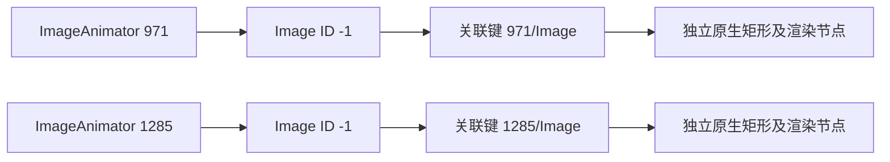

# Inspector 节点身份

ArkUI 的 `$ID` 是组件自身的 `GetId()`，不是 Inspector 为每个导出节点生成的唯一编号。
`UndefinedElementId` 为 `-1`，这类对象不加入全局元素注册表。
官方 `ImageAnimator` 会创建 ID 为 `-1` 的缓存 `Image`，并将选中的图片挂到自身子树。
不同动画组件下的图片因此可能具有相同 `$ID`，但它们是不同对象。

窗口树选择和坐标校验使用同一个关联规则：

- 普通已分配标识继续要求全树唯一。
- 已支持的 `__Recycle__` 保留原有父节点范围规则。
- `Image -1` 必须直接位于原生 `ImageAnimator` 下，且该父节点下的候选唯一。
  原始树和原生树的真实父关系必须一致；原文 `Parent` 必须与实际父节点的完整标题相同，
  `LastParentId` 必须与该父节点标识相同。
- 每个图片仍独立核验原生矩形、客户端渲染标识、实际渲染父链、裁剪及绘制状态。
  不用屏幕位置或矩形相似度配对，不按遍历顺序生成替代标识。

原始 `ID`、完整森林、原生 JSON、节点顺序和父子关系均保留。
坐标输出的 `geometry.source.node_id` 仍为原始 `-1`，并在此类节点增加
`geometry.source.node_key`，用于区分同一窗口内的图片来源。
普通已分配标识的输出不变。同一父节点下两个无法区分的图片、重复正标识、
未知的重复负标识、父关系冲突及重复渲染标识继续拒收。

固定官方源码依据：

- [默认未分配标识](https://github.com/openharmony/arkui_ace_engine/blob/21b150e7bb1d5308846f8e5be8ef0482fb433315/frameworks/core/pipeline/base/element_register.h#L48)
  与[不进入注册表的条件](https://github.com/openharmony/arkui_ace_engine/blob/21b150e7bb1d5308846f8e5be8ef0482fb433315/frameworks/core/pipeline/base/element_register.cpp#L324-L331)。
- [创建缓存图片](https://github.com/openharmony/arkui_ace_engine/blob/21b150e7bb1d5308846f8e5be8ef0482fb433315/frameworks/core/components_ng/pattern/image_animator/image_animator_pattern.cpp#L291-L311)
  与[把缓存图片挂到动画组件](https://github.com/openharmony/arkui_ace_engine/blob/21b150e7bb1d5308846f8e5be8ef0482fb433315/frameworks/core/components_ng/pattern/image_animator/image_animator_pattern.cpp#L154-L163)。
- [Inspector 原样输出类型和标识，并遍历真实子节点](https://github.com/openharmony/arkui_ace_engine/blob/21b150e7bb1d5308846f8e5be8ef0482fb433315/frameworks/core/components_ng/base/inspector.cpp#L403-L478)。

微博采集 `471e4153-59ba-490e-9d5c-183abbb5750f` 的冻结来源中有五个这样的图片。
当前生产保存、双树选择和重读已保留全部 3852 个原生节点，另保留 8 个有明确原文来源的 Overlay，
全部 5031 个原始森林节点也独立保存。1773 个原生布局帧的局部父链投影均通过核验。
该失败采集停止于树构造阶段，尚未采集后续 RenderService 树和最终元数据；
因此这份离线回放验证身份修复及原生投影，不将旧失败改为完整采集成功。
