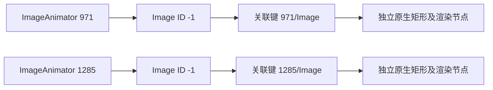
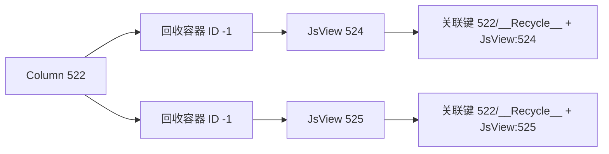

# Inspector 节点身份

ArkUI 的 `$ID` 是组件自身的 `GetId()`，不是 Inspector 为每个导出节点生成的唯一编号。
`UndefinedElementId` 为 `-1`，这类对象不加入全局元素注册表。
官方 `ImageAnimator` 会创建 ID 为 `-1` 的缓存 `Image`，并将选中的图片挂到自身子树。
不同动画组件下的图片因此可能具有相同 `$ID`，但它们是不同对象。

窗口树选择和坐标校验使用同一个关联规则：

- 普通已分配标识继续要求全树唯一。
- `__Recycle__ -1` 使用实际父节点和完整、有序的已分配直接子节点身份。
  同一父节点下的不同包装节点不合并；原文 `Parent` 与实际父完整标题一致，
  被包装子节点的 `Parent` 也必须与该包装节点完整标题一致。
- `Image -1` 必须直接位于原生 `ImageAnimator` 下，且该父节点下的候选唯一。
  原始树和原生树的真实父关系必须一致；原文 `Parent` 必须与实际父节点的完整标题相同，
  `LastParentId` 必须与该父节点标识相同。
- 每个图片仍独立核验原生矩形、客户端渲染标识、实际渲染父链、裁剪及绘制状态。
  不用屏幕位置或矩形相似度配对，不按遍历顺序生成替代标识。

原始 `ID`、完整森林、原生 JSON、节点顺序和父子关系均保留。
坐标输出的 `geometry.source.node_id` 仍为原始 `-1`，并在此类节点增加
`geometry.source.node_key`，用于区分同一窗口内的图片来源。
普通已分配标识的输出不变。同一父节点下两个无法区分的图片、重复正标识、
未知的重复负标识、父关系冲突及重复渲染标识继续拒收。

## 同父节点下的多个回收容器

`RecycleDummyNode::WrapRecycleDummyNode` 每次创建一个新的对象并挂入传入子节点。
默认标识同样为 `-1`；同一 `Column` 可以持有多个这样的独立对象。
仅用父节点和 `__Recycle__` 类型建立索引会把它们误判为重复。

实际编码为 `522/__Recycle__[JsView:524]`。子节点身份必须来自本批完整双树，
不能使用仅存在于原文的 AccessibilityId、遍历序号、屏幕位置或任意编号替代。
多个子节点时使用完整有序列表并核对全局已分配标识唯一性，不擅取第一个子节点。
空包装节点只有在父节点范围内唯一时才可关联；同父多个空包装节点仍属歧义。
直接子节点没有已分配标识时，此规则不能证明其身份，继续拒收。
官方类并未宣称永远只有一个子节点，因此不会把空或多子节点直接称为系统非法状态。

原文明示的 Overlay 不在原生子节点列表内，不参与包装节点锚点；它仍完整保留并接受原有独立渲染核验。
SceneBoard 的回收祖先保留来自完整原文的真实子树，确保关联使用实际子身份，
而不是从只含自身属性的祖先片段推测子节点。

该规则更新非空回收容器的派生关联键，不改原始 ID 或历史采集文件。
带旧关联键的已存派生树不会被当前严格读回视为重新计算结果；没有旧格式兼容或迁移路径。

依据为[包装对象创建和子节点挂接](https://github.com/openharmony/arkui_ace_engine/blob/21b150e7bb1d5308846f8e5be8ef0482fb433315/frameworks/core/components_ng/pattern/recycle_view/recycle_dummy_node.cpp#L22-L40)
及[完整原生转储对真实子节点的遍历](https://github.com/openharmony/arkui_ace_engine/blob/21b150e7bb1d5308846f8e5be8ef0482fb433315/frameworks/core/components_ng/base/ui_node.cpp#L1667-L1757)。

百度运行 `d7649e10-3b4b-4363-826f-9def42480a5b` 的同批原生树包含 73 个回收容器，
其中 11 个父节点各有两个不同容器。离线生产保存与读回保留全部 1528 个原生节点和父子关系，
803 个原生布局帧的投影均通过；完整原文的 20 个根、1657 个节点另行完整保存。
原文还有四个位于独立根、未被该原生树引用的回收容器；不会把原文与原生树宣称为全图相同。
该冻结失败仍缺少后续 RenderService 树和最终采集元数据，不追认为完整采集成功。

固定官方源码依据：

- [默认未分配标识](https://github.com/openharmony/arkui_ace_engine/blob/21b150e7bb1d5308846f8e5be8ef0482fb433315/frameworks/core/pipeline/base/element_register.h#L48)
  与[不进入注册表的条件](https://github.com/openharmony/arkui_ace_engine/blob/21b150e7bb1d5308846f8e5be8ef0482fb433315/frameworks/core/pipeline/base/element_register.cpp#L324-L331)。
- [创建缓存图片](https://github.com/openharmony/arkui_ace_engine/blob/21b150e7bb1d5308846f8e5be8ef0482fb433315/frameworks/core/components_ng/pattern/image_animator/image_animator_pattern.cpp#L291-L311)
  与[把缓存图片挂到动画组件](https://github.com/openharmony/arkui_ace_engine/blob/21b150e7bb1d5308846f8e5be8ef0482fb433315/frameworks/core/components_ng/pattern/image_animator/image_animator_pattern.cpp#L154-L163)。
- [Inspector 原样输出类型和标识，并遍历真实子节点](https://github.com/openharmony/arkui_ace_engine/blob/21b150e7bb1d5308846f8e5be8ef0482fb433315/frameworks/core/components_ng/base/inspector.cpp#L403-L478)。

微博采集 `471e4153-59ba-490e-9d5c-183abbb5750f` 的冻结来源中有五个这样的图片。
当前生产保存、双树选择和重读已保留全部 3852 个原生节点，另保留 8 个有明确原文来源的 Overlay，
全部 5031 个原始森林节点也独立保存。1773 个原生布局帧的局部父链投影均通过核验。
该失败采集停止于树构造阶段，尚未采集后续 RenderService 树和最终元数据；
因此这份离线回放验证身份修复及原生投影，不将旧失败改为完整采集成功。
