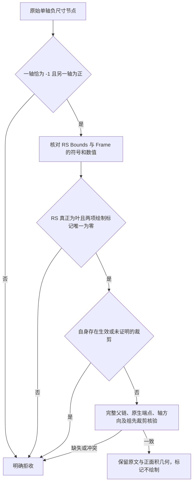

# 单轴负尺寸节点的坐标验证

部分 ArkUI 节点的原始绘制框是 `-1×11`、`-1×38` 或正宽度、`-1` 高度，
原生变换后的矩形却是正面积。原始尺寸、原生包围框与是否绘制是三项不同证据，不能互相代替。
工具保留完整原始树，只对满足严格证据条件的节点输出已验证几何与 `rendered=false`。

## 端点变换

官方 [GetPaintRectWithTransform 与 SkewRect](https://github.com/openharmony/arkui_ace_engine/blob/21b150e7bb1d5308846f8e5be8ef0482fb433315/frameworks/core/components_ng/render/adapter/rosen_render_context.cpp)
在任一尺寸为 `-1` 时仍执行变换，先用带符号尺寸计算 pivot、scale 和 translate，
再按 [RectT 的左右、上下端点](https://github.com/openharmony/arkui_ace_engine/blob/21b150e7bb1d5308846f8e5be8ef0482fb433315/frameworks/base/geometry/ng/rect_t.h)
得到轴对齐包围框。当前支持的零 skew、零 rotation 轴变换继续使用已有投影公式，没有把输入尺寸先取绝对值。

横轴变换为 `q = x + width × pivot × (1 − scale) + translate`，
对应端点为 `q` 和 `q + width × scale`，最后才求左右边界。
例如 `x=10,width=-1,pivot=.25,scale=2,translate=3` 得到 `11.25..13.25`；
先把宽度改为正数会得到错误的 `12.75..14.75`。

## 接收与拒收

`Bounds` 和 `Frame` 都必须与原始 `PaintRect without transform` 保持相应轴的符号一致，
数值仍使用原来的校验门槛；正轴、原点或原生投影漂移不会因节点无绘制而被忽略。
`FrameRect` 与绘制框可以不同，两个原始属性都保留，不能互相覆盖。

无绘制结论要求实际 RS 节点没有子节点，且 `hasDrawContent`、`hasChildrenDrawContent` 各唯一出现并为零。
缺失、重复、矛盾标记或真实 RS 子节点均不能形成该结论。
原始树里的空 `IfElse` 是结构节点，可以完整保留；它不等同于实际渲染子节点。
RS 自己的 [IsEmpty 判断](https://github.com/openharmony/graphic_graphic_2d/blob/c19cedf62fefde6bf184aa815feeaf0346aa4d49/rosen/modules/render_service_base/include/common/rs_obj_geometry.h)
与[绘制标记](https://github.com/openharmony/graphic_graphic_2d/blob/c19cedf62fefde6bf184aa815feeaf0346aa4d49/rosen/modules/render_service_base/src/pipeline/rs_render_node.cpp)
相互独立，不能把混合尺寸直接称为 RS 空几何。

自身负尺寸的 `ClipToBounds`、`ClipToFrame`、自定义或未证明裁剪继续拒收：
ArkUI 原生包围框的端点排序不能证明 RS 实际裁剪区域。
已经独立核验的正尺寸祖先裁剪继续生效；祖先与节点的 Scale、Translate、有效 Pivot、
轴方向、身份、父关系、原生端点顺序和原有误差门槛均保持。
Skew、非零旋转、未知变换、附着状态冲突、非标准单轴负值及缺失来源继续拒收。

公开源码与设备二进制未逐一匹配。源码提供可审查的解释，实际接收还必须由本次原始树、
原生几何与完整渲染证据共同证明；不把源码解释当作任意应用的像素或裁剪保证。

## 输出与证据边界

接口沿用 `geometry.status=verified`、`screen_bounds`、`native_window_rect`、
`rendered=false`、`render_state=not_rendered` 与 `render_state_source=RenderService.no_draw_content`。
正面积几何表示变换后的组件包围框，不表示该处存在绘制像素。原始属性、正文和结构均不删除或改写。
没有新增配置、依赖、旧格式兼容、迁移、按应用放行或近似坐标路径。

两份失败采集只在完整保护后的独立副本上重放，不改写旧状态、收据或正式产物。
应用坐标验证遵循现有正式导出范围：普通应用逐节点核验，系统窗口树继续作为完整原始来源保存；
额外系统节点审计中的旧失败单独报告，不能将普通应用通过写成全部系统节点通过。
工具自有真机采集使用 `privacy.enabled=false` 保留原图，不发布样本、不增加项目通过数。

本次冻结副本重放结果为：表单的 6 个普通应用窗口、852 个 Frame 全部通过；
Coremail 的 6 个普通应用窗口、499 个 Frame 全部通过，其中目标单轴负尺寸节点分别为 20 个和 3 个。
额外系统节点审计中的窗口 9、7、5 仍保留原有错误，不计入普通应用通过数量。
工具自有新真机采集覆盖 12 个窗口，普通应用坐标为 6 个窗口、499 个 Frame 全部通过，
Coremail 的 3 个目标节点均验证为无绘制；该次原始首尾像素变化为零，没有业务输入或模型请求。
表单页面没有重新启动或采集；其本次结论仅来自冻结副本重放。
