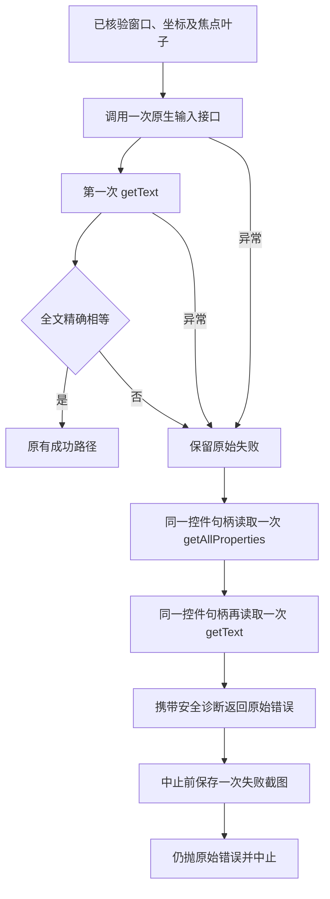

# 原生输入失败后的观察

`Input` 的完成条件仍然是第一次 `getText` 返回的完整字符串与预期值精确相等。
官方 Hypium 的 `input_text` 返回不包含全文写入确认，原生调用正常返回不足以证明输入成功。
发生写入异常、读回异常或内容不符时，本次操作仍然失败。

`replace` 和 `append` 使用显式 `InputTextMode.paste(False)`，保留各自的 `addition` 设置。
这是 SDK 的默认输入选择，不强制所有文本粘贴，也不表示禁止使用剪贴板。
固定官方实现先检查整个 UTF-8 字节串是否可映射为按键：可映射且不超过 200 字节时逐键输入；
有不可映射字节或超过 200 字节时仍由 SDK 使用剪贴板。该选择发生在同一次官方接口调用内，
Har 不按失败更换策略，不拆分文本或自动重输。`clear` 继续使用官方清空接口。

后续读取只用于诊断，不等待某个期望值、不重输、不改变输入策略，也不以稍后读回正确改判成功。
属性读取和后续文本读取分别记录结果；其中一次异常不阻止另一次读取，且不会覆盖最初的错误。
坐标不在焦点叶子内、窗口归属不符等写入前拒绝不进入这组写入失败观察。

## 原生诊断

现有结构化错误增加 `failure_observations`，仍经原有桥接响应进入 `events.jsonl`：

| 记录 | 内容 |
| --- | --- |
| `primary_phase` | 原始失败阶段，后续观察不能覆盖它 |
| `properties` | 新读取的窗口、显示器、层级、焦点、边界白名单与文本摘要 |
| `text` | 后续 `getText` 的类型、长度、SHA-256，以及与预期、首次读回、输入前文本的比较 |
| `trace` 中的 `failure_properties`、`failure_text` | 每次调用的开始、结束、状态及安全异常类型 |

`properties.binding_matches_selected` 比较原选择的窗口、显示器和层级。
`same_component_handle` 表示继续使用原来的 SDK 控件对象，不等同于证明观察期间界面未变化。
非空预期前缀的判断用于区分前缀截断与其他不匹配；它不能证明剪贴板、按键或应用中的具体故障。
属性中的完整 `text`、描述及资源名称只在内存中处理，不将整个原生属性对象写入诊断。

官方 `getText` 与 `getAllProperties` 都通过 `RetrieveWidget` 刷新原生窗口和控件快照，再读取属性。
因此这些证据属于**同一原生属性通道在不同调用时刻的观察**，不是两套独立的文本真实性证明。
若两次值不同，需要结合记录时间与截图继续判断，不能直接断言某个 getter 错误或内容已经稳定。
SDK 内部还可能执行其自己的恢复逻辑；Har 调用一次接口不表示已证明设备只收到一次 RPC。

## 失败截图

SDK 只在动作正常返回后采集 `after-calling` 截图。原生输入抛错后，注册器会中止运行，
所以不能在后续 SDK 失败通知中再补拍。

`Input` 在注册器中止之前，使用现有 `CollectionDevice.screenshotBase64` 和 `PlanningEvidence`
保存一次 `native_input_failure_observation`。记录明确关联原 SDK 任务、输入失败阶段、观察标识、窗口信息、
图片路径和捕获时间。它是失败后的诊断观察，不冒充 SDK 的 `after-calling` 记录或成功回执。

截图保留在现有 `planning-evidence` 内部目录，终端和结构化错误不写图片 base64 或输入正文。
截图本身仍是页面原始观察，不能因文本诊断只存摘要就将它称为脱敏图片。
若运行已取消、观察失败或没有产生新观察，会记录不可用状态；不会绕过取消信号、再次拍摄或覆盖原输入错误。
已有的外部取消原因遵循 SDK 的取消契约。本次诊断保存失败触发中止时，则保留原输入错误作为中止原因，
同时保留证据保存失败状态。收尾仍尝试销毁 SDK 和刷新证据；已有操作错误优先，没有操作错误时清理失败仍致命。

## 已知案例与验证边界

普通海泰较早的冻结记录已完成点击、焦点叶子选择、输入和首次读回，失败在全文比较。
较早记录没有后续观察，不能追溯证明具体输入原因。后续冻结记录中的三次读取和较晚截图一致显示 `v`，
预期文本是 72 字节的可打印 ASCII；当时 Har 仍强制粘贴。这个证据支持移除不必要的强制粘贴选择，
但不能独自证明剪贴板、Ctrl 事件或应用中的具体缺陷。默认选择的实际效果仍需新运行验证；
Unicode 和长文本可能继续使用同一粘贴通道，不能宣称该通道已经修复。
极速海泰的定位点落在焦点输入框外，在写入前拒绝，属于不同阶段的问题。

这项修改的离线测试验证调用次序、原始失败保留、后续匹配不改判成功、两次观察独立失败、正文隔离、
失败截图与 SDK 任务关联，以及取消与截图失败的处理；具体设备原因仍以之后新运行的证据为准。

## 官方实现依据

- [Component 属性读取](https://github.com/openharmony/testfwk_arkxtest/blob/2663426adad3c9c2cecdb75f0e5d23c852cf82d1/uitest/core/frontend_api_handler.cpp#L2033-L2134)：
  `getText` 与 `getAllProperties` 通过相同的控件刷新路径取得属性。
- [RetrieveWidget](https://github.com/openharmony/testfwk_arkxtest/blob/2663426adad3c9c2cecdb75f0e5d23c852cf82d1/uitest/core/ui_driver.cpp#L257-L285)：
  重新取得原生窗口和控件快照。
- [组件输入](https://github.com/openharmony/testfwk_arkxtest/blob/2663426adad3c9c2cecdb75f0e5d23c852cf82d1/uitest/core/widget_operator.cpp#L171-L205)：
  聚焦组件后执行原生文本输入。
- [剪贴板与粘贴按键](https://github.com/openharmony/testfwk_arkxtest/blob/2663426adad3c9c2cecdb75f0e5d23c852cf82d1/uitest/core/ui_driver.cpp#L648-L668)：
  粘贴路径不返回应用全文校验结果。

上述源码解释公开调用语义，不证明某台设备上的服务二进制与该固定版本完全相同。
