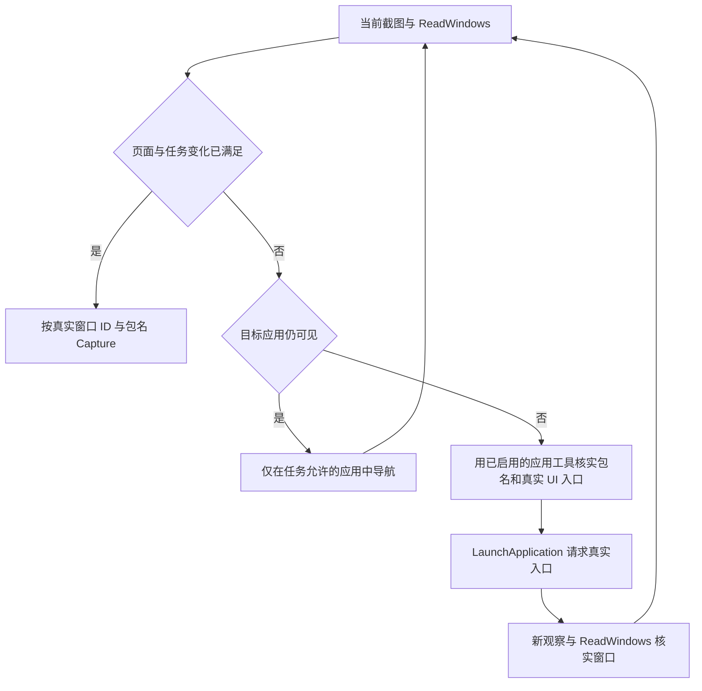

# 应用导航与采集时机

采集任务先检查当前页面。页面和要求的变化已经满足时，直接调用 `Capture`，
不为了多做一个动作而离开页面、最小化、关闭或改变窗口。
只有任务明确要求窗口变化时才进行对应操作；页面、滚动和编辑变化也必须属于任务授权范围。

`ListApplications` 用于发现已安装包，`ReadApplication` 返回真实 UI 入口，
`LaunchApplication` 请求系统启动经过元数据验证的入口。它们是现有注册工具，不是自动恢复流程。
任务只允许操作特定应用时，系统 Dock 或桌面图标不属于这些普通应用的输入范围。
不得通过添加系统包名、猜坐标、发明 Ability 名称或忽略范围错误恢复应用。
所需查询或启动能力未启用、入口不唯一或无法核实时，明确停止并报告缺口。
启动确认只证明系统接受启动请求，不证明窗口已可见、恢复了原页面或内容符合采集要求。
启动后须使用新观察，旧观察因动作版本变化而失效。

`ReadWindows` 保留完整窗口结果，并在窗口正文前提供紧凑的 `task_scope`：

| 字段 | 来源与含义 |
| --- | --- |
| `bundle_names` | 本任务声明的应用范围；未限制时为 `null` |
| `visible_window_ids` | 当前观察中位于任务范围内的普通应用窗口，不以焦点代替范围判断 |
| `absent_bundle_names` | 声明的范围内、当前观察没有对应普通窗口的包名；不表示应用未安装或要求打开全部应用 |

这些字段只是窗口事实，不判断页面是否就绪，也不替代定位、焦点、层级或输入范围检查。
其他应用和系统窗口仍完整保存在 `windows` 中。
输入范围仍按已知普通应用矩形和焦点核验，不表示系统窗口遮挡后的像素级可见性证明。
字段由已有观察计算，不额外读取设备。反馈复用 Midscene 的动作说明和
`context.task.planningFeedback`，由 SDK 传到下一规划轮，没有增加自动点击、重试或另一套规划循环。
`ReadApplication` 的反馈采用与应用列表相同的有界长度，避免沿用默认较短预算截掉真实入口选项。
接入方式见 [Midscene 官方自定义动作说明](https://www.midscenejs.com/integrate-with-any-interface#define-a-custom-action)。

## 冻结失败与验证边界

冻结失败只执行了 `ReadWindows`、一次成功的应用窗口内点击，以及一次被拒绝的 Dock 区域点击，
没有调用 `Capture`。首次点击后目标浏览器不再出现在后续暴露窗口观察中，另一个应用获得焦点。
现有日志没有保留定位描述正文、按钮身份、规划截图或模型理由，不能证明首次点击具体命中了什么控件、
是否属于最小化、关闭或其他导航，也不能从窗口存在推断原页面已经满足任务要求。

第二次点击位于系统 Dock 区域、所有已知普通应用矩形之外，范围拒绝是正确行为。
本次修正补足通用导航指引和允许窗口的结构化反馈，保留错误后的中止及全部原有范围保护。
该失败没有证明坐标变换或范围算法存在缺陷，也不是 `ReadWindows` 反馈长度不足导致：
冻结窗口结果未超过该工具原有长度上限。

离线回归通过真实注册动作验证：可采目标直接进入 `Capture`；目标缺席时选择查询返回的真实入口、
启动后重新绑定观察再采集；旧观察拒绝、范围外启动和 Dock 点击拒绝均发生在不允许的原生动作之前。
这是脚本化的执行与反馈契约验证，不证明视觉模型在真实设备上一定选择相同路径。
本轮不访问设备或真实模型，不改写冻结失败或将其追认为成功。
