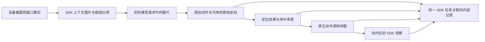
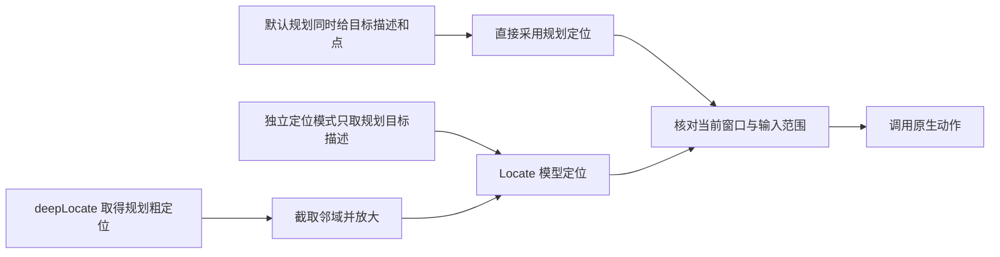

# 导航证据

正常 `run` 自动保存 agent 寻找页面时的图片、规划、定位与动作证据，不需要新的项目配置。
运行命令、项目任务及模型选择不变。证据位于内部 `run.json` 的 `artifacts_directory` 下：

```text
planning-evidence/
  trace.jsonl      按保存顺序排列的结构化记录
  screenshots/    SDK 图片存储保存的实际图片字节
```

每次 `aiAct` 使用独立 `invocation_id`；SDK 的 `execution_id`、`task_id` 直接关联任务。
`plan_index` 表示所属规划轮次。不能用相近时间、相同点击坐标或相似图片替代任务关联。
这些文件属于内部运行证据，不计样本配额，不加入项目声明的交付文件，采集目录仍只有一张配套截图。



## 图片与坐标

| 记录 | 能证明的事实 |
| --- | --- |
| `observation` | 本机收到的设备截图、窗口事实、观察标识和状态版本 |
| `context` | SDK 截图标识、图片尺寸、`shot_size` 和 `shrunk_shot_to_logical_ratio` |
| `model_request` | 实际发出请求中的图片顺序、原始编码、尺寸及 SHA-256，直接关联正在执行的 SDK 任务 |
| `sdk_task` 的 `plan` | 标准协议解析出的动作、原始坐标及协议声明；不保存原始模型正文 |
| `sdk_task` 的 `locate` | 最终定位结果、定位描述及 `hit_by`，区分规划直接命中与额外模型定位 |
| `tool_call` | SDK 已转换到设备逻辑像素的注册工具参数和状态版本 |
| `action_dispatch` | 实际调用原生动作时传入的参数、调用开始及返回状态 |
| `action_observation` | 同一动作任务的后继截图，缺失时明确标记 `unavailable` |

图片记录包含相对内部运行目录的文件路径、字节数、真实尺寸及 SHA-256。
设备截图、SDK 上下文图片、实际请求图片分别保存；它们可能有不同尺寸或编码，不能相互冒充。
图片内容相同时复用 SDK 图片存储，记录仍保留各自的来源与关联。

标准模型协议的 `prompt_spec` 保存公开协议声明，原始数值必须按该声明解释。
自定义模型适配器没有公开原文解析接口时，只记录 SDK 已归一化的截图像素结果和公开坐标声明，
同时明确标记原始坐标不可用；不从最终坐标反推原始模型输出。由内部思考文本生成的定位描述不保存。
定位记录使用 SDK 实际选择的 `locate` 角色解析协议；`insight` 角色用于理解与提取，不能替代定位角色。
两个角色都继承默认模型时结果相同，独立配置后可能使用不同的坐标格式。

`native_returned` 只表示原生回调返回。`os_delivery_confirmed=false` 和 `ui_effect=not_evaluated`
明确表示这不是操作系统送达回执，也不是点击有效的结论。
后继图片仅取自动作任务，规划任务自身的截图不冒充动作后的观察。
诊断不增加重复点击阈值、不修正坐标、不替代现有页面稳定性或最终图片验收。

## 规划与独立定位

当前采集使用 Midscene 1.16.5 的默认 `aiAct` 模式。标准规划器和定位器均使用默认角色时，
规划可直接输出坐标；后续 `Locate` 记录的 `source=plan` 表示采用该点，不表示又调用了定位模型。



SDK 的 `effort="deepThink"` 会分开标准规划与定位；显式配置独立的 `planning` 或 `locate` 角色
也会使标准规划省略内嵌定位。单独配置 `insight` 角色没有这个作用。
在支持该能力的规划器中，`deepLocate=true` 会避免直接采用规划点；已有粗定位时用它确定裁图，再在裁图内定位，
没有粗定位时先查找目标区域。它会增加模型调用，不能保证修正落在错误区域的粗定位。
这些是 SDK 的公开能力；采集器没有自动切换模式或在范围失败后重复尝试。
依据为[官方定位说明](https://www.midscenejs.com/reference/#shared-types)和
[固定版本的规划条件](https://github.com/web-infra-dev/midscene/blob/v1.16.5/packages/core/src/agent/tasks.ts#L557-L562)。

项目中的路径停止条件交给规划阶段处理；独立定位只解决当次目标在哪里，不决定是否继续任务。
SDK 支持未完成目标时报告失败并退出，采集器随后保留失败状态；成功采集仍必须取得候选并通过验收。
诊断能证明发生了哪些动作、图像是否变化，不能仅凭原生调用返回就认定任务停止条件未触发。

## 保存范围与失败

记录由已安装 Midscene 的公开进度、执行快照、模型客户端工厂和图片存储接口产生。
完整 SDK 报告、原始执行转储和动作缓存仍关闭；不记录请求头、认证选项、完整提示词、
完整模型回复或独立 Input 正文字段。定位描述只保留公开定位字段；已知模型密钥字面值会被过滤。

内部图片保留实际导航画面，可能包含屏幕中的账号或输入内容。项目的采后截图打码开关只处理
正式采集截图，不改变导航图片或已经发出的模型请求；内部导航证据不属于脱敏交付。

证据写入失败会中止运行，动作派发前和验收前均等待写入，结束时仍完成本地收尾。
中断后保留已保存的证据，缺图和未知界面效果保持明确状态。
过去未记录的模型图片或原始坐标无法离线补造；这项能力需要下一次正常运行产生新证据。
