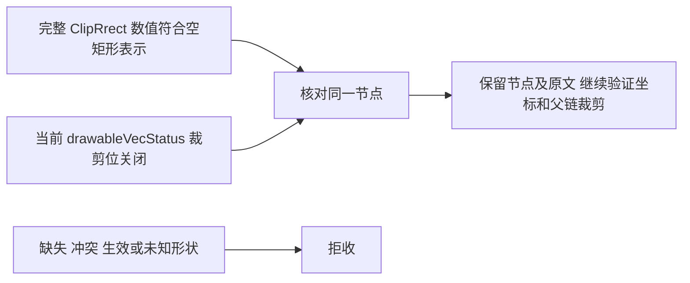

# 官方修饰器转储与空圆角裁剪

RenderService 的 `ClipRrect` 使用 `RRect` 属性转储格式。该格式打印矩形和四组圆角半径，
但没有闭合属性自身最外层的方括号。`OtherModifiers` 列表仍有自己的结束括号。
采集器按这个明确格式读取完整的十二个有限数值，不修改原文，不给其他损坏字段补括号。
格式依据为固定官方版本的 [RRect 属性转储](https://github.com/openharmony/graphic_graphic_2d/blob/c19cedf62fefde6bf184aa815feeaf0346aa4d49/rosen/modules/render_service_base/src/modifier/rs_render_property.cpp#L386-L400)。

解析成功不意味着裁剪可以忽略。接受空形状需要同一节点的两类证据：

待应用值只接受宽或高非正的矩形候选；正面积矩形不会在缺少完整当前形状证据时放行。
官方 [GetClipToRRect](https://github.com/openharmony/graphic_graphic_2d/blob/c19cedf62fefde6bf184aa815feeaf0346aa4d49/rosen/modules/render_service_base/include/property/rs_properties.h#L385-L388)
以矩形是否为空决定是否启用，但打印的零存在浮点显示精度限制，不能单独证明当前裁剪未生效。
因此还须读取真实顶层 `drawableVecStatus`，确认其 `CLIP_TO_BOUNDS` 位关闭。
这个位包含当前圆角裁剪条件，依据为官方 [状态计算](https://github.com/openharmony/graphic_graphic_2d/blob/c19cedf62fefde6bf184aa815feeaf0346aa4d49/rosen/modules/render_service_base/src/drawable/rs_drawable.cpp#L169-L182)。

状态字段必须唯一，并紧接官方的两项缓存状态字段。节点名称、绘制命令和待应用修饰器里的
同名文本不能充当当前状态；缺失、重复、非法或破坏括号边界时拒收。
当前 `ClipToBounds` 标记仍独立核验，后续变换和其他裁剪也继续执行原有检查。

此修复只调整现有修饰器解析与验证，不改变采集文件、规范事实结构、项目配置或视觉验收。
回归同时覆盖官方空形状、启用裁剪、正面积形状、伪字段、截断、后续未知变换，以及完整节点与父链裁剪保留。
