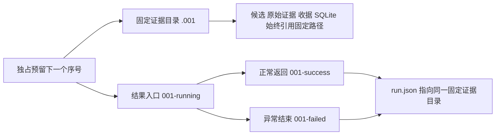

# 运行结果与固定证据目录

`project.toml` 的 `run.output` 继续指定输出根。每次 `run` 和 `finalize` 都在同一个根内取得下一个序号，
至少三位，依次使用 `001`、`002`，超过三位自然增长。不同输出根独立编号。
既有目录及其收据保持原样，工具不会为了重跑清空输出。

```text
output/
  001-success/run.json  正常结束的运行结果
  002-failed/run.json   失败运行的结果与错误
  003-running/run.json  尚未正常结束的运行入口
  .001/                运行的固定证据目录
    project.toml
    configuration.json
    events.jsonl
    model-usage.jsonl
    run.json
    captures/<capture_id>/
  .002/                失败时也保留全部已取得的证据
  .003/
```

CLI 返回 `001-success` 这样的结果目录。其 `run.json` 包含最终运行汇总，
`artifacts_directory` 指向 `.001` 这样的固定证据目录，`run_index` 保存序号。
运行期间的入口指向同一证据目录，最新进度以固定目录内的 `run.json` 为准。
点前缀用于区别证据与结果入口，不依赖操作系统将其隐藏。



成功表示本次命令正常结束。`run.json.status` 保留原来的 `complete` 或 `failed`，
`new_samples` 仍只计算本轮新增样本，`stop_reason=run_sample_limit` 不表示项目总配额完成。
发布过样本后发生异常的运行仍显示 `failed`；已发布样本按原收据恢复核验，不丢弃成功进度。

结果目录只保存入口，不保存配置副本或另一份采集数据。运行结束时只改变结果入口的名字，
所有证据实体、候选路径、发布清单、准备收据、数据库记录及独立验收来源都不随状态改名。
`finalize` 可以继续使用失败运行固定目录中的采集路径，重复验收与续采仍使用原发布事务。
这沿用成熟的[运行身份与证据位置分离](https://mlflow.org/docs/latest/api_reference/rest-api.html)方式，
没有引入运行时依赖。

编号通过固定证据目录的独占创建预留，同根并发运行不能取得相同序号。
已经预留的序号不复用，旧时间戳目录不参与新编号，也不改名。
强制杀进程可能留下 `running`，表示未记录正常终止；工具不据此伪造成功或自动改判失败。
关闭操作也属于本次运行，关闭失败必须记录真实错误。
