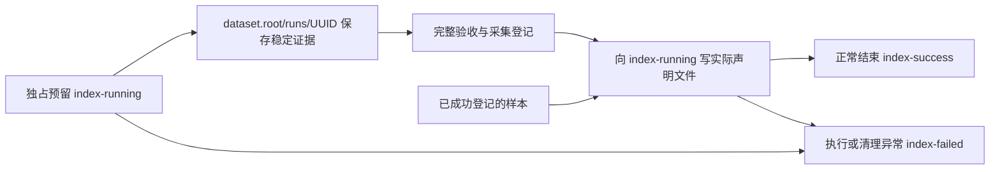

# 运行交付与内部证据

`run.output` 保存用户本轮实际取得的交付文件。`run`、`finalize` 和 `export` 在同一输出根内
共同递增编号，至少三位，超过三位自然增长；不同输出根独立编号。
已有目录、文件和收据保持原样，不为重跑清空、搬移或重命名历史输出。

内部数据继续使用原 `dataset.root`。新运行证据集中在 `runs/<UUID>/`，
不再在交付根新建并列的 `.001` 目录，也不把详细 `run.json` 复制到用户结果目录。

```text
run.output/
  001-success/
    manifest.json        本轮实际文件的来源、相对路径、大小和 SHA-256
    <声明的实际文件或样本子目录>
  002-failed/
    manifest.json        真实失败状态、错误及已完成的交付项
    <失败前已写出的文件，如有>
  003-running/
    manifest.json        尚未正常结束的运行及当前交付项

dataset.root/
  dataset.sqlite3        继续使用原采集登记和计数
  samples/<capture_id>/  已验收事实，保持稳定身份
  runs/<UUID>/
    project.toml
    configuration.json
    run.json             详细状态、run_index、artifacts_directory、进度和错误
    events.jsonl
    model-usage.jsonl    有模型调用的运行才产生相应用量记录
    captures/<capture_id>/
    exports/<capture_id>.json
```

具体文件由必填 `[delivery]` 声明，规则见[项目声明的交付文件](declarative-delivery.md)。
`directory="."` 平铺本轮文件；也可按应用、采集标识等固定替换项组织样本子目录。
文件数量不是成功条件，实际文件必须与 `manifest.json` 的明确清单对应。



CLI 返回 `001-success` 这样的实际交付目录。外部 `manifest.json` 初始包含
`status="running"`、`run_index` 和空 `samples`；每个交付项记录来源、相对路径、大小和摘要。
正常闭合写入 `status="complete"`，异常写入 `status="failed"` 和真实错误，再改变整个结果目录的状态后缀。
产物引用均相对结果目录，改名不要求改写这些引用。

配置、原始采集、候选、验收收据、SQLite 和内部详细状态始终引用稳定的内部位置。
内部 `run.json` 的 `run_index` 对应本轮序号，`artifacts_directory` 指向自身稳定目录；
它记录完整进度，不是用户交付文件。`finalize` 的来源也保留内部稳定路径。

成功只表示本次命令正常结束。达到 `run_sample_limit` 时，总配额可能尚未完成。
采集已经登记、随后导出失败的运行仍显示 `failed`，已采计数不回退；
可使用 `export --sample-id` 在新编号目录重新交付，不重新调用模型或计数。
关闭设备锁、日志等清理步骤也属于本次命令，清理异常必须使内部记录和外部清单都标记失败，
同时保留已验收计数、已写出的文件和真实错误。

编号通过结果目录的独占创建预留，同根并发命令不能复用序号。
已有数字状态目录和旧数字证据目录参与延续序号，但不会创建新的并列点目录；
旧时间戳目录保持原名，不参与数字序列。
强制杀进程可能留下 `running`，它表示尚未记录正常终止，工具不会据此伪造成功或自动改判失败。

输出规则和存储位置不决定采集身份，但本接口不搬移旧数据，也不提供复制布局的自动路径映射。
保留原 `dataset.root` 和所有被引用的旧路径；来源、完整性及恢复边界见
[采集事实、交付与恢复](delivery-contract.md)。
