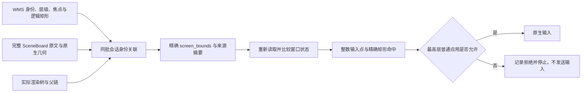

# 屏幕坐标与输入范围

屏幕动作必须用已经应用真实绘制变换的窗口外框判断归属。
WMS 的 `bounding_box` 保留逻辑尺寸，不能直接与截图上的点比较；
`screen_bounds` 是经过同批 SceneBoard、原生几何和实际 RenderService 父链交叉核验的浮点屏幕矩形。
所有新窗口观察与新采集都必须提供它，没有缺失时改用 WMS 的路径。

## 窗口观察

`ReadWindows` 返回有明确身份、可见性和精确屏幕外框的窗口。
每个系统进程、显示器组合共用一份完整 SceneBoard 原文与原生几何；
同批窗口共用实际渲染树与未挂载树，不对每个普通应用重复抓取完整系统树。
外框仅取决于祖先及会话自身；应用内部控件树仍在正式采集时完整验证。

`screen_bounds_source` 保留会话组件、session Surface、显示器、屏幕的真实标识，
以及 SceneBoard 原文、原生几何、渲染树和未挂载树的 SHA-256。
观察中的临时文件在完成或失败后清理；正式采集保留文件和摘要引用。
正式准备阶段从这些原始文件重新计算外框，拒绝缺失或被改写的边界和来源。

只排除会话明确不可见、RenderService 明确不可见或完全遮挡的窗口，返回排除原因。
部分可见的背景应用继续参与归属判断，不按应用名或包名减少检查范围。
精确几何读取结束后再次核对 WMS、会话、可见性、焦点、身份和变换；中途变化则拒绝本次观察。
本次真机只读批次为 11 个可见窗口、26 个有明确证据的排除项，耗时约 15.83 秒。
这是该批次的测量结果，不是固定延迟承诺。

## 输入与窗口工具

`Tap`、`DoubleClick`、`Scroll`、`Input` 使用 SDK 实际输入整数点，
`DragAndDrop` 同时检查起点与终点。普通 SDK 动作按 `Math.round` 取整，
原生组件输入使用官方组件中心的整数截断规则；校验点与实际输入点保持一致。
命中条件是左、上边界包含，右、下边界不包含，再选最高 `z_order` 普通应用。
`KeyboardPress` 继续按唯一前台普通应用的实际焦点检查。

执行前比较规划时和当前窗口的身份、焦点、层级、系统分类、可见性、WMS 变换与精确屏幕框。
来源摘要可能因时钟等内容变化而改变，摘要变化本身不表示窗口路由状态变化。
范围检查使用任务原有 `bundle_names`；本次验证只允许 `com.uc.mobile`，没有扩展允许范围。

`MoveWindow` 根据真实系统标题栏的可拖动点计算位移；`ResizeWindow` 根据精确右下边界计算起点；
`OccludeWindow` 的交集、前后层级与完成状态也使用精确屏幕框。
窗口控制先证明控件的真实窗口归属，再检查实际输入点，不将整数控件框误等同于浮点外框。
移动和尺寸目标使用整数物理像素；完成验收将精确外框的每个字段按 `Math.round` 比较，
最多读回三次，连续两次达到目标才报告成功。输入命中不使用这个目标取整规则。

## 证据与限制

冻结 UC 窗口的逻辑框是 `(203,203,2048,2230)`，精确屏幕框是
`(203.3,203.3,1470.885888,1601.59938)`。
点 `(2184,1872)` 落在逻辑框内，却在精确屏幕框外；旧逻辑框不能证明它属于 UC。
离线回归覆盖这个反例、浮点边缘取整、物理背景窗口层级，以及输入前零原生调用的拒绝。

本次实机注册 `Tap` 在范围检查处拒绝了该点，原生后端陷阱记录零调用。
随后通过已安装应用声明的入口将 UC 带到前台，解析并核验了实际系统最大化控件。
一次真实标题栏拖动已发出，目标为 `(300,300)`；当时读回被 WMS 比例交叉核验拒绝，
因此原始实机运行保持失败，不把它改写为窗口工具成功。
移动后的独立冻结证据用于离线诊断和回归，不重放业务区域点击。
修正 WMS 比例发布语义后的同批离线重放通过全部 11 个窗口；UC 精确原点为 `(300,300)`。
这证明冻结数据可被当前实现验证，不等同于重新运行窗口工具的连续读回验收。

窗口外框与 `z_order` 是几何范围限制，不是透明像素、圆角、系统浮层或输入热区的完整证明。
矩形遮挡比例也不是实际遮挡像素比例。混合正负尺寸且缺少完整无绘制证明的控件继续拒收。
完整外框可能伸出显示画布；窗口拖拽已独立检查实际整数起终点在画布内。
普通点动作的范围检查仍只判断应用矩形归属，尚未独立裁掉画布外的部分，不能宣称完整输入热区验证。
本次没有模型请求、新正式采集或发布，也不修改已有失败目录、正式样本、数据库、收据或项目配置。
