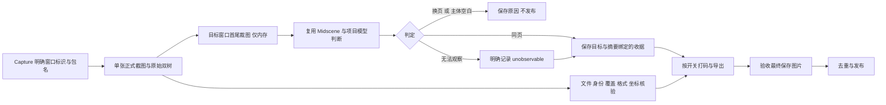

# 目标页面稳定性

采集允许光标闪烁、同一页面的局部更新和背景窗口变化。首尾像素、窗口列表或控件树不相等，
只会产生差异记录，不再直接拒收。内容判定只关注明确选中的目标窗口是否换到其他页面，或主体是否变为空白。

## 判定与证据

采集工具要求 `target_window_id` 与 `target_bundle_name`，两者必须来自已读回的可见应用窗口。
同应用多窗口也不猜测焦点或前台顺序。原始证据仍覆盖所有实际可见窗口，内容判断只使用目标窗口裁图。
目标身份与截图坐标的完整性单独核验，背景窗口的正文和像素变化不影响此判断。

`page-observation.json` 记录目标身份、精确屏幕矩形、实际整数裁图边界、首尾图片及裁图摘要，
并关联本次窗口与控件树来源。采集主截图仍只有一张；末图与两个裁图不进入候选、日志或交付文件。
原始像素差异保存在 `pixel-consistency.json`，完整窗口和树的摘要差异保存在 `consistency.json`。
这些差异是观测事实，不是换页判据。

内容判断使用 Midscene 的 [`aiQuery`](https://v1.midscenejs.com/reference/#aiquery) 结构化接口，
沿用项目现有模型配置和用量记录。已核验的原始 PNG 裁图经公开 `UIContext.screenshotSequence`
按 before、after 顺序传入，主图同时绑定 after；判断请求仅包含这两张图。
SDK 返回的对象直接进入严格 schema 校验，要求恰有 `decision` 和非空 `evidence`。
字符串化 JSON、数组、空值和多余字段都是协议错误，不执行二次 JSON 解析或类型兼容分支。
这里校验的是 SDK 公开 API 的实际返回值；模型响应的解码仍由已锁定版本的 SDK 执行。
判断只输出下列明确结果及证据说明：

| 结果 | 行为 |
| --- | --- |
| `same_page` | 目标仍是同一页面，继续准备与最终图片验收 |
| `page_changed` | 已换到不同文档、目标或功能页面，拒收并保存原因 |
| `body_blank` | 目标主体消失或变为空白，仅有工具栏不算主体，拒收并保存原因 |
| `unobservable` | 遮挡、画面不足等使主体无法判断，保留这一限制，不宣称稳定性已证实 |

局部文字更新、输入编辑、滚动、计数器、动画、光标以及同页弹层不等于换页。
主体不可见或无法区分空文档与加载失败时，应记录 `unobservable`，不把它伪装成换页或空白。
该结果本身不拒收；任务对最终保存图片的验收以及文件、坐标等检查仍需通过。
`page-stability.json` 与导出 WMS 中的同名收据保存真实结论、目标和观测摘要。
模型响应格式错误或来源摘要不符属于独立错误，不伪装成页面变化。

`dataset.stability_regions` 继续作为项目声明随原文及观测记录保存，不能豁免内容变化，也不屏蔽任何像素。
不再要求系统叶子的路径、数量、位置或文字保持不变。原始图片和控件树不因此改写。

## 生命周期与限制

目标首尾图在采集完成后进入内存中的模型请求；判断结束后清理设备对象的瞬时图片引用。
SDK 内存记录随运行结束统一清理，图片与执行报告的持久化保持关闭。
这次判断使用原始目标图；之后的截图打码不会追溯改变已经发送的图像。
每份新候选增加一次页面判断请求，纳入同一用量记录，最终图片的项目验收仍单独进行。

离线 `finalize` 可以验证已有页面判断收据，不能凭原图和像素统计补造已删除的末图。
未发布候选若缺少这份收据，明确拒绝准备；`capture.py` 的无目标原始采集不具备自动页面判断结论。
已经发布的样本继续按原始收据与文件摘要恢复，不重算新规则，不改写或追认旧失败记录。

判断依赖所选视觉模型，不能保证识别所有导航或空白。尤其是遮挡、相似文档、纯画布和很小的主体变化，
可能缺乏足够视觉证据；`unobservable` 是保留的未证实边界。
首尾两次观察也不能发现期间短暂跳转后又回到原页的过程。采集保持 `atomic=false`。

## 依据与本轮验证边界

[Playwright 的导航说明](https://playwright.dev/docs/navigations)明确区分导航、加载与后续动态渲染；
[目标元素稳定性](https://playwright.dev/docs/actionability)和[截图回归](https://playwright.dev/docs/test-snapshots)
是不同检查。这里采用同样的职责区分，复用 [Midscene 结构化查询](https://v1.midscenejs.com/reference/#aiquery)，
没有把全屏截图相等当作页面未跳转的定义。

备忘录解析故障的冻结副本没有保留模型响应正文与末帧裁图，因此不追认该次页面判定。
解析契约回归使用真实已安装 SDK 与本地模型客户端替身，检查对象返回、两张图的顺序和摘要、
单次请求用量，以及格式错误与清理行为，不连接设备或真实模型。

早先光标回归中，冻结统计显示剩余 165 个变化像素的范围与焦点输入框的原生光标范围吻合；
末帧图片未保留，因此不能声称已重放真实双图或已用模型证实该次差异。
合成正反例验证的是裁图、来源绑定、判断协议和拒收行为，不能替代视觉模型在真机上的准确率验证。
