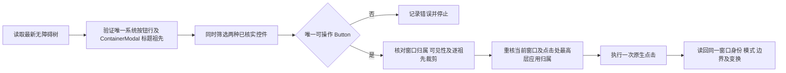

# 系统窗口最大化按钮选择与验证

`ToggleWindowSize` 现在识别两种已核实的系统最大化控件：`EnhanceMaximizeBtn` 和
`EnhanceCompatibleMaximizeBtn`。两者构成同一个候选集合；没有名称优先级，零个或多个可操作候选均拒绝。
这修复了 UC 的可见按钮存在、工具却报告缺少最大化按钮的问题。

## 语义证据

普通控件的绑定见官方
[ContainerModal 增强实现](https://github.com/openharmony/arkui_ace_engine/blob/21b150e7bb1d5308846f8e5be8ef0482fb433315/frameworks/core/components_ng/pattern/container_modal/enhance/container_modal_view_enhance.cpp)。
公开默认标题栏源码没有设备上的 `EnhanceCompatibleMaximizeBtn`，因此另行核对系统安装产物。
官方[标题栏加载器](https://github.com/openharmony/arkui_ace_engine/blob/21b150e7bb1d5308846f8e5be8ef0482fb433315/frameworks/core/components_ng/pattern/container_modal/container_modal_utils.cpp#L28-L68)
读取 `/system/etc/abc/arkui/customtitle.abc`。本次只读接收该文件，大小 107596 字节，SHA-256 为
`dd2a699deaabfb1354752c08ffec27c8ccf0fe577b592f32fc2d7686017e9089`。

局部指令显示该 Button 的 `TapGesture.onAction` 调用 `onCompatibleMaximizeButtonClick`，
根据当前状态经 `ContainerModal.callNative` 发出 `win_compatible_max_event` 或
`win_compatible_recover_event`。官方
[WindowSceneSessionImpl 接收端](https://github.com/openharmony/window_window_manager/blob/8b0d8fe1b973d865904c942c286b3d2a3b9b08e7/wm/src/window_scene_session_impl.cpp#L9017-L9024)
将它们分别映射到 `MaximizeForCompatibleMode` 与 `RecoverForCompatibleMode`，
再发送[对应的会话事件](https://github.com/openharmony/window_window_manager/blob/8b0d8fe1b973d865904c942c286b3d2a3b9b08e7/wm/src/window_scene_session_impl.cpp#L4665-L4698)。
控件判断依据实际绑定及原生事件，不仅依据资源名称。

本地 `ark_disasm` 声明支持 ABC 13.0.1.0，而输入版本为 24；它输出版本错误后仍生成结果。
该行为与工具的[版本检查实现](https://github.com/openharmony/arkcompiler_runtime_core/blob/11b92cb1234f63287bfde1e321c8c35cedc3f544/libpandafile/file.cpp#L644-L674)一致。
上述局部绑定链相互对应，并有后续真机效果验证；不据此声称整份 ABC 通过了版本兼容验证。
安装产物、指令文件和截图只保存在本地 `artifacts/window-control-20261022`，不进入仓库。

## 选择与执行边界

控件必须处于目标 `hostWindowId` 的 `containerModalButtonRowId` 内，属于唯一可见
`ContainerModal` 的首个直接标题 Row。控件类型为 `Button`，`visible`、`enabled`、`clickable`
均为原生字符串 `true`。中心点必须在所有祖先的非空屏幕边界内。
应用正文中的同名节点不参与选择，隐藏或零面积控件不能成为点击对象。

点击前重新检查规划观察；按钮处最高 `z_order` 的普通应用必须仍是同一窗口，
同包名的另一个窗口也不能遮住它。点击后核对进程、包名、显示器及 UI 节点身份。
现有工具接口保持为 `ToggleWindowSize({window_id})`，结果保留 `before`、`after` 和 `bounds_changed`；
`window_control` 审计事件保存本次实际 `control_id`、`accessibility_id`、矩形及中心。
底层只读操作 `window_size_control` 读取最新布局并返回这些字段，不执行输入。

## 本次真机结果

独立诊断在 2026-10-22 19:15 UTC 执行一次注册的 `ReadWindows` 和一次 `ToggleWindowSize`。
当前观察重新定位窗口 106 的 `EnhanceCompatibleMaximizeBtn`，实际控件标识 69，
本次矩形 `[1410,212][1468,270]`，中心 `(1439,241)`。这些坐标仅是本次证据，不能供后续操作复用。

| 实际 WMS 字段 | 操作前 | 操作后连续两次稳定读回 |
| --- | --- | --- |
| `window_mode` | 102 | 102 |
| 逻辑边界 x/y/width/height | 203 / 203 / 2048 / 2230 | 203 / 0 / 2048 / 2230 |
| `scale_x` / `scale_y` | 0.718262 / 0.718386 | 0.876953 / 0.876682 |
| 实际控件屏幕矩形 | `[1410,212][1468,270]` | `[1677,11][1748,82]` |

兼容窗口最大化通过位置及缩放变化完成，不能要求它变成普通全屏的模式值，也不把逻辑尺寸直接当成屏幕尺寸。
实际截图仍可见空白表单及部分后台窗口。完整 WMS 清单和会话可见性已分别保存：
操作后仍有 16 个窗口需要按原有全可见窗口规则处理，其中夸克窗口 105 仍可见。
本次没有执行 `Capture`、新一轮双树导出或发布，没有修改旧失败、正式样本和任务配额。
此前因背景旋转而拒收的采集仍然失败，不能因为按钮操作成功就追认通过。

本地证据目录为 `artifacts/window-control-20261022/live-2026-10-22T19-15-17-065Z`，
包含实际注册器事件、操作收据、两次稳态读回、前后独立观察、完整窗口原文及可见性核对结果。
模型请求、Capture 调用和发布次数均为零。

完整回归通过：Python 317 项、TypeScript 294 项，另通过 TypeScript 类型检查。
新增测试覆盖两种按钮各自成功、双候选顺序无关拒绝、祖先归属与裁剪、过期观察及更高层窗口遮挡。
现有依赖版本不变。
